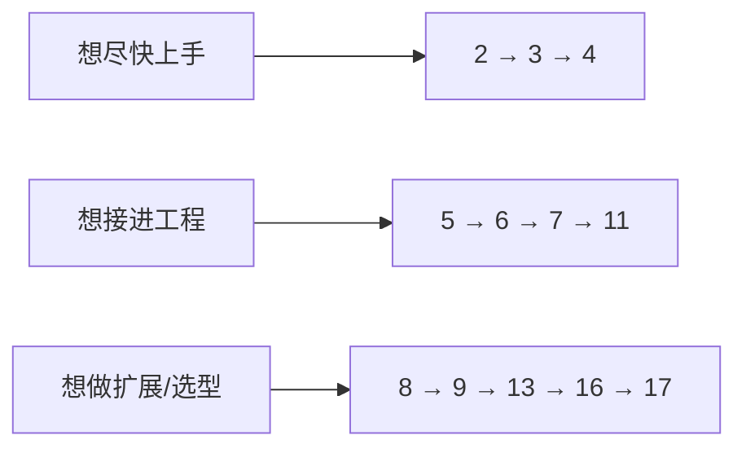

# AI Coding Agent 实战

**Pi、Claude Code 与 Codex 全景指南**

一本写给软件开发者、能照着敲、也能读懂原理的书。

**在线阅读：** <https://fxjs.github.io/ai-coding-agents-book/>

> 基准版本：Pi `1.4.0` · Claude Code `2.1.303` · Codex CLI `0.163.0`
> 命令细节以 `--help` 与交互内 `/` 菜单为准；版本敏感处已标注。

---

## 这本书要解决什么问题

你已经会用 AI 写代码了——至少会把一段代码贴进对话框。但从「贴代码」到「让 agent 在你的仓库里自主干活」，中间隔着一整套工程细节：

- 三个工具到底有什么不同？我的项目该用哪个，或者怎么组合？
- 为什么同一个模型，别人用起来像资深工程师，我用起来像实习生？
- 让它改代码，怎么保证它不乱删文件、不把密钥打到日志里？
- 怎么把它塞进 CI、塞进编辑器、塞进我自己的程序？
- 上下文爆了会怎样？压缩是怎么做的？为什么它「忘了」前面的约定？
- 扩展、技能、插件、MCP、hooks 到底谁管什么？

这本书把这些问题拆成 17 章、5 个附录，配一个可以真跑的小项目 `examples/task-cli`。

## 谁适合读

| 你是 | 怎么读 |
|---|---|
| 第一次接触 coding agent | 第 1–3 章顺序读，先跑起来 |
| 已经在用其中一个 | 第 4–7 章补课，对应工具专章（13/14/15）查漏，附录 E 看 omp 增强，第 17 章看迁移 |
| 要把它接进团队/CI | 第 5、7、9、11、12 章 |
| 想写扩展、做二次开发 | 第 8、9、13、16 章 + `examples/pi-extensions` |
| 做技术选型 | 第 1、7、10、17 章 + 附录 A |

## 目录

### 正文

| 章 | 标题 | 一句话 |
|---|---|---|
| 0 | [前言：为什么现在要学 coding agent](book/00-preface.md) | 工具变了，工作方式也要变 |
| 1 | [从代码补全到 coding agent](book/01-landscape.md) | agent loop、工具、上下文，三家的架构差异 |
| 2 | [安装、认证与第一个可用配置](book/02-install.md) | 装好、登录、选模型、跑通第一句 |
| 3 | [第一次结对：一个任务，三种打法](book/03-first-task.md) | 同一个需求，Pi / Claude / Codex 各做一遍 |
| 4 | [交互式使用：界面、键位与斜杠命令](book/04-interactive.md) | TUI 分区、消息队列、命令体系 |
| 5 | [非交互与自动化：一次执行、结构化输出与 RPC](book/05-headless.md) | print、JSON、RPC、SDK、CI 里的用法 |
| 6 | [上下文工程：指令文件、会话树与压缩](book/06-context.md) | 让 agent「记住」正确的东西 |
| 7 | [工具、权限与沙箱](book/07-tools-security.md) | 工具清单、权限模式、隔离方案 |
| 8 | [技能与提示模板](book/08-skills.md) | 把团队经验固化成可复用资产 |
| 9 | [MCP、Hooks、插件与扩展](book/09-mcp-hooks-plugins.md) | 生态的四种扩展点 |
| 10 | [模型、思考等级与成本](book/10-models-cost.md) | 选模型、控预算、本地部署 |
| 11 | [实战工作流：TDD、重构、审查、排错](book/11-workflows.md) | 五个高频场景的完整提示词与流程 |
| 12 | [多 agent、并行与云端](book/12-multi-agent.md) | subagent、worktree、后台与云任务 |
| 13 | [工具专章：Pi](book/13-pi.md) | 可编程内核、多 provider 路由、SDK 嵌入 |
| 14 | [工具专章：Claude Code](book/14-claude-code.md) | 权限三件套、checkpoint、后台与云 |
| 15 | [工具专章：Codex](book/15-codex.md) | 沙箱 × 审批、exec 流水线、多 agent |
| 16 | [内部原理：agent loop、协议与会话格式](book/16-internals.md) | 自己实现一个迷你 agent |
| 17 | [横向对比、选型与迁移](book/17-migration.md) | 决策矩阵与配置迁移 |

### 附录

| 附录 | 内容 |
|---|---|
| [A](appendix/a-commands.md) | CLI 与斜杠命令速查 |
| [B](appendix/b-keybindings.md) | 键位总表 |
| [C](appendix/c-configs.md) | 配置模板合集 |
| [D](appendix/d-faq.md) | FAQ 与术语表 |
| [E](appendix/e-omp.md) | omp 实战手册：安装、CLI、TUI、工具、子 agent、扩展与自动化 |

## 三条阅读路径



## 配套代码

```
examples/
├── task-cli/            # 全书共用的示例项目（可运行、可测试）
├── pi-extensions/       # 一个真实可加载的 Pi 扩展（TS）
├── skills/code-review/  # 可复用的审查技能
├── prompts/             # 提示模板
├── mcp/                 # MCP 配置样例
└── ci/                  # GitHub Actions 中的agent用法
```

第 3 章起的所有练习都基于 `examples/task-cli`。它刻意做得小：一个 JSON 存储的待办 CLI，零运行时依赖。

## 如何构建

```bash
npm run check      # 静态检查：章节编号 / 表格 / 锚点 / 链接 / 笔误
npm run build      # 生成 dist/index.html 与 dist/book.md
npm run verify     # check + build
npm run pdf        # 用本机 Chrome 导出 dist/book.pdf（A4，浅色打印样式）
npm run test:examples   # 跑 examples/task-cli 的 8 个测试
npm run serve           # 静态托管 dist/（http://127.0.0.1:8080）
```

构建脚本零依赖：自带 Markdown 子集解析器；Mermaid 图联网时渲染，离线时回退为源码块。
`dist/book.md` 是合并版，可直接喂给 pandoc 生成 PDF/EPUB。

### 阅读体验

- **全文检索**：按 `/` 或 `Ctrl/⌘+K` 聚焦搜索框，输入任意词即可检索**标题、正文与代码块**
  （多关键词用空格分隔，AND 匹配；英文大小写不敏感）。结果带章节位置、命中高亮与上下文片段；
  `↑`/`↓` 选择，`Enter` 跳转，`Esc` 清空。命中词会在**正文中全部高亮**，`F3` / `Shift+F3`
  在命中处之间前后跳转（显示「第 n/m 处」）。也支持 `?q=关键词` 直接带查询打开。
- **目录联动**：侧栏随滚动高亮当前小节，`Ctrl+Shift+F`（浏览器内）可搜索页面。
- **单文件、可独立部署**：`dist/index.html` 自包含（CSS/JS/索引都在里面），双击即可离线阅读；
  章节互链在构建时已改写成页内锚点（`book/*.md` → `#锚点`），所以把 `dist/` 丢给任意静态服务器也不会 404。

## 排版约定

| 标注 | 含义 |
|---|---|
| 无标注 | 已在本机 `--help` 或官方文档核对 |
| 「示例输出」 | 为说明格式构造的近似输出 |
| ⚠️ 版本敏感 | 小版本之间变化过，使用前请确认 |

并排展示三家命令时，顺序固定为 **Pi → Claude Code → Codex**。

## 许可

文字以 CC BY-NC 4.0 发布，示例代码以 MIT 发布。
