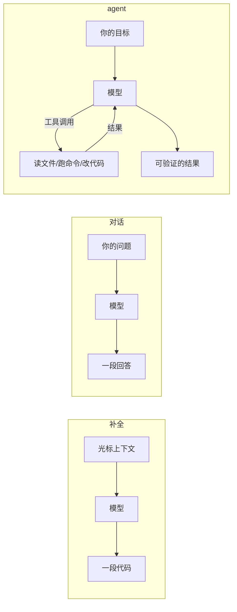
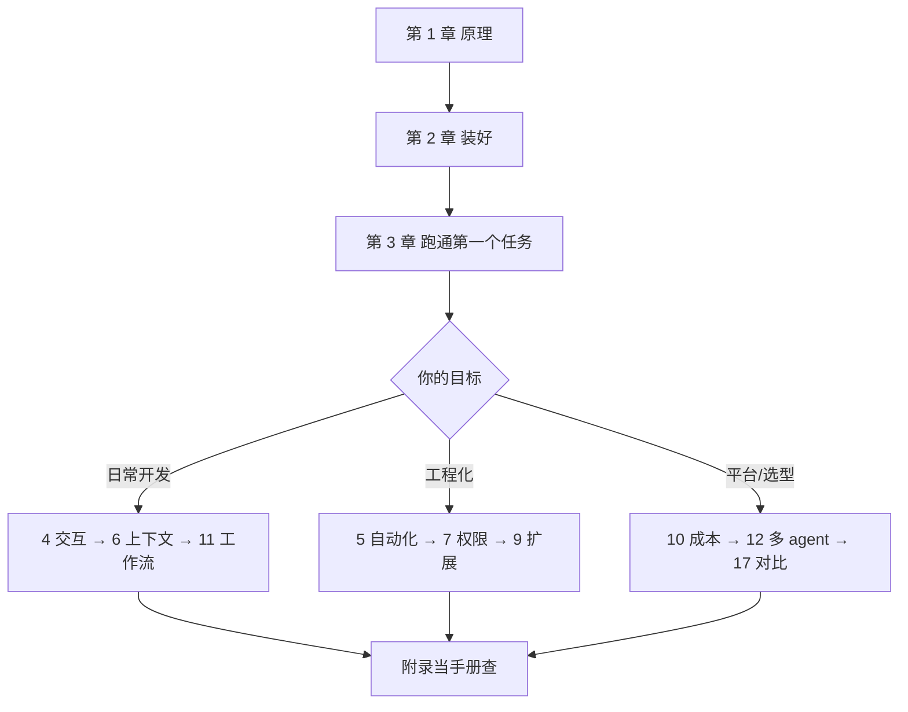

# 前言：为什么现在要学 Coding Agent

> 本章你将学会：
> - 区分「补全」「对话」「agent」三种形态，知道能力边界在哪
> - 明白这本书为什么把三个工具放在一起讲
> - 用正确的心态开始：把 agent 当同事，而不是许愿池

## 0.1 三个瞬间

第一个瞬间：你在 IDE 里敲下半个函数名，灰色补全出现了。这是 **2021 年的 Copilot 时刻**——模型学会了「猜你要写什么」。

第二个瞬间：你把报错贴进网页对话框，它给你一段能跑的代码。这是 **2022 年的 ChatGPT 时刻**——模型学会了「解释和生成」。

第三个瞬间：你说「这个测试挂了，修一下」，它自己读文件、跑测试、看到失败、改代码、再跑、通过，最后告诉你改了哪三行。这是 **2024 年之后的 agent 时刻**——模型学会了「做事」。

三者的差别不是模型更聪明，而是**模型多了手和眼睛**：

**读图要点**：agent 多了一条从「环境」回到「模型」的边。这条回路是全部威力与全部风险的来源——它能自己确认「改对了没有」，也能自己把 `rm -rf` 执行掉。

## 0.2 为什么是这三个工具

市面上的 coding agent 很多，本书选 **Pi、Claude Code、Codex**，因为它们恰好代表了三种截然不同的设计哲学：

| | 代表的问题 | 典型用户 |
|---|---|---|
| **Pi** | 「我怎么把它改成我想要的样子？」 | 想深度定制、想嵌进自己系统的开发者 |
| **Claude Code** | 「怎么开箱即用又足够强？」 | 团队、日常开发、重 IDE/云协作 |
| **Codex** | 「怎么让它无人值守也不出事？」 | 平台/基础设施、CI、批量任务 |

学会这三个，再看其它工具（Cursor、Cline、Aider、Gemini CLI…），你会发现概念是同一套：循环、工具、上下文、权限、扩展。**工具会换，模型会换，这五个概念不会。**

## 0.3 这本书不做什么

- 不教你「100 个提示词模板」。提示词会过时，**验证回路**不会。
- 不吹「一句话生成整个 App」。真实项目里，agent 的价值在**局部、可验证、有测试**的改动上。
- 不假设你有无限预算。第 10 章会算清 token 账。
- 不保证每个命令在明天的版本里都一样。所有命令都标注了基准版本，`--help` 永远是最终权威。

## 0.4 你会得到什么

读完并动手做完练习，你应该能：

1. 在 10 分钟内把三个工具都装好、连上模型、跑通第一个任务（第 2 章）。
2. 写出让 agent「一次改对」的指令，而不是来回拉扯五轮（第 3、6、11 章）。
3. 把 agent 接进 CI、脚本、自己的程序（第 5、13 章）。
4. 设计一套团队级的权限与护栏，敢让它碰生产仓库（第 7、9 章）。
5. 判断一个新出的 coding agent「值不值得换」，以及怎么迁移（第 18 章）。
6. 必要时自己实现一个最小 agent（第 17 章）。

## 0.5 怎么读

每章结尾有练习，全部基于 `examples/task-cli`。**请真的去跑**——agent 工具的手感只能从手感里学。

## 0.6 准备环境

| 需要 | 版本 | 检查 |
|---|---|---|
| Node.js | ≥ 22（Pi 硬性要求 22.19+） | `node -v` |
| git | 任意较新版本 | `git --version` |
| 终端 | 支持真彩色与备用屏幕 | 见第 4 章 |
| 一个模型账号 | Anthropic / OpenAI / 或兼容端点 | 见第 2 章 |

本书示例在 Linux 上验证；macOS 基本一致；Windows 需要注意终端与路径差异（第 4 章有专门小节）。

## 0.7 三条心态

**一、把它当实习生，不是编译器。**
实习生需要：明确的目标、可用的工具、能自查的标准、以及你 review 他的产出。四样缺一，产出就会失控。

**二、可验证性决定上限。**
有测试的仓库，agent 能自己收敛；没测试的仓库，agent 只能「看起来很对」。第 11 章会反复用到这一点。

**三、小步、可回滚。**
一次让 agent 改 20 个文件，出错时你无法定位；一次改 2 个文件并跑测试，出错时你只需要看一个 diff。这不是保守，这是**让 agent 的错误变得便宜**。

---

下一章我们从「一次请求到底发生了什么」开始，把黑盒拆开。
