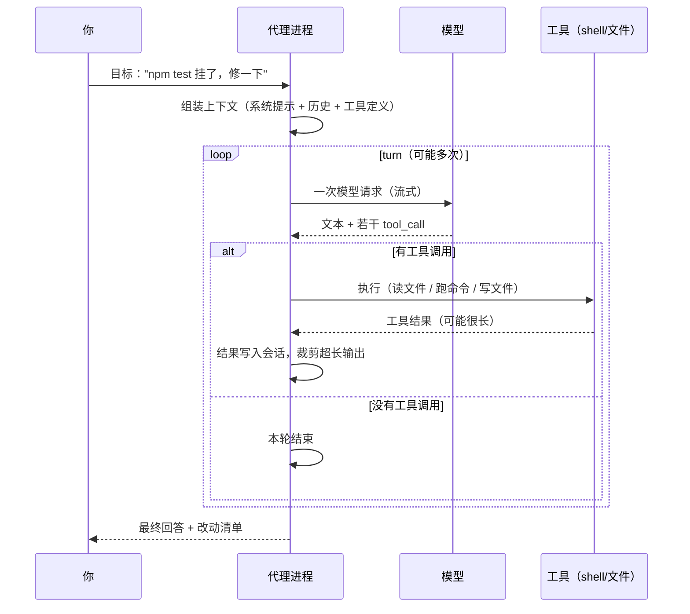
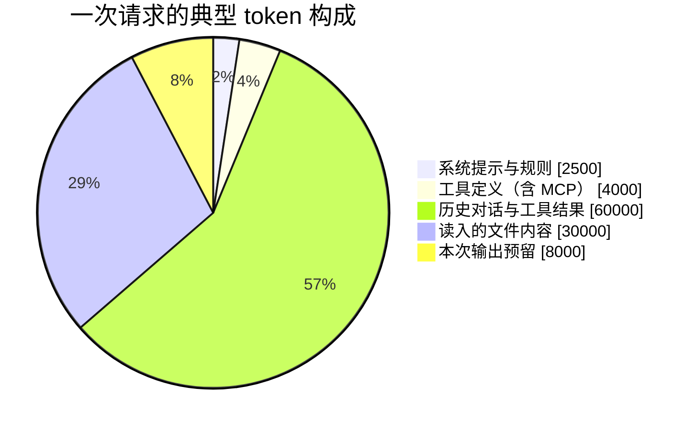
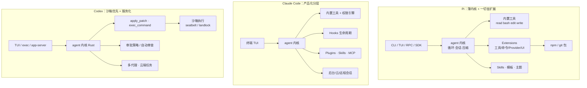

# 第 1 章 从代码补全到编码代理

> 本章你将学会：
> - 用「循环 + 工具 + 上下文」三个词解释任何编码代理
> - 画出一轮请求里 token 的去向，知道钱花在哪
> - 看懂 Pi / Claude Code / Codex 的架构差异，以及它如何影响使用方式

## 1.1 三种形态的精确区别

| 形态 | 输入 | 输出 | 有状态吗 | 能自我纠错吗 |
|---|---|---|---|---|
| 补全（FIM） | 光标前 + 光标后 | 中间填充的代码 | 无 | 不能 |
| 对话 | 一轮消息 | 文本 | 弱（多轮历史） | 不能（它看不到结果） |
| 代理 | 目标 + 工具 + 历史 | 工具调用 + 文本 | 强（会话 + 环境） | 能（工具结果是新的输入） |

补全模型用的是 **Fill-In-the-Middle** 目标：把文档切成前缀/后缀，让模型预测中间。它便宜、快、无脑，但**没有「目标」的概念**——它只知道「这里该接什么」。

代理则多了一个**闭环**：

```text
目标 → 计划 → 动作（工具） → 观察（结果） → 修正 → … → 结束
```

这个环只要转得起来，模型就能自己发现「我刚才那个假设是错的」。**绝大多数「AI 写代码不靠谱」的抱怨，本质是这个环缺了观察环节**：没有测试、没有类型检查、没有可运行的命令，代理就只能靠猜。

## 1.2 一轮对话里到底发生了什么

把一次「帮我修这个测试」拆开，会看到嵌套的两层循环：



**外层是 run，内层是 turn。** 一个 turn = 一次模型请求 + 该请求里所有工具调用的执行。工具结果会作为下一条消息进入下一 turn。

用伪代码写出来只有二十行：

```python
def agent_loop(goal, tools, session):
    messages = [system_prompt(tools), *session.history, user(goal)]
    while True:
        reply = model(messages)                    # 一次流式请求
        messages.append(reply)
        if not reply.tool_calls:
            return reply.text                      # 没有工具调用 → 结束
        for call in reply.tool_calls:              # 可能并行
            result = execute(call, tools)          # 权限检查在这里
            messages.append(tool_result(call.id, truncate(result)))
        if over_budget(messages):
            messages = compact(messages)           # 见第 6 章
```

Pi 的扩展文档把这两层循环画得很清楚：`agent_start → turn_start → 工具执行 → turn_end → … → agent_end`，并且在 `agent_end` 之后还可能因为重试、压缩、排队消息再起一轮。**「它好像还在干活」不是错觉，是真的还有一轮。**

## 1.3 唯一的硬约束：上下文窗口

模型的记忆只有一样东西：这次请求里发的 token。所有「它忘了」「它抽风了」「它越改越乱」的问题，八成能归到上下文管理上。

一次请求的 token 大致这样分配：



（数字是示意，不是某个具体工具的真实值。）

几个可以直接用的推论：

1. **工具越多，固定开销越大。** 20 个 MCP 工具的描述可能就吃掉 5k token，而且**每一轮都要重发**。这就是 Pi 默认只开 4 个工具、Codex 提供 `toolExposure` / `enabled_tools`、Claude 默认按需加载 MCP 的原因。
2. **读大文件很贵。** 一个 3000 行的文件约 40k token。让代理「先读整个仓库」是最常见的浪费。
3. **长会话一定会压缩。** 压缩不是可选项，是必需项；理解压缩策略（保留什么、丢弃什么）比记住快捷键重要得多（第 6 章）。
4. **缓存能省钱但改不了能力。** 前缀缓存（prompt caching）能让重复的 system + 工具定义便宜一个数量级，但只要前缀变了就失效——所以「不要在会话中途改系统提示」既省事又省钱。

## 1.4 工具：代理的感官与手脚

工具不是「插件的附属品」，它本身就是 prompt 的一部分：**工具的名字、描述、参数 schema 会原样进入模型上下文**，决定模型「想不想得起」用它。

| 感官/手脚 | 典型工具 | 没有它会怎样 |
|---|---|---|
| 看文件 | read / Read | 只能凭记忆猜代码 |
| 找东西 | grep / Glob / `rg` | 到处乱读，烧 token |
| 改代码 | edit / Write / apply_patch | 只能给你贴代码让你手抄 |
| 跑命令 | bash / exec_command | 无法验证，只能「看起来对」 |
| 查网页 | WebFetch / WebSearch / web_search | 只能用训练截止前的知识 |
| 记待办 | TodoWrite / update_plan | 长任务中途跑偏 |
| 分工 | Task / spawn_agent | 单线程，上下文很快爆 |

三家在这件事上的取舍很不一样：

- **Pi** 默认只给 `read bash edit write`，其余（`grep` `find` `ls` `powershell` `codemode` `tool_search`）按需打开。哲学是「工具少 → 描述短 → 模型更专注」。
- **Claude Code** 给一整套（含 `Task`、`TodoWrite`、`WebFetch`），靠权限系统控制风险。
- **Codex** 把「改代码」收敛成**一个** `apply_patch` 工具，用 patch 语义天然限制改动范围；执行走 `exec_command` + `write_stdin`，可以开交互式会话。

## 1.5 三家的架构差异



**读图要点**：

- Pi 的内核最薄，几乎所有能力（包括 MCP、codemode）都能被替换或卸载；代价是「默认不好用」，需要你组装。
- Claude Code 把「权限 + 生命周期钩子 + 云」做进了产品层，能力最全，也最重。
- Codex 把**执行**单独抽成沙箱层，agent 只能通过受控通道动手；这是它能无人值守的根本原因。

## 1.6 同一模型，效果为什么差这么多

把模型固定为同一个，换工具，效果仍有明显差异。四个可调杠杆：

| 杠杆 | 具体表现 | 你能改吗 |
|---|---|---|
| 系统提示 | 有没有写清「先读 AGENTS.md」「改完必须跑测试」 | 能（第 6 章） |
| 工具描述 | 参数设计是否让模型「一次调对」 | 部分能（自定义工具/扩展） |
| 上下文策略 | 什么时候压缩、压缩保留什么 | 部分能（`/compact` 指示、配置） |
| 验证回路 | 有没有测试/类型检查/lint 可跑 | **完全能，收益最大** |

最后一项是本书反复强调的重点：**给代理一个能自己判断对错的标准，比给它一段更长的提示词有效十倍。**

## 1.7 能力边界

| 擅长 | 不擅长（目前） |
|---|---|
| 有明确验收标准的局部改动 | 需求含糊、目标冲突的大改造 |
| 读懂陌生代码库的局部逻辑 | 跨 20 个模块的架构重构（除非你拆分） |
| 照着测试修 bug | 没有测试、只能靠「感觉对」的修复 |
| 机械重复（加参数、改调用点、写文档） | 需要真实业务判断的取舍 |
| 快速试错、给多个方案 | 长期一致性（会话一长就会漂移） |

知道边界，才不会把「工具问题」误判成「模型不行」。

## 1.8 练习

1. 用表格列出你最近一次手动改 bug 的步骤，标出哪几步代理**能**做、哪几步只有你能做。
2. 打开你正在开发的项目，估算：`系统提示 + 工具定义` 占多少 token？最大的三个文件各多少行？如果让代理「先通读仓库」，会花多少 token（按 1 行 ≈ 13 token 粗算）？
3. 找出你项目里**已经有但代理还不知道**的验收手段（测试命令、lint、类型检查、`make check`），下一章开始我们会把它写进指令文件。

---

下一章：把三个工具装好，连上模型，跑通第一句话。
