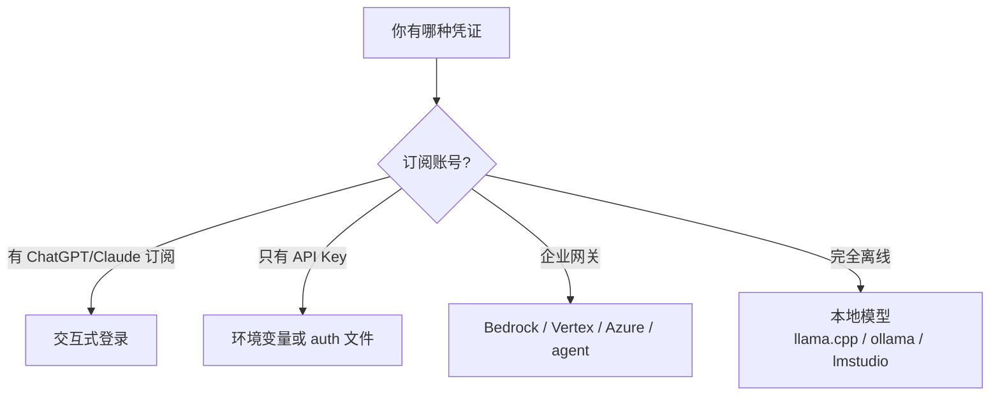

# 第 2 章 安装、认证与第一个可用配置

> 本章你将学会：
> - 十分钟内装好三个工具，并判断「装成功了没有」
> - 选对认证方式：订阅、API Key、兼容端点、本地模型
> - 画出三个工具的配置地图，知道每个文件管什么

## 2.1 先做三个检查

```bash
node -v          # Pi 要求 >= 22.19；Claude Code / Codex 的 npm 安装也需要 Node
git --version    # agent 大量依赖 git 做差异与回滚
echo $TERM       # 应为 xterm-256color 或类似；tmux/screen 也可
```

终端选择直接影响体验：

| 终端 | 结论 |
|---|---|
| iTerm2 / WezTerm / Kitty / Alacritty / Windows Terminal | 推荐，真彩色 + 备用屏幕正常 |
| VS Code 内置终端 | 可用，Alt 组合键可能被占用（见第 4 章） |
| 老式 `cmd.exe` | 不建议；Codex/Pi 的 TUI 会掉帧 |
| tmux | 可用；注意 `Ctrl+B` 前缀冲突与 OSC 52 剪贴板 |

## 2.2 安装 Pi

```bash
# 官方安装器（推荐：锁定依赖版本，自带 Node 管理）
curl -fsSL https://pi.dev/install.sh | sh

# 或者 npm（不锁定传递依赖）
npm install -g --ignore-scripts @earendil-works/pi-coding-agent

pi --version
```

Windows：

```powershell
powershell -c "irm https://pi.dev/install.ps1 | iex"
```

Nix 用户：`nix profile add github:earendil-works/pi/stable`。

Pi 的安装器把可执行文件放在 `~/.pi/agent/bin/pi`（具体路径随平台不同），并且**用自己管理的 Node 运行**。因此：

- 升级用 `pi update`，不要 `npm update -g`（否则可能版本不一致）。
- 换 Node 版本不影响 Pi。

## 2.3 安装 Claude Code

```bash
npm install -g @anthropic-ai/claude-code
# 或使用原生安装器（会自动选择当前平台构建）
claude install
```

健康检查：

```bash
claude doctor        # 检查安装、配置、认证、依赖
claude update        # 升级（别名 claude upgrade）
```

Claude Code 是原生单文件可执行程序（本机为 ELF），启动快；`claude install stable|latest|<version>` 可以指定版本。

## 2.4 安装 Codex

```bash
npm install -g @openai/codex
codex --version
codex doctor          # 诊断安装、配置、认证、运行时
codex update
```

Codex 是 Rust 单二进制（通过 npm 包分发对应平台的二进制）。它有一个**共享后台守护进程**（app-server），第一次交互式启动时会拉起；`codex --no-daemon` 可以绕过它。

## 2.5 认证：四条路，选一条



### 2.5.1 Pi

Pi 用「provider」抽象所有来源，认证结果落在 `~/.pi/agent/auth.json`。

```bash
pi                     # 进入交互
/login                 # 选择 provider 登录（OAuth 或粘贴 key）
/login anthropic       # 直接指定
```

环境变量方式（适合 CI）：

```bash
export ANTHROPIC_API_KEY=sk-ant-...
export OPENAI_API_KEY=sk-...
pi --list-models                # 看当前能用的模型
pi --model sonnet:high -p "hi"  # 指定模型与思考等级
```

给外部程序复用凭证（不用把 key 写进脚本）：

```bash
pi auth print-api-key --provider openai
pi auth print-bearer-token --provider openai-codex
```

自定义兼容端点写在 `~/.pi/agent/models.json`（见附录 C）。

### 2.5.2 Claude Code

```bash
claude                 # 首次运行会引导登录
claude setup-token     # 生成长期有效的 token（需要订阅）
claude auth            # 管理认证
```

CI 里用 `ANTHROPIC_API_KEY`。企业环境用 Bedrock/Vertex 时，按对应云厂商的方式注入凭证，Claude Code 会自动识别。

### 2.5.3 Codex

```bash
codex login            # ChatGPT 账号或 API Key
codex login status     # 确认登录态
```

CI 里用 `OPENAI_API_KEY`。本地开源模型：

```bash
codex --oss --local-provider ollama -m qwen3-coder
codex --oss --local-provider lmstudio
```

## 2.6 三个「第一句话」

分别在一个**空目录**里执行，确认链路通：

```bash
mkdir -p /tmp/first-run && cd /tmp/first-run

# Pi：一次性执行，只打印最终回答
pi -p "用一句话说明这个目录里有什么"

# Claude Code：同上
claude -p "用一句话说明这个目录里有什么"

# Codex：注意子命令是 exec
codex exec "用一句话说明这个目录里有什么"
```

期望现象：

| 工具 | 现象 | 说明 |
|---|---|---|
| Pi | 打印一句话后退出，退出码 0 | `-p` 是「跑完就退」 |
| Claude Code | 同上 | 无 TTY 时自动进入 print 模式 |
| Codex | 打印过程事件与最终消息 | `exec` 默认把过程打到 stderr |

如果卡在「认证失败」，跳到 2.8。

## 2.7 配置地图

三个工具都遵循「用户级 + 项目级」两层，但目录名和优先级不同。

```text
~/.pi/agent/                    ~/.claude/                 ~/.codex/
├── settings.json               ├── settings.json          ├── config.toml
├── keybindings.json            ├── CLAUDE.md              ├── AGENTS.md
├── mcp.json                    ├── agents/                ├── sessions/
├── models.json                 ├── hooks/                 ├── plugins/
├── auth.json                   ├── plugins/               └── auth.json
├── AGENTS.md / CLAUDE.md       └── projects/ (会话历史)
├── SYSTEM.md / APPEND_SYSTEM.md
├── extensions/  skills/  prompts/  themes/
└── bin/pi
```

项目级：

| 工具 | 项目目录 | 关键文件 |
|---|---|---|
| Pi | `.pi/` | `settings.json`、`mcp.json`、`extensions/`、`skills/`、`prompts/`、`SYSTEM.md`、`APPEND_SYSTEM.md` |
| Claude Code | 仓库根 | `CLAUDE.md`、`.claude/settings.json`、`.claude/agents/`、`.claude/hooks/`、`.mcp.json` |
| Codex | 仓库根 | `AGENTS.md`、`.codex/config.toml`、`.codex/skills/` |

指令文件（`AGENTS.md` / `CLAUDE.md`）在第 6 章细讲；这里先记住一件事：**它们会被自动读入，所以是「团队规范」最便宜的落地点**。

## 2.8 常见故障对照表

| 现象 | 大概率原因 | 处理 |
|---|---|---|
| `401 Unauthorized` | key 没生效 / 用错了 provider | `pi auth print-api-key`、`claude auth`、`codex login status` |
| `404 model not found` | 模型名写错或该 provider 无此模型 | `pi --list-models`、`codex features list` |
| 一直转圈不输出 | 代理/网络被拦 | 设 `HTTPS_PROXY`；Pi 可加 `--offline` 跳过启动网络请求 |
| TUI 花屏 | 终端不支持备用屏幕 | Pi：`--tui-mode regular`；Codex：`--no-alt-screen` |
| Pi 报 Node 版本 | 用系统 Node 跑了 npm 版 | 用官方安装器，或升级到 22.19+ |
| 登录跳到 localhost 失败 | 远程机器无浏览器 | 复制终端里的 URL 到本地打开；或改用 API Key |
| 中文/emoji 错位 | 终端字体或 locale | `LANG=zh_CN.UTF-8`，换 Nerd Font |
| Codex 提示 workspace trust | 首次进入新目录 | 按提示确认；`--dangerously-bypass-hook-trust` 只用于自动化 |

## 2.9 一分钟自检脚本

把下面存成 `check-agents.sh`，换机器时先跑它：

```bash
#!/usr/bin/env bash
set -u
for cmd in pi claude codex; do
  if command -v "$cmd" >/dev/null; then
    printf '%-8s %s\n' "$cmd" "$(${cmd} --version 2>&1 | head -1)"
  else
    printf '%-8s 未安装\n' "$cmd"
  fi
done

echo "--- 认证 ---"
pi --list-models 2>/dev/null | head -3 || echo "pi: 无可用模型"
codex login status 2>&1 | head -2
echo "--- 配置目录 ---"
ls -d ~/.pi/agent ~/.claude ~/.codex 2>/dev/null
```

## 2.10 技巧与坑

- **别急着全局安装一堆扩展/插件。** 先把裸工具用顺，再按需加。工具越多，固定 token 开销越大（第 1 章）。
- **API Key 不要写进仓库。** 用环境变量或各家的 auth 文件；`pi auth print-api-key` 就是为了避免明文。
- **Pi 的 `--api-key` 只在本次运行生效**，不会落盘，适合临时验证。
- **模型别名比全名稳。** `sonnet` / `opus` 这类别名会跟随最新版本；写死全名适合需要可复现的 CI。
- **同一个终端里混用三个工具时，注意环境变量污染**：`ANTHROPIC_API_KEY` 同时被 Pi 和 Claude 读取，Claude 的 Bedrock 相关变量也会影响 Pi 的 provider 选择。

## 2.11 练习

1. 用 2.9 的脚本确认三个工具都可用，并记录各自版本。
2. 在 `/tmp/first-run` 里分别跑三个「第一句话」，把输出贴到笔记里，标出差异（谁打印了过程、谁只打印结果）。
3. 断网后重试一次，观察各自的报错文案，思考：哪些错误是「重试有用」的，哪些是「配置错了」的。
4. 把 `check-agents.sh` 加进你的 dotfiles。

---

下一章开始真正干活：同一个需求，三个工具各做一遍，然后逐条对比它们的「思考轨迹」。
