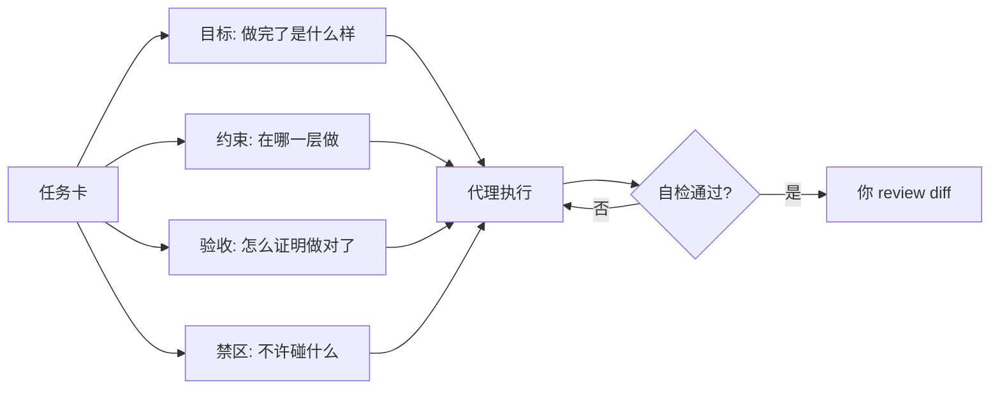

# 第 3 章 第一次结对：一个任务，三种打法

> 本章你将学会：
> - 把一个模糊需求改写成「代理能一次做对」的任务卡
> - 用同一张任务卡在三个工具上各跑一遍，并看懂差异
> - 建立自己的「观察清单」，以后判断任何代理的输出

## 3.1 先准备一个真实的工作区

```bash
cp -r ~/hubGit/ai-coding-agents-book/examples/task-cli /tmp/task-cli
cd /tmp/task-cli
git init -q && git add -A && git commit -qm "baseline"
npm test          # 应该 8 个测试全过
```

从这一刻起，**每次让代理干活前都先提交一次**。这是全书最重要的一条操作习惯：干净的基线 = 出错时一条 `git checkout .` 就能回到原点。

## 3.2 任务卡：把需求变成可验收的契约

不好的指令：

> 给 task 加个编辑功能。

好的任务卡有四段：**目标 / 约束 / 验收 / 禁区**。

```text
# 目标
给 task-cli 增加 `task edit <id>` 子命令：可修改标题（--title）和优先级（--priority low|normal|high），
至少提供一个参数。

# 约束
- 业务逻辑放 src/tasks.mjs（纯函数），CLI 解析放 src/cli.mjs，不要混。
- 不新增任何运行时依赖。
- 保持现有命令行为与输出格式不变。
- 错误信息沿用现有风格：`task: 找不到任务 #9`。

# 验收
- `npm test` 全绿。
- 新增测试覆盖：改标题、改优先级、两个都改、id 不存在、没给任何参数。
- 手动验证：
  TASKS_FILE=/tmp/t.json node src/cli.mjs add "a"
  TASKS_FILE=/tmp/t.json node src/cli.mjs edit 1 --title "b" --priority high
  TASKS_FILE=/tmp/t.json node src/cli.mjs list --all

# 禁区
- 不要动 test/tasks.test.mjs 里已有的 8 个测试。
- 不要改 package.json、README、store.mjs。
- 不要顺手重构。
```



**读图要点**：四段里只有「验收」是**代理能自己判断**的，它决定了这个循环能不能自己收敛。另外三段都是减少「它想歪」的概率。

为什么这样写有效：

| 段落 | 作用 | 少了会怎样 |
|---|---|---|
| 目标 | 定义「做完了」 | 代理自由发挥，加一堆你不要的功能 |
| 约束 | 定义「在哪做」 | 逻辑塞进 CLI 层，测试没法写 |
| 验收 | 让代理能自查 | 它只能「看起来对」 |
| 禁区 | 防止误伤 | 顺手改了无关文件，review 成本暴涨 |

## 3.3 打法一：Pi

```bash
cd /tmp/task-cli
pi --tools read,bash,edit,write,grep,find,ls
```

进去后粘贴任务卡。也可以一次性：

```bash
pi -p "$(cat /tmp/task-card.md)"
```

**观察重点**（Pi 默认不逐步征求同意，所以轨迹会很连贯）：

1. 它先读了 `tasks.mjs` 还是先读了 `test/`？（先读测试说明它在找验收标准）
2. 它有没有跑 `npm test`？跑了几次？
3. 第一次实现后测试挂了吗？它怎么读失败的？
4. 最终 diff 有几行？有没有碰到禁区文件？

一个典型的成功轨迹（示例输出，已精简）：

```text
→ read src/tasks.mjs
→ read src/cli.mjs
→ read test/tasks.test.mjs
→ bash: npm test
  ℹ pass 8
→ edit src/tasks.mjs        # 新增 editTask 纯函数
→ edit src/cli.mjs          # 增加 edit 分支
→ edit test/tasks.test.mjs  # 新增 5 个用例（追加，未改动原有）
→ bash: npm test
  ℹ pass 13
→ bash: TASKS_FILE=/tmp/t.json node src/cli.mjs edit 1 --title b
→ 完成：改了 3 个文件，新增 1 个函数、5 个测试
```

如果它一次就通过了，别急着高兴——**先自己跑一遍测试，再看 diff**。代理最常见的失败不是「写错」，而是「写对了但你没要」。

## 3.4 打法二：Claude Code

```bash
cd /tmp/task-cli
claude
```

Claude Code 的默认交互会在敏感操作上**请求权限**（具体取决于权限模式）。推荐先用 Plan 模式让它出方案，再切到接受编辑：

```text
# 第 1 步：只看不做
> 进入 plan 模式，读代码后给我一份实施计划，不要改文件。

# 第 2 步：确认计划后
> 按计划实施。规则：改完必须跑 npm test；测试失败先读失败信息再改。
```

对应的命令行版本：

```bash
claude -p --permission-mode plan "读 src/ 与 test/，给出给 task-cli 加 edit 子命令的实施计划"

# 计划确认后执行
claude -p --permission-mode acceptEdits --max-budget-usd 1 "$(cat /tmp/task-card.md)"
```

**观察重点**：

1. Plan 模式的计划里有没有列出「要改哪些文件」？漏了文件说明它没读全。
2. 它是否主动使用 `TodoWrite` 记步骤（长任务不容易跑偏）。
3. 权限提示里，它请求了哪些命令？如果它想跑 `git commit`，说明边界感需要你纠正。

## 3.5 打法三：Codex

```bash
cd /tmp/task-cli
codex
```

推荐用受限沙箱 + 人工确认的中间档：

```bash
codex --sandbox workspace-write --ask-for-approval on-request
```

非交互（适合脚本化验证）：

```bash
codex exec --sandbox workspace-write -c approval_policy="never" "$(cat /tmp/task-card.md)"
```

**观察重点**：

1. Codex 的改动以 **patch** 形式呈现。patch 的好处是**你能一眼看出改了哪些行**，坏处是一次 patch 太大就难读。
2. 它在沙箱里跑测试，如果测试要写 `/tmp` 之外的文件，可能被拒绝——这是它的安全边界在工作，不是 bug。
3. 它会用 `update_plan` 维护计划，完成后给一份摘要。

```text
# 示例输出（精简）
• 读取 src/tasks.mjs、src/cli.mjs、test/tasks.test.mjs
• 计划：1) tasks.mjs 加 editTask 2) cli.mjs 加分支 3) 追加测试
• apply_patch: src/tasks.mjs (+14 -0)
• apply_patch: src/cli.mjs (+18 -1)
• apply_patch: test/tasks.test.mjs (+52 -0)
• exec: npm test → 13 passed
```

## 3.6 三份结果放在一起看

假设三次都成功，diff 仍然会有差异：

| 观察点 | Pi | Claude Code | Codex |
|---|---|---|---|
| 默认改几个文件 | 3（最小） | 3~4（可能顺手改 README） | 3（patch 约束强） |
| 是否先读测试 | 通常先读 | 计划阶段会读 | 通常先读 |
| 是否自我验证 | 会跑测试 | 会跑测试 | 会跑测试（沙箱内） |
| 输出可读性 | 工具轨迹连续 | 步骤 + 权限提示 | patch + 计划 |
| 跑偏的风险 | 无审批，可能改多 | 有审批，易被打断 | 沙箱限制，可能「做不了」 |
| 出错后恢复 | `git checkout .` | `/rewind` 或 `git checkout .` | `codex apply` 前可拒绝 |

**结论不是「谁更好」，而是**：

- 你**信任环境**时，Pi 最顺（没有审批摩擦）。
- 你**需要过程可控、可回滚**时，Claude Code 的 checkpoint 更省心。
- 你**在共享/生产仓库、或要无人值守**时，Codex 的沙箱是刚需。

## 3.7 复盘：差异从哪来

同一张任务卡，三种表现。差异来自四个地方：

1. **上下文策略**：Pi 默认只给 4 个工具，描述短，模型更聚焦；Claude 工具多，能力全但更容易「顺手做别的」；Codex 的 `apply_patch` 天然把改动限制在 patch 内。
2. **权限模型**：审批越频繁，你介入越多，轨迹越碎；完全无审批，轨迹最连贯但风险最高。
3. **验证回路**：三家都会跑你给的验收命令。**你给不出验收命令，三家都会退化成「看起来对」。**
4. **提示词习惯**：Claude 的系统提示偏向「先计划再动手」，Codex 偏向「先读规范再 patch」，Pi 的系统提示最简，靠你给的规则。

## 3.8 把一次性成功变成可复用

把 3.2 的任务卡存成 `docs/tasks/003-edit-command.md`，并在 `AGENTS.md` 里加一行：

```text
做任务前先读 docs/tasks/ 下对应任务卡；完成后按任务卡的「验收」逐条自检并在回复里打勾。
```

这样你不需要每次重写提示词，**任务卡本身就是上下文**。第 6 章会把这件事系统化。

## 3.9 技巧与坑

- **别让代理「先解释再动手」超过两轮**。解释是廉价的，验证是昂贵的；直接让它跑测试比让它论证更有信息量。
- **`git commit` 是代理的安全带。** 它每完成一个可验证的小步就提交一次，你能用 `git log` 看到它的思考节奏。
- **中文任务卡没问题，但代码标识符要保留英文**（`editTask` 而不是「编辑任务函数」），否则它可能发明一个中文命名的函数。
- **拒绝「顺便」**。任务卡里写「不要顺手重构」，能省掉 30% 的 review 时间。
- **Codex 的 patch 被拒绝后**，用 `codex apply <task-id>` 可以在你审查后再落地——这是它比另两家更适合生产仓库的地方（第 12 章）。

## 3.10 练习

1. 用三个工具各做一遍 3.2 的任务，记录：耗时、轮数、改了哪些文件、测试通过次数、你介入了几次。
2. 故意把任务卡写得很模糊（只留「目标」），再跑一遍，对比失败方式。**这个练习比成功案例更有价值。**
3. 给 `task-cli` 再加一个需求：`list --json`。先写任务卡，再让代理实现，最后检查它有没有破坏 `renderTable` 的已有测试。
4. 把你项目里最近的一个小需求写成任务卡，存档到仓库。

---

下一章进入交互界面：那些藏在 TUI 里的效率开关，往往比换模型更能提升产出。
