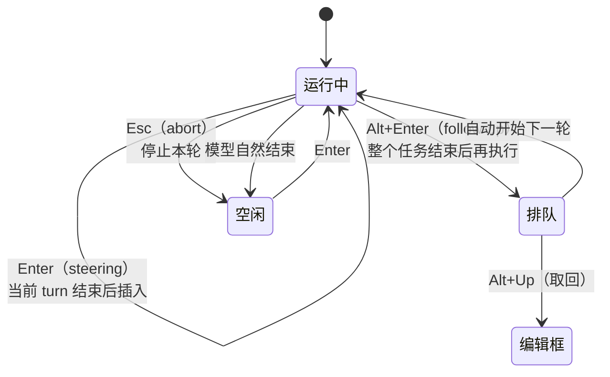

# 第 4 章 交互式使用：界面、键位与斜杠命令

> 本章你将学会：
> - 读懂 TUI 每一块在告诉你什么，而不是只看最后一段回复
> - 掌握「打断 / 插话 / 追加 / 撤回」四种控制流
> - 用命令面板、模板、技能把重复输入降到零

## 4.1 界面分区

三个工具的 TUI 布局大同小异，以 Pi 为例：

```text
┌──────────────────────────────────────────────────────────────┐
│ pi v1.4.0  ~/work/api      AGENTS.md  loaded  2 skills       │ ← 头部：本次加载了什么
├──────────────────────────────────────────────────────────────┤
│ > 修一下 refresh token 的过期判断                              │ ← 你的输入（回显）
│                                                              │
│ ● 先看 auth/session.ts 和它的测试                              │ ← 助手文本
│   ├ read auth/session.ts                                     │ ← 工具调用
│   ├ read test/session.test.ts                                │
│   └ bash npm test -- session                              ⌄  │ ← 可折叠（Ctrl+O）
│     ℹ pass 12  ✖ fail 1                                      │
│                                                              │
│ ● 失败点是 expiresAt 用了秒，而 provider 返回毫秒。             │
├──────────────────────────────────────────────────────────────┤
│ > _                                                          │ ← 编辑器
│ ~/work/api  session:fix-token  sonnet·high  62% ctx  $0.41    │ ← 页脚：环境/用量
└──────────────────────────────────────────────────────────────┘
```

**读图要点**：

- **头部**列出本次启动加载的指令文件、技能、扩展——「它为什么知道这件事」的答案在这里。
- **页脚**的 `62% ctx` 是最该盯的数字：接近 80% 时主动 `/compact`，比等它自动压缩更可控。
- **`$0.41`** 是累计花费（按 provider 定价估算），长任务要定期看。
- 工具输出默认折叠，`Ctrl+O` 展开——review 时先展开，别只看结论。

Claude Code 与 Codex 的布局类似：上面是对话与工具调用，中间是输入框，底部一行状态（模型、目录、权限模式）。Codex 的底部还会显示审批模式与沙箱档位，Claude 会显示当前 permission mode。

## 4.2 输入区的六个动作

| 动作 | Pi | Claude Code | Codex |
|---|---|---|---|
| 引用文件 | 输入 `@` 搜索，`Tab` 补全路径 | `@` 引用文件/目录 | `@` 提及文件 |
| 粘贴图片 | `Ctrl+V`（macOS 还支持文件） | 直接粘贴 | `-i` 传图，或粘贴 |
| 跑 shell 并把输出给模型 | `!git status` | `!` 前缀 | 用自然语言让它跑 |
| 跑 shell 但不进上下文 | `!!git status` | — | — |
| 多行输入 | `Shift+Enter` 或 `Ctrl+J` | `Shift+Enter` / `\` 续行 | `Shift+Enter` / `Ctrl+J` |
| 外部编辑器写长提示 | `Ctrl+G` | `Ctrl+G`（视配置） | `/keymap` 查看/绑定 |

`@` 引用是最被低估的功能。它等价于「把这个文件内容塞进上下文」，但比复制粘贴多了路径信息，代理后续更容易定位。**代价是 token**：引 5 个大文件，上下文立刻见底。经验值：单次引用不超过 3 个文件，单文件不超过 500 行；更大的文件让它自己用 `grep` 定位。

## 4.3 四种控制流

代理在跑的时候，你的输入有三种命运，加上一种「撤回」：



三种输入的区别，用一句话记：

- **Enter = 纠偏**：「别改 store.mjs」——它会在下一个 turn 生效，模型能看到。
- **Alt+Enter = 追加**：「修完顺便跑一下 lint」——它不会打断当前任务。
- **Esc = 刹车**：不满意就停，队列里的消息会退回编辑器（Pi），不会丢。

实时纠偏是代理工具相对「复制粘贴到网页」最大的优势。看到它要往错误方向走，**立刻按 Esc，补一句约束，再 Enter**，比等它跑完再骂它有效得多。

## 4.4 键位：只记这十二个

Pi 的完整键位见附录 B，日常只需要这些：

| 键 | 作用 | 为什么重要 |
|---|---|---|
| `Enter` | 提交 / 插话 | 纠偏 |
| `Shift+Enter` | 换行 | 写多行提示 |
| `Esc` | 打断 | 及时止损 |
| `Alt+Enter` | 追加任务 | 不打断当前工作 |
| `Alt+Up` | 取回排队消息 | 改主意时 |
| `Ctrl+O` | 折叠/展开工具输出 | review 必用 |
| `Ctrl+T` | 显示/隐藏思考块 | 判断它是否在瞎猜 |
| `Shift+Tab` | 切换思考等级 | 难题升级、简单任务降本 |
| `Ctrl+P` | 循环模型 | 便宜模型干粗活 |
| `Ctrl+L` | 选模型 | — |
| `Ctrl+X` | 复制上一条回复 | 贴到 PR/文档 |
| `Ctrl+G` | 外部编辑器 | 长提示 |

Claude Code 的高频键：`Shift+Tab` 切权限模式（plan / 自动接受 / 普通），`Ctrl+C` 取消，`Ctrl+D` 退出，`Esc` `Esc` 回到上一条消息重新编辑，`Ctrl+R` 搜索历史（⚠️ 版本敏感）。

Codex 的高频键：`Ctrl+C` 中断，`Esc` `Esc` 编辑上一条，`Ctrl+J` 换行，`Tab` 补全斜杠命令。**以 `/keymap` 显示的为准**——Codex 的键位可完全重映射（`~/.codex/config.toml` 的 `tui.keymap.*`）。

> ⚠️ 版本敏感：键位是小版本改得最勤的部分。升级后先跑一次 `/hotkeys`（Pi）或 `/keymap`（Codex）。

## 4.5 斜杠命令：三个来源

输入 `/` 会看到一长串命令，它们其实来自三个不同的地方：

```mermaid
flowchart LR
  A[输入 /] --> B{命令来源}
  B -->|内置| C[会话/模型/权限]
  B -->|Prompt 模板| D[.md 文件，展开成提示词]
  B -->|Skill| E[/skill:name，加载完整说明]
  B -->|扩展/插件| F[代码注册的命令]
```

优先级：**扩展命令 > 内置命令 > 模板**（同名时）。名字冲突时，用 `/` 菜单里的来源标注确认。

### 内置命令速览

| 分组 | Pi | Claude Code | Codex |
|---|---|---|---|
| 模型 | `/model` `/thinking` `/scoped-models` | `/model` `/effort` `/fast` | `/model` `/fast` |
| 会话 | `/new` `/resume` `/tree` `/fork` `/clone` `/compact` `/name` | `/clear` `/resume` `/rewind` `/compact` `/context` | `/new` `/resume` `/fork` `/compact` `/undo` |
| 信息 | `/session` `/hotkeys` `/changelog` | `/cost` `/usage` `/stats` `/status` | `/status` `/usage` `/debug-config` |
| 权限 | `/trust` | `/permissions` | `/permissions` `/approve` |
| 导出 | `/export` `/share` `/copy` `/bug` | `/export` `/share` `/copy` | `/export` `/rollout` |
| 生态 | 由扩展/模板/技能提供 | `/mcp` `/plugin` `/skills` `/agents` `/hooks` | `/mcp` `/plugin` `/skills` `/agents` `/hooks` |

完整清单见附录 A。

### 自定义模板：把重复输入变成命令

Pi 的模板就是一个带 frontmatter 的 Markdown，文件名即命令名：

```markdown
---
description: 审查当前改动
argument-hint: "[focus]"
---
审查工作区 diff，重点看 ${1:-正确性与安全}。按 P0/P1/P2 分级，每条给文件:行号。
```

放到 `~/.pi/agent/prompts/review.md` 后，输入 `/review 并发` 就会展开成完整提示词。`$1` `$2` `$@` `$ARGUMENTS` 支持默认值与切片（`${@:2}`）。

Claude Code 用 `.claude/commands/*.md` 达到同样效果；Codex 用 `/prompts` 管理。

## 4.6 显示模式与终端适配

| 需求 | Pi | Claude Code | Codex |
|---|---|---|---|
| 全屏（编辑器固定） | 默认；`--tui-mode fullscreen` | 默认 | 默认 |
| 常规滚动回看 | `--tui-mode regular` | 默认即为终端滚动 | `--no-alt-screen` |
| 复制终端历史 | 常规模式 + 鼠标选择 | 直接选 | `--no-alt-screen` 或 `/raw` |
| 搜索历史输出 | `Ctrl+Shift+F` | transcript 视图内搜索（⚠️ 快捷键随版本变化） | `Ctrl+F`（transcript 内） |
| 跳转到上一条提问 | `Ctrl+Shift+Up` | `Ctrl+R` 历史 | `Esc` `Esc` |

**全屏模式的好处**是输入框永远在固定位置，长输出不会把编辑器顶走；**坏处**是终端原生滚动条失效，复制要靠工具自己的复制功能。经常要把输出贴到别处的人，建议用 regular 模式。

## 4.7 技巧与坑

- **看头部，不看广告。** 启动时先确认「AGENTS.md 已加载」「技能 N 个」——没加载说明路径错了，后面全是白干。
- **`Ctrl+O` 是 review 的入口。** 结论可以骗人，工具输出不太会。
- **`Ctrl+T` 看思考块，判断是不是在猜。** 如果思考里出现「可能」「应该是」而没有去读文件，直接打断，补一句「先读 X 再回答」。
- **模型循环用在长任务中段**：探索阶段用便宜模型，收尾用强模型。Pi 的 `Ctrl+P` + `/scoped-models` 可以预设一组。
- **别在会话中途改系统提示**。改了就破坏前缀缓存，成本上升且行为跳变；改完重启会话（`/new`）。
- **`/name` 给会话起名**，一周后回来找得到。
- **Windows**：Windows Terminal 会吞掉部分 `Alt` 组合键，Pi 提供了替代键（`Ctrl+Q` 代替 `Alt+Enter`），Codex 的键位可在 `config.toml` 里重绑；WSL 下记得 `Ctrl+Z` 挂起行为与原生一致。
- **tmux**：`Ctrl+B` 前缀与 Pi 的部分键冲突，建议把 tmux 前缀改成 `Ctrl+A`，或使用 `tmux -L` 独立会话。

## 4.8 练习

1. 跑一个会让代理「想说很久」的任务（例如「解释这个仓库的鉴权流程」），在它输出第一段后按 `Esc`，再补一句「只回答三个关键函数名和所在文件」。体会打断 + 纠偏的效果。
2. 用 `Ctrl+O` 展开一次工具输出，找出一处「代理结论与工具输出不一致」的地方（如果没有，说明它这次很诚实）。
3. 写一个自己的 `/review` 模板（参照 `examples/prompts/refactor.md`），在三个工具里都配一份，比较展开行为。
4. 把 `Shift+Tab` 从 off 切到 high，问同一个问题，比较思考块长度与耗时。

---

下一章离开 TUI：把代理变成一条命令、一个 API、一个 CI 步骤。
