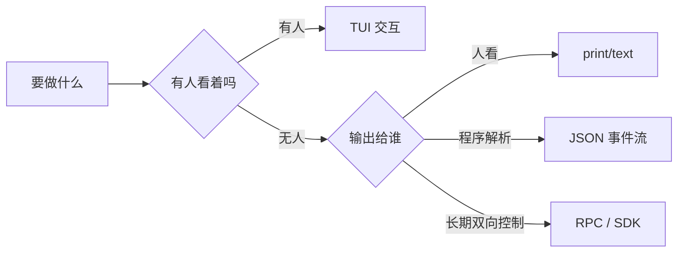
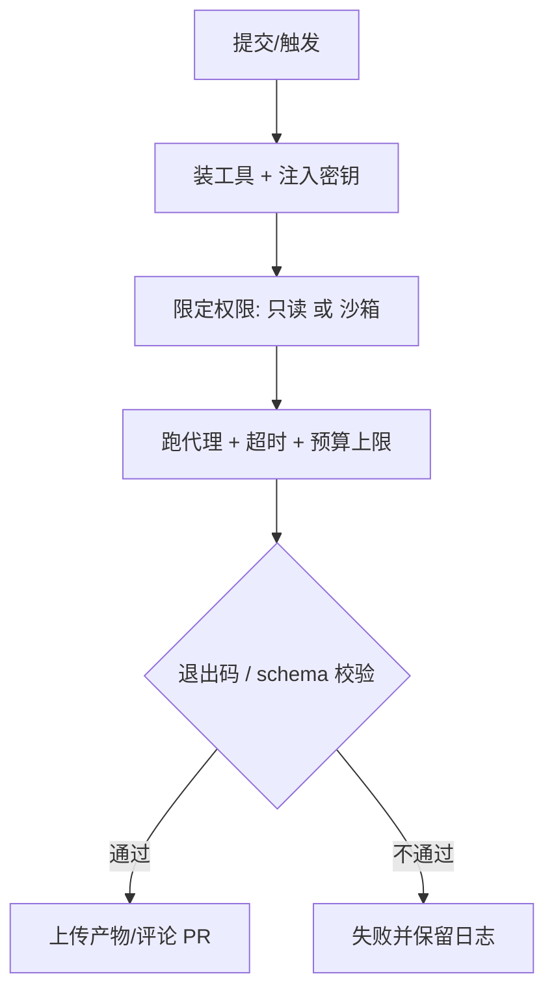

# 第 5 章 非交互与自动化：一次执行、结构化输出与 RPC

> 本章你将学会：
> - 三条命令把代理变成「普通 Unix 工具」：读 stdin、写 stdout、带退出码
> - 解析三种结构化输出，把代理接进 CI、脚本、自己的程序
> - 用 RPC 与 SDK 做长驻集成，而不是每次冷启动

## 5.1 四种形态，选一个



| 形态 | Pi | Claude Code | Codex |
|---|---|---|---|
| 纯文本一次性 | `-p` | `-p` | `codex exec` |
| JSON 事件流 | `--mode json` | `-p --output-format stream-json` | `codex exec --json` |
| 单次 JSON 结果 | —（事件流里取最后一条） | `-p --output-format json` | `-o file` + `--json` |
| 长驻双向 | `--mode rpc` / SDK | stream-json 输入输出 | app-server |
| 指定 JSON Schema | — | `--json-schema` | `--output-schema <file>` |

## 5.2 三条命令的共同点

```bash
# 1) 读管道
git diff | pi -p "把这份 diff 的风险点列成清单"
git diff | claude -p "把这份 diff 的风险点列成清单"
git diff | codex exec "把这份 diff 的风险点列成清单"

# 2) 输出给下一个程序
pi -p --mode json "..." > events.jsonl
claude -p --output-format json "..." > result.json
codex exec --json "..." > events.jsonl

# 3) 用退出码做门禁
pi -p "跑 npm test，失败就以非零退出" || exit 1
```

注意三件事：

1. **stdout 是协议通道。** Pi 的 JSON 模式把诊断信息写 stderr，stdout 只放 JSONL；Claude 的 `stream-json` 同理。你自己加的 `echo` 调试会污染解析，写日志请进 stderr。
2. **`-p` 不等于「无工具」。** 它仍然会读写文件、跑命令。要只读，显式限制工具（Pi `--tools`）或权限模式（Claude `--permission-mode plan`、Codex `-s read-only`）。
3. **会话默认落盘。** CI 里用 `pi --no-session`、`claude --no-session-persistence`、`codex exec --ephemeral`，避免污染和串味。

## 5.3 Pi：JSON 事件流

```bash
pi --mode json "检查 src/ 里的错误处理" > events.jsonl
```

第一条记录是会话头，之后是事件：

```json
{"type":"session","version":3,"id":"9c1f…","timestamp":"2026-01-01T00:00:00.000Z","cwd":"/work/api"}
{"type":"agent_start"}
{"type":"turn_start"}
{"type":"message_start","message":{"role":"user","content":"检查 src/ 里的错误处理"}}
{"type":"message_update","assistantMessageEvent":{"type":"text_delta","contentIndex":0,"delta":"先看"}}
{"type":"tool_execution_start","toolName":"read","toolCallId":"call_1"}
{"type":"tool_execution_end","toolCallId":"call_1"}
{"type":"turn_end","message":{"role":"assistant","content":["…"]},"toolResults":["…"]}
{"type":"agent_end","messages":["…"],"willRetry":false}
{"type":"agent_settled","aborted":false}
```

要点：

- `message_update` 里是**增量**（`delta`），不是累积文本；要拼完整回复得自己累积，或者直接取 `message_end.message`。
- `agent_end` 只表示「这一轮底层运行结束」，之后可能还有重试/压缩/排队；**真正稳定是 `agent_settled`**。
- 想只拿最终文本，用 `jq` 过滤 `message_end` 里 role=assistant 的最后一条。

一个能直接用的「提取最终回答」脚本（`examples/ci/pi-stream.mjs`）：

```js
import { spawn } from 'node:child_process';

const prompt = process.argv.slice(2).join(' ') || '总结当前目录';
const child = spawn('pi', ['--mode', 'json', '--no-session', prompt], {
  stdio: ['ignore', 'pipe', 'inherit'],
});

let buf = '';
let last = '';
child.stdout.setEncoding('utf8');
child.stdout.on('data', (chunk) => {
  buf += chunk;
  const lines = buf.split('\n');       // 只按 LF 切分，JSON 里可能有 U+2028
  buf = lines.pop() ?? '';
  for (const line of lines) {
    if (!line.trim()) continue;
    const ev = JSON.parse(line);
    if (ev.type === 'message_end' && ev.message?.role === 'assistant') {
      last = ev.message.content
        .filter((b) => b.type === 'text')
        .map((b) => b.text)
        .join('');
    }
    if (ev.type === 'tool_execution_start') {
      console.error(`[tool] ${ev.toolName}`);   // 进度写 stderr
    }
  }
});

child.on('close', (code) => {
  process.stdout.write(last + '\n');
  process.exit(code ?? 1);
});
```

## 5.4 Claude Code：从单条 JSON 到流式

```bash
# 单条结果：适合「跑完取结论」
claude -p --output-format json "总结这次改动的影响面"

# 流式事件：适合做进度条/实时 UI
claude -p --output-format stream-json --include-partial-messages "重构 utils/date.ts"

# 结构化字段：让模型按 schema 输出
claude -p --json-schema '{"type":"object","properties":{"risk":{"type":"string"},"files":{"type":"array","items":{"type":"string"}}},"required":["risk","files"]}' \
  "评估这次改动"
```

运维相关开关（都在 `--help` 里）：

| 开关 | 作用 |
|---|---|
| `--max-budget-usd 2` | 花钱上限，超了自动停（仅 print） |
| `--fallback-model a,b` | 主模型过载时自动切换 |
| `--permission-mode plan` | 只读规划，不改文件 |
| `--permission-prompts none` | 无人应答时一律拒绝（CI 安全默认） |
| `--autocompact 200k` | 控制自动压缩阈值 |

## 5.5 Codex：exec 是主力

```bash
# 基础
codex exec "跑 npm test，失败就修"

# 结构化 + 外部留档
codex exec --json -o last.txt "审计依赖漏洞"

# Schema 约束
codex exec --output-schema schema.json "按 schema 输出审查结果"

# 只读审计，不进 git 仓库也能跑
codex -s read-only -a never exec --skip-git-repo-check "解释这个脚本做了什么"

# 独立审查（不需要模型改代码）
codex review --base origin/main
```

`codex exec` 的默认行为值得记住：

- 过程事件打到 **stderr**，最终消息打到 stdout（`-o` 可另存）。
- `--ephemeral` 不留会话文件；CI 必加。
- `-c approval_policy="never"` 表示不等人审批（配合沙箱）。
- 退出码非零表示执行失败，可以直接用于门禁。

## 5.6 Pi RPC：长驻、双向、可编程

RPC 模式是「用 JSONL 说话的子进程」。适合非 Node 语言、需要进程隔离、或要自己画 UI 的场景。

```bash
pi --mode rpc --no-session
```

协议只有四类记录：

| 方向 | 记录 | 用途 |
|---|---|---|
| stdin | command | `prompt` / `get_state` / `abort` / `bash` / 会话操作 |
| stdout | response | 某条命令的结果，带 `id` 关联 |
| stdout | event | 运行、消息、工具、压缩、重试事件 |
| 双向 | extension_ui_request/response | 扩展要弹窗时转发给宿主 |

最小客户端（Node，换任何语言同理）：

```js
import { spawn } from 'node:child_process';

const pi = spawn('pi', ['--mode', 'rpc', '--no-session'], { stdio: ['pipe', 'pipe', 'inherit'] });
let buf = '';

pi.stdout.setEncoding('utf8');
pi.stdout.on('data', (chunk) => {
  buf += chunk;
  const parts = buf.split('\n');
  buf = parts.pop() ?? '';
  for (const line of parts) {
    if (!line) continue;
    const rec = JSON.parse(line);
    if (rec.type === 'response' && rec.command === 'prompt' && rec.success) {
      console.error('已接受:', rec.data.disposition);
    } else if (rec.type === 'message_update' && rec.assistantMessageEvent?.type === 'text_delta') {
      process.stdout.write(rec.assistantMessageEvent.delta);
    } else if (rec.type === 'agent_settled') {
      pi.stdin.end();
    }
  }
});

const send = (obj) => pi.stdin.write(JSON.stringify(obj) + '\n');
send({ id: 'r1', type: 'prompt', message: '用三句话解释这个仓库' });
```

关键约定：**命令用 `id` 关联响应，事件用 `type` 区分；`prompt` 的成功响应只代表「已接受」，不代表「跑完了」**，要等 `agent_settled`。

## 5.7 Pi SDK：进程内嵌

需要在自己程序里直接跑 agent（不要子进程）时：

```ts
import { createAgentSession, SessionManager } from "@earendil-works/pi-coding-agent";

const { session } = await createAgentSession({
  cwd: process.cwd(),
  sessionManager: SessionManager.inMemory(),   // 不落盘
});

const unsubscribe = session.subscribe((event) => {
  if (event.type === "message_update" && event.assistantMessageEvent.type === "text_delta") {
    process.stdout.write(event.assistantMessageEvent.delta);
  }
});

try {
  await session.prompt("列出 src 下所有导出函数，按文件分组");
  console.log("\n---\n" + session.getLastAssistantText());
} finally {
  unsubscribe();
  session.dispose();     // 释放工具、扩展、监听器
}
```

`session.steer()` / `session.followUp()` 对应交互里的插话与追加；`session.abort()` 停止；`waitForIdle()` 等空闲。这套 API 和 CLI 共用同一个内核，所以行为一致。

## 5.8 CI 里的四条工程规则



1. **权限最小化**：审查类只给 `read,grep,find,ls`（Pi）或 `plan`（Claude）或 `read-only`（Codex）；要改代码才给写权限，并且限制沙箱。
2. **必须设上限**：超时（`timeout`）+ 预算（`--max-budget-usd` / token budget）。代理卡在循环里烧钱的概率不是零。
3. **产物可追溯**：结构化输出存 artifact，别只留在日志里。
4. **幂等**：同一个 PR 重跑不应产生重复评论/重复提交。用「先查有没有标记再写」的策略，或让代理只输出文件、由后续步骤决定怎么用。

完整示例见 `examples/ci/github-actions.yml`。

## 5.9 技巧与坑

- **TTY 检测**：有的 CLI 在非 TTY 下会自动切换行为（Claude 在 stdout 非 TTY 时按 print 处理）。写脚本时显式传 `-p`，不要赌默认值。
- **`readline` 会坑你**：Node 的 `readline` 把 `U+2028/U+2029` 也当换行，而它们在 JSON 字符串里合法。解析 JSONL 请自己按 `\n` 切。
- **stdout 背压**：读得慢会阻塞子进程。长时间运行记得持续消费 stdout，或把日志级别降到 stderr。
- **并发写同一文件**：两个代理同时改一个仓库会互相覆盖。串行执行，或各自 `git worktree`（第 12 章）。
- **不要在 prompt 里塞密钥**：密钥进会话 = 进日志 = 进备份。用环境变量或 provider 的 auth。
- **`--no-session` 不等于无状态**：它只是不落盘，模型仍然能看到本次运行的历史。
- **退出码不是唯一信号**：有的失败会以「正常退出 + 错误文本」形式出现。关键路径上加 schema 校验或断言。

## 5.10 练习

1. 用 `pi --mode json` 跑一个任务，用 `jq` 统计：turn 数、工具调用次数、每个工具的参数长度。找出哪个工具最贵。
2. 写一个 `review.sh`：`git diff` → `claude -p --output-format json` → 用 `jq` 提取结论 → 退出码非零时打印到 stderr 并 `exit 1`。
3. 用 RPC 模式写一个 20 行的客户端，支持 `prompt` 和 `abort` 两个命令。
4. 把 `examples/ci/github-actions.yml` 里的三个 job 分别改成「只读审查」，比较它们的权限配置差异。

---

下一章：为什么它总是「忘了」你上午说过的约定？我们把上下文拆开算账。
