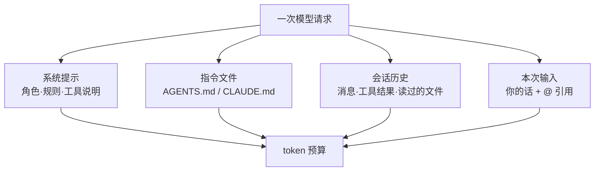
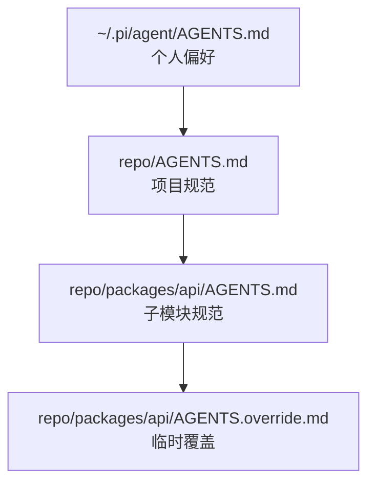
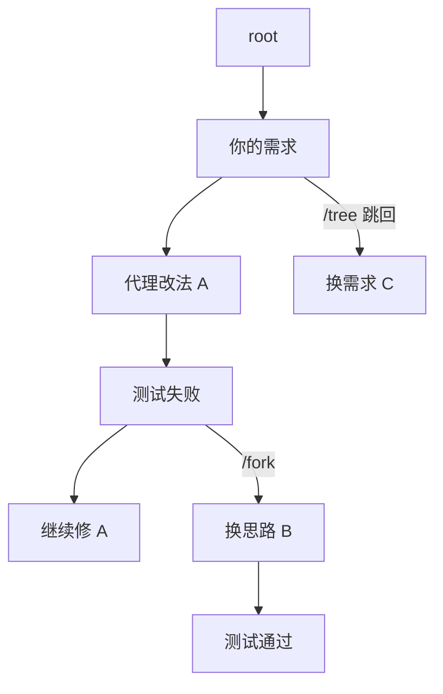
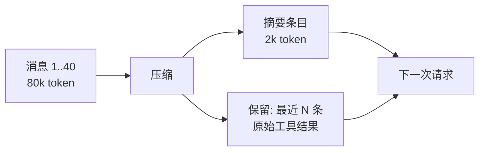

# 第 6 章 上下文工程：指令文件、会话树与压缩

> 本章你将学会：
> - 写一份「代理真的会遵守」的 AGENTS.md，而不是没人看的 README 副本
> - 用会话树做分支实验，而不是反复重开
> - 在压缩发生时保住关键信息，并判断压缩有没有伤到任务

## 6.1 上下文的四个来源



四者里，**你能稳定控制的是 B 和 C**；D 会自然膨胀；E 靠自律。

一个常见误解是「上下文越大越好」。实际上：

- 上下文越长，**模型注意力越分散**（中间内容最容易被忽略）。
- 每一轮都要重发，**费用随长度线性增长**。
- 超过阈值必然触发压缩，**压缩点是不可控的信息丢失**。

所以正确目标是：**在正确的时刻，给最小但足够的信息**。

## 6.2 指令文件：团队规范唯一可靠的落点

三家都支持「自动读入的项目指令文件」：

| 工具 | 用户级 | 项目级 | 覆盖机制 |
|---|---|---|---|
| Pi | `~/.pi/agent/AGENTS.md`（或 `CLAUDE.md`） | `AGENTS.md` / `AGENTS.override.md` / `CLAUDE.md` | `AGENTS.override.md` 在同目录内替换 |
| Claude Code | `~/.claude/CLAUDE.md` | `./CLAUDE.md`、子目录 `CLAUDE.md` | 逐层叠加；`/memory` 直接编辑 |
| Codex | `~/.codex/AGENTS.md` | `./AGENTS.md`、子目录 `AGENTS.md` | 逐层叠加；`.rules` 管执行策略 |

Pi 额外提供**系统提示级**的两个文件：`SYSTEM.md`（整体替换默认系统提示）和 `APPEND_SYSTEM.md`（追加）。除非你要重写 Pi 的人格，否则用 `AGENTS.md` 就够——它更可移植。

### 6.2.1 什么该写，什么不该写

| 该写 | 不该写 |
|---|---|
| 怎么跑测试 / lint / 类型检查 | 产品需求文档 |
| 目录职责与「不要碰」的区域 | 大段复制粘贴的代码 |
| 提交前必须通过的检查 | 会变的事实（版本号、URL） |
| 错误处理、日志、命名的团队约定 | 「要写出高质量代码」这类空话 |
| 已知的坑（「别用 X，因为 Y」） | 长篇历史背景 |

一条硬规则：**每条指令都要可执行、可验证**。「代码要清晰」不可验证；「函数超过 40 行就拆分」可验证。

### 6.2.2 一份能用的 AGENTS.md

放到 `task-cli/AGENTS.md`：

```markdown
# task-cli

零依赖待办 CLI。Node ≥ 22，ESM。

## 命令

- 测试：`npm test`（= `node --test`）。**任何改动后必须跑。**
- 手动验证：`TASKS_FILE=/tmp/t.json node src/cli.mjs …`（不要污染仓库里的 tasks.json）

## 结构（改代码前先确认改哪一层）

- `src/tasks.mjs` — 纯函数，禁止引入 IO / process / 时间（时间从参数传入）
- `src/store.mjs` — 只做 JSON 读写，不做业务判断
- `src/cli.mjs` — 只做参数解析、命令分发、输出
- `test/tasks.test.mjs` — 单元测试，使用 `node:test` + `node:assert/strict`

## 约定

- 错误信息格式：`task: <原因>`，由入口层统一打印，纯函数层只 throw Error。
- 新增命令必须同时更新 `HELP` 常量与 README 的用法段。
- 不新增运行时依赖；需要工具函数就写在文件末尾并导出测试。
- 中文注释可以，标识符一律英文。

## 禁区

- 不要改 `package.json` 的 `engines` 与 `type`。
- 不要为了让测试通过而修改已有断言；已有测试代表对外契约。
- 不要格式化整个文件；只改必要的行。

## 已知坑

- `renderTable` 用 `padEnd` 计算宽度，中文会错位——这是已知问题，修复需要单独任务。
- `store.save` 是「写临时文件 + rename」，不要改成直接 `writeFile`。
```

**为什么这份文件有效**：

1. 它给出**可直接执行的命令**，代理能自查。
2. 它划分了**层级职责**，代理不会把业务逻辑塞进 CLI。
3. 它列了**禁区**，减少「顺手改」。
4. 「已知坑」让代理不再反复「发现」同一个问题并试图修复。

### 6.2.3 指令文件的层级策略



- 个人层只放**你个人**的习惯（语言、提交信息风格、常用命令），不要放团队规则。
- 团队规则放仓库根，**进版本控制**，和代码一起 review。
- 子模块规则只写「与根规则不同」的部分，别复制。
- 临时实验用 override，别改主线。

Claude Code 用 `claude /memory` 直接编辑这些文件；Codex 用 `/init` 生成初版再改。

## 6.3 会话树：把「重开」变成「分支」

代理的会话不是一条线，而是一棵树。Pi 把这棵树显式暴露出来：



对应命令：

| 操作 | Pi | Claude Code | Codex |
|---|---|---|---|
| 回到某个历史点继续 | `/tree` 选中节点 | `Esc` `Esc` 编辑上一条；`/rewind` 回滚 | `Esc` `Esc`；`/undo` |
| 从某点分叉到新会话 | `/fork`、`--fork <id>` | `--fork-session` | `codex fork` |
| 原地复制当前会话 | `/clone` | — | — |
| 切换历史会话 | `/resume`、`-r` | `-r` | `codex resume` |

**分支的实战价值**：同一个问题试两种方案时，不要在一个会话里来回改（上下文会被两种方案的痕迹污染），而是 fork 一份。两个分支各自干净，最后 `git diff` 比结果。

Claude 的 `/rewind` 更强的一点是**可以连文件一起回滚**（`--rewind-files <message-id>`），相当于「会话 + 工作区」同时回到过去；Codex 的 `codex apply` 则相反，倾向「先在会话里生成 patch，你确认后再落地」。

## 6.4 压缩：它到底丢了什么

上下文接近上限时，代理会插入一条「摘要」替换更早的消息：



三个关键事实：

1. **原始消息没有被删除**，只是不再进入模型请求。Pi 的会话文件里仍保留全部条目，`/tree` 还能看到。
2. **摘要质量决定任务能否继续**。摘要通常保留：目标、约束、已完成、待办、关键文件路径。**容易丢**：具体报错文本、精确行号、你口头提过的偏好。
3. **压缩点之后出现「它忘了」是正常的**，不是模型变笨。

### 6.4.1 主动压缩，别等自动

```text
# Pi / 通用
/compact 保留：任务目标、已修改文件清单、失败测试名与报错、我的三条约束（不改测试断言、不加依赖、只动 src/tasks.mjs）

# Claude Code
/compact 重点保留 API 变更与未完成的 TODO

# Codex
/compact
/recap        # 更适合「我离开了一会儿，给我个进度摘要」
```

主动压缩的时机：**完成一个可验证的小步之后**（测试刚通过、刚提交）。此时上下文里「已完成的探索过程」价值最低，压掉它损失最小。

### 6.4.2 长任务的抗遗忘结构

与其指望模型记住，不如把状态**外置**：

```text
docs/tasks/003-edit-command.md   # 任务卡：目标/约束/验收（第 3 章）
PROGRESS.md                      # 每完成一步追加一行：做了什么、测试状态、下一步
```

在 AGENTS.md 里固定一句：

```text
长任务（>5 步）开始时读 docs/tasks/ 下对应任务卡；每完成一步更新 PROGRESS.md；
上下文压缩后先读这两个文件再继续。
```

这样即使压缩把过程全丢了，代理也能从文件恢复「我在干什么」。

## 6.5 token 预算的实操账

以 `task-cli` 为例（粗算，1 行代码 ≈ 12 token）：

| 项 | 估算 |
|---|---|
| 系统提示 + 4 个工具定义 | ~3k |
| AGENTS.md | ~600 |
| 读 3 个源文件 + 1 个测试文件（约 400 行） | ~5k |
| 跑一次测试的输出（失败时） | 0.5–2k |
| 10 轮对话的累积 | 15–30k |
| **一次任务总计** | **25–40k token** |

对照：让代理「先通读整个仓库」再回答，同样任务可能 150k+。差距不在模型，在**你有没有让它读无关文件**。

四条省 token 的硬技巧：

1. **用 `grep`/`find` 定位，而不是 `read` 整个文件**（Pi 默认没开 `grep`，需要时 `--tools +grep` 或直接在提示里让它用 `rg`）。
2. **`@` 引用控制在 3 个文件以内**，大文件让它自己搜。
3. **工具输出裁剪**：跑测试只跑相关的（`npm test -- session`），不要每次都全量。
4. **阶段切换时压缩**，别把探索过程带到实现阶段。

## 6.6 技巧与坑

- **指令文件不是越长越好。** 超过 200 行，遵守率明显下降。把细节挪到 `docs/`，指令文件只留「什么时候读哪个文件」。
- **矛盾指令比缺失指令更糟。** 「必须写测试」和「快速迭代优先」同时存在时，模型会随机选一个。定期清理。
- **不要往指令文件里放密钥**，它会被发给模型。
- **改完指令文件要 `/reload`**（Pi）或重启会话，否则当前会话仍用旧提示。改了系统提示还会让前缀缓存失效。
- **压缩后先验证再继续。** 跑一次测试，确认它没把「已通过」记成「待修」。
- **`/context`（Claude）和 `/session`（Pi）** 能看上下文占用明细，别靠猜。
- **别在压缩后立刻要求「继续之前的工作」**，先让它读 `PROGRESS.md`，成功率高一倍。

## 6.7 练习

1. 给 `task-cli` 写 `AGENTS.md`（照 6.2.2 改写），然后故意问它「这个项目怎么跑测试？」，看它是否照做。
2. 用同一个需求在两个分支上各试一种实现（`/fork` 或 `git worktree`），最后比较 diff。记录「分支污染」带来的差异。
3. 制造一次压缩：连续让它读 10 个大文件直到 `ctx` 超过 80%，观察压缩后它忘掉了什么。然后写一条带保留清单的 `/compact` 指示重试。
4. 用 `pi --mode json` 数一下同任务的 turn 数与工具调用次数，找出最贵的一步。

---

下一章：给它工具，也给它边界。
