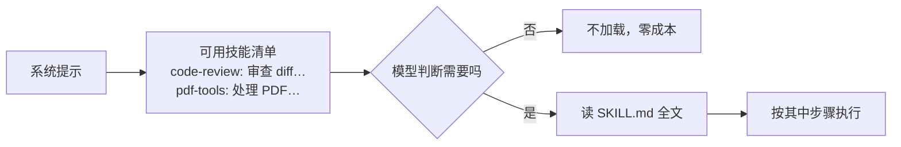

# 第 8 章 技能与提示模板

> 本章你将学会：
> - 用「渐进披露」把团队隐知识塞进代理，而不撑爆上下文
> - 写出一个模型真的会主动加载的技能
> - 在模板、技能、扩展三者之间做正确选择

## 8.1 问题：好提示词存不下来

你已经摸索出一段效果很好的审查提示词。问题是：

- 每次都要复制粘贴 → 会漏、会改、会忘。
- 贴进 `AGENTS.md` → 上下文常驻，每次都花钱，而且细节越多遵守率越低。
- 写进扩展 → 为了一段文字写代码，太重。

技能（skill）就是为这中间地带设计的：**平时只占一行（名字 + 一句描述），需要时才加载全文。**



这叫**渐进披露（progressive disclosure）**。它的代价是「模型可能想不起来用」——所以描述的写法极其关键，必要时用 `/skill:name` 强制加载。

## 8.2 SKILL.md 的结构

一个技能是一个目录：

```text
code-review/
├── SKILL.md            # 必需：frontmatter + 指令
├── references/         # 可选：细节文档，按需读
│   └── checklist.md
├── scripts/            # 可选：可执行脚本
│   └── collect-diff.sh
└── assets/             # 可选：模板等静态资源
```

`SKILL.md` 的 frontmatter（Agent Skills 规范）：

| 字段 | 作用 | 建议 |
|---|---|---|
| `name` | 命令名与显示名 | 小写连字符，与目录同名 |
| `description` | **路由描述**，模型据此决定是否加载 | 写清「做什么 + 什么时候用」 |
| `allowed-tools` | 预先批准的工具（实验性） | 只在确定安全时用 |
| `disable-model-invocation` | 只允许显式 `/skill:name` 调用 | 危险或昂贵的技能 |
| `license` / `compatibility` / `metadata` | 元信息 | 团队分发时填 |

描述的错误写法与正确写法：

| 写法 | 结果 |
|---|---|
| `description: 帮助做代码审查` | ❌ 太泛，模型不知道何时用 |
| `description: 代码审查` | ❌ 同上 |
| `description: 审查当前仓库的改动（工作区/暂存区/指定提交），输出按严重度排序的问题清单与最小修复建议。当用户说 review、审查、看看这个 diff、提交前检查时使用。` | ✅ 有动作、有触发词 |

## 8.3 把 code-review 装进去

示例已经写好，直接用：

```bash
# Pi：个人级
mkdir -p ~/.pi/agent/skills && cp -r examples/skills/code-review ~/.pi/agent/skills/

# Pi：项目级（推荐，跟着仓库走，且受项目信任保护）
mkdir -p .pi/skills && cp -r examples/skills/code-review .pi/skills/
```

Pi 还会扫描 `~/.agents/skills/` 与 `.agents/skills/`（Agent Skills 通用位置），从工作目录向上找到仓库根为止。

```bash
# Claude Code
mkdir -p .claude/skills && cp -r examples/skills/code-review .claude/skills/

# Codex
mkdir -p .codex/skills && cp -r examples/skills/code-review .codex/skills/
```

调用方式：

```text
# Pi：显式强制加载，后面可以跟参数
/skill:code-review 只看并发相关

# Claude Code
/skill-code-review      # 或直接说「review 这个 diff」，让它自己加载

# Codex
/skills                 # 浏览；也可直接自然语言触发
```

## 8.4 写技能的四条设计原则

以 `examples/skills/code-review/SKILL.md` 为例：

**一、步骤要原子、可执行。**

```markdown
1. 确定范围：暂存区有内容就审暂存区，否则工作区，否则 HEAD~1..HEAD
2. 先读 AGENTS.md 的团队约定
3. 逐文件读 diff 与改动点上下文
4. 对每个可疑点构造一个会失败的输入；构造不出来就不报
5. 输出报告，不改代码
```

对比「请仔细审查代码，注意各种问题」——后者等于没说。

**二、用表格和固定输出格式约束结果。**

```markdown
| 级别 | 类别 | 看什么 |
|---|---|---|
| P0 | 正确性 | 边界、空值、并发、错误吞掉 |
```

固定输出格式让结果可比较、可进 CI、可 diff。

**三、给「不要做什么」留位置。**

`code-review` 明确写「不评论纯格式」「不确定写待确认」。**技能的价值一半在约束。**

**四、把长内容挪到 references/。**

`SKILL.md` 控制在 100 行内；详细检查表放 `references/checklist.md`，指令里写「先读 references/checklist.md 再开始」。这样主文件便宜，细节仍可按需加载。

## 8.5 模板 vs 技能 vs 扩展

```mermaid
flowchart TD
  A[想复用一段内容] --> B{需要执行代码/调 API 吗}
  B -->|是| C[扩展 / 插件 / Hook]
  B -->|否| D{超过 100 行或需要多文件吗}
  D -->|是| E[技能 Skill]
  D -->|否| F[提示模板 Prompt Template]
  F --> G{需要参数吗}
  G -->|是| H[模板 + $1/${1:-默认}]
```

| | 提示模板 | 技能 | 扩展 |
|---|---|---|---|
| 形态 | 单个 `.md` | 目录 + `SKILL.md` | TS/JS 代码 |
| 何时进入上下文 | 调用时整体展开 | 先只有描述，按需加载全文 | 注册工具/命令/钩子 |
| 参数 | `$1` `$@` `${1:-默认}` | 参数追加到指令 | 自行解析 |
| 能否执行命令 | 不能 | 能指导模型执行 | 能（进程内） |
| 适合 | 高频短提示 | 流程/规范/多文件知识 | 集成、门禁、provider |
| 成本 | 展开即占上下文 | 未加载时几乎为零 | 每轮都占工具描述 |

同一个需求的不同实现：

```markdown
<!-- 模板：prompts/review.md -->
---
description: 审查当前改动
---
审查工作区 diff，重点 ${1:-正确性与安全}。输出 P0/P1/P2 清单。
```

```markdown
<!-- 技能：skills/review/SKILL.md -->
---
name: review
description: 审查改动并输出分级问题清单。当用户说 review/审查/看 diff 时使用。
---
（80 行的完整流程、检查表、输出格式、约束）
```

```ts
// 扩展：需要拦截工具调用、或跑外部命令时
pi.on("tool_call", ...); pi.registerCommand("review", ...);
```

**经验法则**：先写模板；模板长到 100 行以上就升级为技能；需要确定性行为（拦截、调 API、读环境）才写扩展。

## 8.6 模板参数速查

| 语法 | 含义 |
|---|---|
| `$1` `$2` | 位置参数 |
| `$@` / `$ARGUMENTS` | 全部参数 |
| `${1:-默认值}` | 有参用参，无参用默认 |
| `${@:2}` | 从第 2 个开始的全部参数 |
| `${@:2:3}` | 从第 2 个起取 3 个 |

调用支持类似 shell 的引号：`/review "API 兼容性"` 是一个参数。

## 8.7 团队分发

| 工具 | 分发方式 |
|---|---|
| Pi | 打成 Pi package（npm/git），`pi install npm:@org/pi-skills`，`pi list` 查看，`pi config` 选择启用哪些资源 |
| Claude Code | 放进插件（`.claude-plugin` 目录 + marketplace），`claude plugin` 安装；或直接提交 `.claude/skills/` |
| Codex | `codex plugin add`，或提交 `.codex/skills/` |

Pi 的 package 可以同时携带扩展、技能、模板、主题，是三者里最像「依赖包」的：

```bash
pi install npm:@acme/pi-workflows
pi list
pi config        # 勾选要启用的技能/模板/扩展
pi update        # 统一升级
```

## 8.8 把技能当代码管理

- **进版本控制**，和代码一起 review。
- **改描述要谨慎**：描述是路由，改动会影响「什么时候被加载」。
- **记录变更**：在 frontmatter 的 `metadata.version` 里加版本，团队里说明改了什么。
- **可回归**：准备 3~5 个「应该触发」和「不应该触发」的问法，改完描述后手测一遍。
- **别在技能里写死路径**：用相对技能目录的路径，Pi 会把技能路径告诉模型。

## 8.9 技巧与坑

- **技能不是越长越好。** 超过 200 行，模型会跳读。
- **`description` 里放触发词**（review、审查、diff），比形容词有效。
- **一个技能只做一件事。** 「审查 + 修复 + 提交」应拆成三个，否则每步都可能被执行错。
- **危险技能加 `disable-model-invocation: true`**，只允许显式调用。
- **项目级技能受项目信任保护**：陌生仓库让你 trust 时，先看 `.pi/skills` 与 `.claude/skills` 里有什么。
- **模板不会自动带上下文**：模板展开后就是一条用户消息，别指望它引用文件；需要文件就让模型自己读。
- **同名冲突**：Pi 里扩展命令 > 内置 > 模板；技能走 `/skill:` 命名空间，不会撞名。

## 8.10 练习

1. 把 3.2 的任务卡做成模板 `prompts/task.md`，参数为「任务名」。
2. 把 6.2.2 的 AGENTS.md 拆成「根指令」+「技能 `project-conventions`」，比较哪种更省 token、哪种更常被遵守。
3. 写一个 `debug-ts` 技能：固定「先复现 → 再二分 → 最后修复」的流程，并在团队里试用一周。
4. 统计你一周内重复输入最多的三段提示词，把它们分别做成模板/技能，记录节省的时间。

---

下一章进入生态的另外三个扩展点：MCP、Hooks 与插件/扩展代码。
