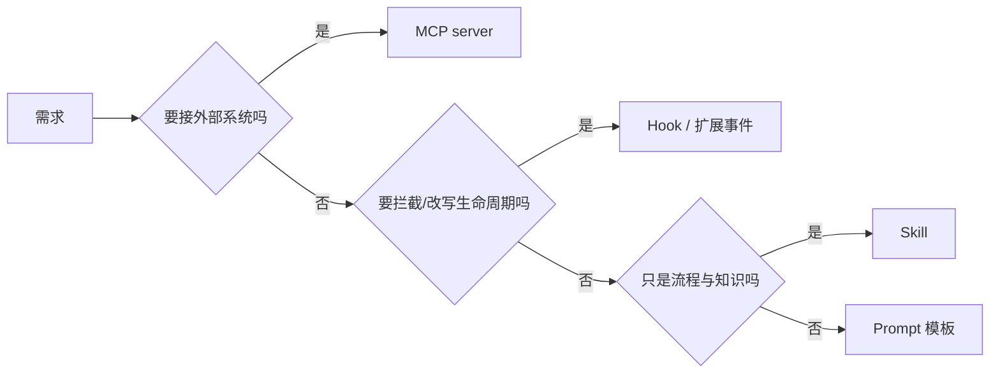
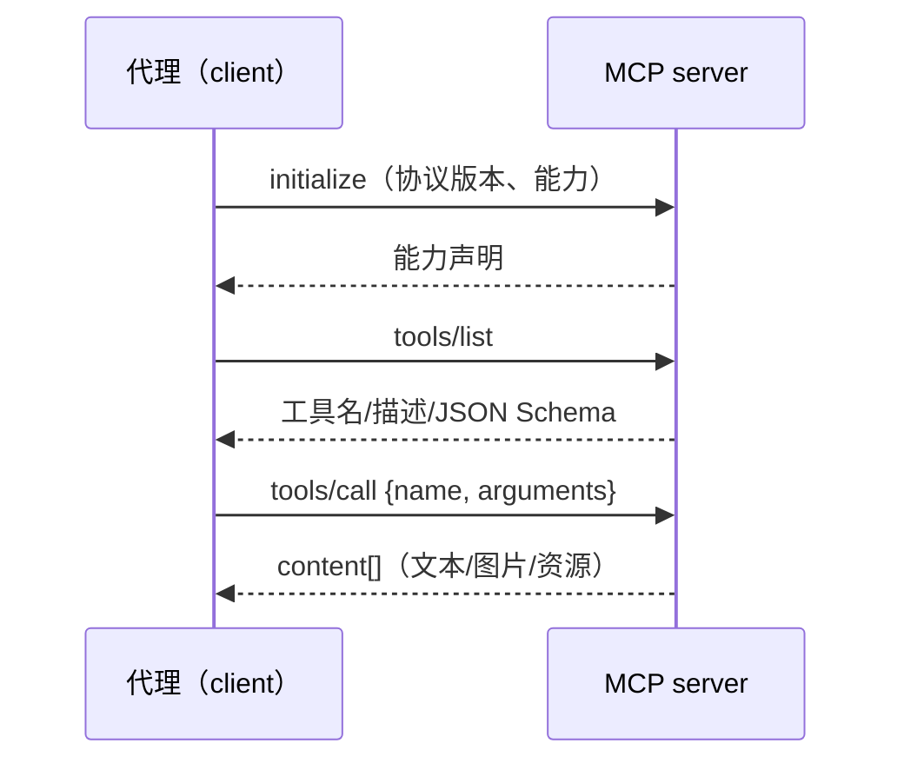

# 第 9 章 MCP、Hooks、插件与扩展

> 本章你将学会：
> - 判断一个需求该用 MCP、Hook、技能还是代码扩展
> - 接一个 MCP 服务器，并把它的工具成本压到最低
> - 读懂并写出一个真实的 Pi 扩展，理解三家扩展点的差异

## 9.1 四个扩展点，各管一段



| 扩展点 | 本质 | 谁执行 | 典型用途 | 代价 |
|---|---|---|---|---|
| MCP | 标准协议，暴露工具/资源 | 独立进程 | 接 GitHub、Sentry、数据库、内部平台 | 每个工具描述都占 token |
| Hook | 生命周期上挂命令 | 你的 shell 脚本 | 格式化、拦截、审计、通知 | 每次触发有进程启动开销 |
| 扩展/插件 | 进程内代码 | 宿主进程 | 自定义工具、provider、UI、门禁 | 与宿主同权限，风险最高 |
| 技能 | 指令文件 | 模型 | 流程、规范、检查清单 | 加载后占上下文 |

**选择顺序**：能写技能就不写代码；能配 MCP 就不自己实现；必须确定性拦截时才上 Hook/扩展。

## 9.2 MCP：一次实现，处处可用

MCP（Model Context Protocol）是「工具提供方」和「工具使用方」之间的 JSON-RPC 协议。它把「接一个系统」从 O(n×m) 降到 O(n+m)。



传输方式两种：

- **stdio**：代理拉起子进程，通过 stdin/stdout 通信。本地工具首选。
- **streamable HTTP**：远程服务，支持 OAuth。注意：**旧版 SSE 传输已被主流实现弃用**，Pi 明确拒绝 `sse` 配置。

### 9.2.1 Pi

```bash
pi mcp add filesystem -- npx -y @modelcontextprotocol/server-filesystem .
pi mcp add docs --url https://example.com/mcp
pi mcp add -l tools --env API_KEY='${TOOLS_KEY}' -- uvx tools-mcp   # 项目级
pi mcp list          # 连接并打印状态、工具数、错误
pi mcp login sentry  # OAuth
```

配置文件（`~/.pi/agent/mcp.json` 或 `.pi/mcp.json`）见 `examples/mcp/mcp.json`。关键字段：

| 字段 | 说明 |
|---|---|
| `command` / `args` / `env` / `cwd` | stdio 服务器 |
| `url` / `headers` / `oauth` | HTTP 服务器 |
| `exposure` | `codemode`（默认）/ `deferred` / `direct` / `hidden` |
| `toolExposure` | 按工具名或通配单独覆盖 |
| `enabled` | 保留配置但不连接 |
| `description` | 一句话说明，用于系统提示与工具搜索排序 |
| `timeout` | 单请求超时（秒） |

工具命名规则：`mcp__<server>__<tool>`，因此可以精确地按前缀做权限控制：

```bash
pi --tools read,codemode,'mcp__git__*'      # 只保留 git 服务器的 MCP 工具
pi --no-mcp                                  # 本次完全不连 MCP
```

**exposure 的取舍**（这是 MCP 最实用的技巧）：

| exposure | 模型能看到工具描述吗 | 适用 |
|---|---|---|
| `direct` | 能，每轮都占 token | 少量高频工具 |
| `deferred` | 先用 `tool_search` 搜到才可见 | 工具多但用得少 |
| `codemode` | 不声明，写脚本调用 | 需要组合/过滤多次调用 |
| `hidden` | 完全不可达 | 危险工具（删除类） |

默认 `codemode` 是「默认不占 token」的意思：工具在连接后不进入系统提示，模型写脚本时再 `searchTools()` 找到它。

### 9.2.2 Claude Code

```bash
claude mcp add --transport http sentry https://mcp.sentry.dev/mcp
claude mcp add my-server -e API_KEY=xxx -- npx my-mcp-server
claude mcp list
claude mcp add-json name '{"command":"...","args":[]}'
```

也支持 `.mcp.json`（项目级）与 `--mcp-config`（一次性）。

### 9.2.3 Codex

```bash
codex mcp add filesystem -- npx -y @modelcontextprotocol/server-filesystem .
codex mcp list
```

配置在 `~/.codex/config.toml` 的 `[mcp_servers.*]`，支持 `command`、`args`、`env`、`url`、`bearer_token_env_var`、启动超时等。

## 9.3 MCP 的四个坑

1. **token 爆炸**：20 个工具 × 每个 150 token 描述 = 3k，且每轮重发。用 `deferred`/`codemode` 或 `toolExposure` 收窄。
2. **信任问题**：MCP server 返回的内容是**不可信输入**（可能含注入指令）。别给「能读文件 + 能联网 + 能写」三合一的 server 开全权限。
3. **凭证管理**：优先 `${ENV_VAR}` 注入，不要把 token 写进 `mcp.json`；能用 OAuth 就别用长期 token。
4. **进程残留**：stdio server 崩溃后工具会「消失」，`/mcp` 里 reconnect；容器里注意僵尸进程。

## 9.4 Hooks：确定性的拦截与副作用

Hook 的价值是**不依赖模型自觉**。三家都支持，但事件名和配置形态不同。

| 时机 | Pi 事件 | Claude Code | Codex |
|---|---|---|---|
| 用户输入 | `input` | UserPromptSubmit | `user_prompt_submit` |
| 工具调用前 | `tool_call`（可 block/改参） | `PreToolUse` | `pre_tool_use` |
| 工具调用后 | `tool_result`（可改写结果） | `PostToolUse` | `post_tool_use` |
| 会话开始/结束 | `session_start` / `session_shutdown` | SessionStart / SessionEnd | `session_start` / `session_end` |
| 压缩前后 | `turn_end`（可插条目） | PreCompact / PostCompact | `pre_compact` / `post_compact` |
| 代理结束 | `agent_settled` | Stop / SubagentStop | `interrupt` 等 |

一个「保存后自动格式化」的 Claude Hook：

```json
{
  "hooks": {
    "PostToolUse": [
      {
        "matcher": "Edit|Write",
        "hooks": [{ "type": "command", "command": ".claude/hooks/format.sh" }]
      }
    ]
  }
}
```

```bash
#!/usr/bin/env bash
# .claude/hooks/format.sh —— 只格式化被改的文件，失败不阻断
set -euo pipefail
file=$(jq -r '.tool_input.file_path // empty')
[[ -n "$file" && -f "$file" ]] || exit 0
case "$file" in
  *.ts|*.tsx) npx prettier --write "$file" >/dev/null 2>&1 || true ;;
  *.py)       ruff format "$file" >/dev/null 2>&1 || true ;;
esac
exit 0
```

Hook 的三条纪律：

- **快**：超过 1 秒的 hook 会明显拖慢每一轮。重活放后台。
- **fail closed**：安全检查类 hook 出错时必须阻断（`exit 2`），而不是放行。
- **幂等**：可能被重复调用，别写「追加」逻辑。

## 9.5 Pi 扩展实战：逐段读懂

`examples/pi-extensions/pre-commit-guard.ts` 是一个完整例子，包含三种扩展点。

**第一步：门禁。** 监听 `tool_call`，返回 `{ block, reason }` 即可阻断：

```ts
pi.on("tool_call", async (event, ctx) => {
  if (event.toolName !== "bash") return undefined;
  const command = event.input.command as string;
  if (/\bgit\s+push\s+.*(--force|-f)\b/.test(command)) {
    if (!ctx.hasUI) return { block: true, reason: "无 UI 可确认，拒绝强推" };
    const ok = await ctx.ui.confirm("高风险命令", command);
    return ok ? undefined : { block: true, reason: "用户拒绝" };
  }
});
```

要点：

- **非交互模式默认拒绝**（`ctx.hasUI === false`），这是 CI 安全的关键。
- 返回 `undefined` 表示放行；返回 `{ block: true }` 会生成一条失败的 tool result 给模型，模型能看到原因并换个做法。

**第二步：命令。** `pi.registerCommand` 增加斜杠命令，`ctx.ui.notify` 输出：

```ts
pi.registerCommand("guard", {
  description: "查看当前生效的护栏规则",
  handler: async (_args, ctx) => ctx.ui.notify(rules.join("\n"), "info"),
});
```

**第三步：工具。** 用 `defineTool` + TypeBox schema 定义模型可调用的工具：

```ts
const repoStats = defineTool({
  name: "repo_stats",
  label: "Repo Stats",
  description: "统计仓库文件数与代码行数，按扩展名分组",
  parameters: Type.Object({ pattern: Type.Optional(Type.String()) }),
  async execute(_id, params) {
    const { stdout } = await pi.exec("git", ["ls-files", ...(params.pattern ? [params.pattern] : [])]);
    // …统计…
    return { content: [{ type: "text", text: summary }], details: { files, lines } };
  },
});
pi.registerTool(repoStats);
```

三条契约：

- `content` 给模型看，`details` 给渲染/状态恢复用。
- 失败就 `throw`（会变成错误结果），不要返回一段「出错了」的文本冒充成功。
- 会读写文件的工具要用 `withFileMutationQueue()` 包住读-改-写，避免并发打架。

加载与调试：

```bash
pi --extension ./examples/pi-extensions/pre-commit-guard.ts
# 放进 ~/.pi/agent/extensions/ 或 .pi/extensions/ 后 /reload
```

**扩展的风险**：它与 Pi 同进程、同权限，能读到你的会话、凭证、文件。只加载你读过的代码。

## 9.6 插件与包：怎么发给别人

| 工具 | 单元 | 安装 | 内容 |
|---|---|---|---|
| Pi | Pi package（npm/git） | `pi install <source>`、`pi list`、`pi config` | 扩展 + 技能 + 模板 + 主题 |
| Claude Code | Plugin（含 marketplace） | `claude plugin add`、`--plugin-dir A.zip`、`--plugin-url` | 命令、agent、hook、MCP 配置、技能 |
| Codex | Plugin | `codex plugin add` | 技能、hook、MCP、prompt |

共同点：**插件是「打包」，扩展是「能力」**。团队分发时优先用插件/包，别让大家手工拷文件。

Pi 的 package 清单（`package.json` 里的 `pi` 字段）可以声明暴露哪些资源，安装后 `pi config` 可以逐项开关——这对「一个大包，各取所需」特别有用。

## 9.7 反模式

| 反模式 | 后果 | 替代 |
|---|---|---|
| 把所有内部系统都做成 MCP + `direct` | 上下文被工具描述占满 | `deferred` / `codemode` |
| 用 Hook 做业务逻辑 | 慢、难测、出错阻断主流程 | 放 CI 或独立脚本 |
| 扩展里直接 `exec` 拼接字符串 | 命令注入 | 用数组参数 `pi.exec("git", [...])` |
| 技能里写死绝对路径 | 换机器就废 | 相对技能目录 |
| 插件里塞密钥 | 泄漏 + 无法轮换 | 环境变量 / OAuth |

## 9.8 练习

1. 接一个 MCP 服务器（filesystem 即可），把 `exposure` 从 `direct` 改成 `codemode`，用 `pi --mode json` 对比系统提示的 token 变化。
2. 用 Claude 的 `PreToolUse` hook 阻止写入 `*.lock` 文件，并用一条命令验证它真的拦住了。
3. 给 `pre-commit-guard.ts` 加一条规则：禁止 `git commit --no-verify`。
4. 把你们团队最常用的一个内部 API 包成 MCP server（哪怕是 20 行的 stdio 实现），给三个工具各接一次，比较配置成本。
5. 设计一个「扩展 vs 技能 vs Hook」的决策记录，写进团队文档。

---

下一章算钱：模型怎么选、思考等级怎么调、预算怎么控。
