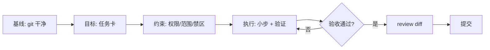

# 第 11 章 实战工作流：TDD、重构、审查、排错

> 本章你将学会：
> - 五个高频场景的完整流程，每个都带可直接用的提示词
> - 每个流程该配什么权限档位、什么验收命令
> - 什么时候该让 agent 停手，交回给人

## 11.0 通用骨架

所有工作流都是同一个骨架的五种填法：



| 场景 | 权限档位 | 验收命令 | 人类必须做的事 |
|---|---|---|---|
| TDD 新功能 | workspace-write | `npm test` | 确认测试真的测了需求 |
| 重构 | acceptEdits + 测试 | `npm test` × N | 确认对外行为没变 |
| 审查 | read-only / plan | 无需 | 判断问题是否真实 |
| 排错 | workspace-write | 复现脚本 + 测试 | 确认根因解释成立 |
| 文档/迁移 | workspace-write | 构建/链接检查 | 抽查事实准确性 |

## 11.1 工作流一：TDD 新功能

**核心：先让 agent 写失败的测试。** 这强制它理解需求，也给你一个「它到底理解成什么」的检查点。

### 提示词（可直接复制）

```text
# 阶段 1：只写测试
目标：给 task-cli 增加 `task edit <id> [--title X] [--priority P]`。
这一阶段**只允许修改 test/ 下的文件**，不要改 src/。

请先读 src/tasks.mjs 与 src/cli.mjs 理解现有结构，然后写测试，覆盖：
1. 只改标题
2. 只改优先级
3. 两个都改
4. id 不存在 → 报错 `task: 找不到任务 #<id>`
5. 两个参数都没给 → 报错并提示用法
6. 改成与原来相同的值 → 应视为成功且不改变 completedAt

要求：使用现有测试风格（node:test + node:assert/strict），追加到文件末尾，不改已有用例。
完成后运行 `npm test`，**确认新测试是失败的**，并把失败信息贴出来。
```

```text
# 阶段 2：最小实现
现在让这 6 个测试通过。只改 src/，不要改测试。
每完成一个测试的修复就重跑 `npm test -- --test-name-pattern`（或全量）。
如果某个测试你认为写错了，停下来指出，不要自己改测试。
```

### 为什么分两阶段

- 一次性「写测试并实现」，模型会**按实现写测试**，测试变成橡皮图章。
- 分开后，测试是「契约」，实现必须迁就它。
- 你能在阶段 1 结束时检查：6 个测试是不是真的覆盖了需求。

### 三工具命令

```bash
pi --tools read,bash,edit,write,grep "…阶段 1 提示词…"
claude -p --permission-mode acceptEdits "…"     # 或交互式分两轮
codex exec -s workspace-write -c approval_policy="never" "…"
```

### 验收清单

- [ ] 新测试在实现前确实失败（有失败输出为证）
- [ ] 实现后全绿，且**没有修改已有断言**
- [ ] `git diff test/` 里只有新增
- [ ] 手动跑一次真实命令，输出符合预期

## 11.2 工作流二：重构

**核心：定义「不变量」，并让每一步都可回退。**

### 提示词

```text
重构 src/tasks.mjs 里的 selectTasks。

不变量（必须保持不变，逐条自检并在最后确认）：
1. 函数签名与导出名不变
2. 默认 filter='open'
3. 排序规则：未完成在前 → 优先级 high/normal/low → 创建时间升序
4. 非法 filter 抛 `未知过滤条件 <x>`
5. 不修改入参数组（纯函数）

约束：
- 一次只做一个可独立验证的改动，每步后跑 `npm test`
- 不新增依赖，不改测试
- 若某步测试失败，回退该步并说明原因

先给我 3 个重构方案（各写代价），推荐一个，等我确认后再动手。
```

### 常见的三个方案（用于对照模型输出）

| 方案 | 做法 | 代价 |
|---|---|---|
| A. 提取比较器 | 把三级排序抽成 `compareTasks` | 最小，易测，改善有限 |
| B. 策略表 | 用 `FILTERS` 映射表替换 if/switch | 可读性好，扩展新 filter 便宜 |
| C. 管道化 | `filter → sort` 拆成独立可组合步骤 | 最灵活，改动面最大 |

### 坑

- **模型喜欢「顺手」改测试**。提示词里必须写死「不改测试」。
- **模型喜欢一次改完**。用「一次一个改动 + 每步跑测试」压住。
- **重构后没人 review**。重构的 diff 必须人看，因为测试可能覆盖不到。

## 11.3 工作流三：代码审查

**核心：审查是只读任务，必须给出文件:行号。**

```text
审查当前分支相对 main 的改动（git diff main...HEAD）。

按 P0/P1/P2 输出，每条必须包含：
- 文件:行号
- 触发条件（什么输入/并发/环境下会出问题）
- 最小修复建议（不重写）

只报你能构造出失败场景的问题；不确定的写「待确认」。
不要评论格式问题。不要修改任何文件。
最后列出你重点检查过但判断没问题的部分。
```

三工具的命令行版本：

```bash
git diff main...HEAD | pi -p "…审查提示词…"
git diff main...HEAD | claude -p --permission-mode plan "…"
codex review --base main
```

### 审查 Agent 自己写的代码

Agent 审查自己有个天然缺陷：**它会为自己的选择辩护**。两个办法：

1. **换会话/换模型审**：用另一个会话（甚至另一个工具）审，效果显著更好。
2. **给对抗性指令**：「假设这段代码有 bug，找出最可能的三个」。

### 验收

- [ ] 每条问题都能在代码里定位
- [ ] 没有「建议重构整个模块」这种不可执行的建议
- [ ] 至少有一条是「测试缺口」

## 11.4 工作流四：排错

**核心：先复现，再二分，最后修复。**（对应 `examples/prompts/debug.md`）

```text
现象：`task done 1` 在 tasks.json 不存在时输出了 "已完成 #1" 而不是报错。

步骤：
1. 复现：给我一条能稳定触发的命令，并贴出实际输出与期望输出
2. 定位：列出 3 个假设，标注最可能的；对每个给出可证伪的检查
3. 修复：先写一个会失败的测试，再改代码
4. 回归：跑全量测试；说明同类问题是否还存在（其它命令有没有同样缺陷）

约束：一次只验证一个假设；不要改 store.mjs 的写入策略。
```

### 一个真实的定位过程（示例）

```text
假设 1：completeTask 在 id 不存在时返回 changed=false 而不抛错
  检查：读 src/tasks.mjs:31 → 确实 throw，假设排除
假设 2：CLI 层的 id 解析把 NaN 当成有效 id
  检查：node -e "console.log(Number('abc'))" → NaN；但 `done 1` 是合法数字
假设 3：db.nextId 与 tasks.length 不一致导致找不到
  检查：cat tasks.json → 发现文件不存在，load() 返回空数组，然后 completeTask 抛错被 catch 了吗？
根因：cli.mjs 里 main() 的 .catch 打印了错误但对 done 分支提前 return，
      实际是 `changed` 为 false 时打印了"本来就是完成状态"
```

（这类「假设 → 证伪」的过程，是 agent 最擅长也最容易偷懒的地方。**要求它贴出证据**。）

### 坑

- **模型喜欢猜根因**，不读代码。用「对每个假设给出可证伪的检查」压住。
- **修完不写测试**，同一个 bug 下周回来。要求「先写失败测试」。
- **日志污染**：让它加临时日志时，明确「结束后删除」。
- **别让它动无关的防御性代码**，否则 diff 会失控。

## 11.5 工作流五：文档与迁移

**核心：事实必须可验证，链接必须能打开。**

```text
更新 README 的「用法」一节，反映新增的 edit 命令。

要求：
1. 每个命令示例都必须真的能跑（用 TASKS_FILE=/tmp/doc.json 验证）
2. 命令输出用真实输出（可以截断长行），不要编造
3. 保持现有章节顺序与风格
4. 不要改 package.json、LICENSE、CHANGELOG
5. 结束后把「你实际执行过的命令清单」列出来，供我抽查
```

迁移场景（例如从 Claude Code 迁到 Pi）见第 17 章，提示词模板在 `examples/prompts/`。

## 11.6 把工作流固化成资产

| 资产 | 放哪 | 谁维护 |
|---|---|---|
| 任务卡 | `docs/tasks/NNN-*.md` | 提需求的人 |
| 工作流提示词 | `prompts/`（模板）或 `.claude/commands/` | 团队负责人 |
| 审查技能 | `.pi/skills/code-review/` 等 | 平台组 |
| 验收命令 | `AGENTS.md` / `make check` | 全员 |
| 权限模板 | `.pi/settings.json`、`.claude/settings.json`、`.codex/config.toml` | 安全/平台 |

四者合起来，就是「团队级 AI 工作流」。**新人不看文档也能干对**，因为他们只要说「按 code-review 技能审一下」，就复用了整套标准。

## 11.7 什么时候该让人接手

| 信号 | 动作 |
|---|---|
| 同一错误重试 ≥ 3 次 | 停下，人看日志 |
| diff 超过 300 行 | 拆分任务，别一次审 |
| 涉及密钥/权限/加密 | 人写或人逐行审 |
| 涉及数据迁移 | 先要回滚方案 |
| 模型开始「论证自己没错」 | 换会话/换工具重来 |
| 你解释了三遍它还没懂 | 问题在任务卡，不在模型 |

## 11.8 练习

1. 完整跑一遍 11.1，记录「阶段 1 的测试」与「阶段 2 的实现」分别几轮。
2. 拿一段你写过的代码让 agent 重构，用 11.2 的提示词，检查它是否守住了 5 条不变量。
3. 让 A 工具写代码，B 工具审查，比较「自己审自己」与「交叉审」的发现数量。
4. 把 11.4 的排错提示词做成技能，在下次真实 bug 上试用。
5. 给你的仓库补齐 11.6 的五类资产，目标：新人能独立完成一次完整任务。

---

下一章：当任务大到一个人（一个会话）干不完时。
