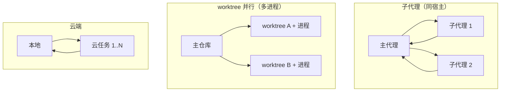
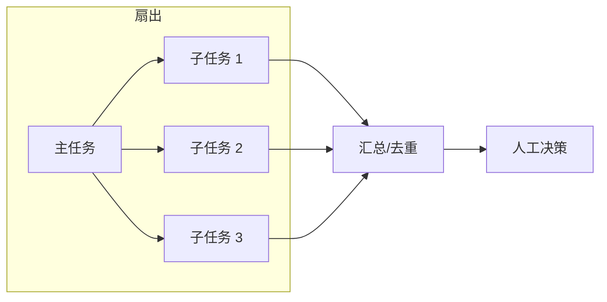

# 第 12 章 多代理、并行与云端

> 本章你将学会：
> - 判断一个任务该不该拆成多个代理，以及怎么拆
> - 用 worktree / 子代理 / 云任务三种方式安全并行
> - 避免并行带来的文件冲突、成本失控与「三个代理都读了一遍仓库」

## 12.1 什么时候真的需要多代理

不是所有任务都该并行。多代理的代价是**协调成本**：拆分、汇总、冲突处理、重复上下文。

| 适合并行 | 不适合 |
|---|---|
| 多个独立模块的同类改动（加日志、改 API 调用） | 强耦合的单点重构 |
| 同一个问题的多角度调查（性能/安全/兼容性） | 需要连续推理的调试 |
| 互不重叠文件的批量任务 | 共享同一个文件的多处修改 |
| 需要「隔离上下文」的探索（避免互相污染） | 预算紧、任务小 |

一个实用的判断：**如果两个子任务会修改同一个文件，就别并行。**

## 12.2 三种并行形态



| 形态 | 隔离级别 | 成本 | 适用 |
|---|---|---|---|
| 子代理 | 上下文隔离，共享文件系统 | 低（同进程/同机） | 调查、审查、分工实现 |
| worktree 并行 | 文件系统隔离 + 上下文隔离 | 中 | 同仓库多方案、多模块 |
| 云任务 | 完全隔离（独立机器） | 高 | 大规模、长时间、CI 化 |

## 12.3 Claude Code：子代理与后台会话

**定义子代理**（`--agents` 或 `.claude/agents/*.md`）：

```bash
claude --agents '{
  "reviewer": {"description":"审查代码，只读","prompt":"你是严格的代码审查者，只报有证据的问题"},
  "tester":  {"description":"补测试，不改实现","prompt":"你只写测试，不允许修改 src/"}
}'
```

交互中用 `/agents` 管理；主代理通过 `Task` 工具（`subagent_type`）调用它们。子代理有**独立上下文**，返回摘要给主代理——这是控制上下文膨胀的关键手段。

**后台会话**：

```bash
claude --bg "把 docs/ 里所有过时的 API 示例更新一遍"
claude agents            # 列出后台会话
claude attach <id>       # 接管
claude logs <id>         # 看日志
claude stop <id>         # 停
```

后台会话的价值：长任务不占着你的终端，也不占你的注意力。

## 12.4 Codex：多代理与 worktree

Codex 的多代理是「任务（thread）」级别的：

```text
# 在 TUI 里
/agents        # 打开 agent 命令中心：查看、切换、停止子代理
```

模型侧对应这些工具（由内部注册，不需要你写）：

| 工具 | 作用 |
|---|---|
| `spawn_agent` | 派生一个子任务，继承当前工作目录 |
| `send_input` | 给子代理追加指令 |
| `wait` | 等待若干子代理完成或需要审批 |
| `close_agent` | 关闭子代理 |

工程上更有用的两个开关：

```bash
codex --worktree "重构 report 模块"     # 在独立 git worktree 里跑，主分支不动
codex resume --last                     # 回来继续
codex queue "顺便把测试补上"             # 给运行中的会话排队
codex archive <id>                      # 归档，不占列表
```

`--worktree` 是「并行做实验」最省心的方式：每个会话一个工作树，互不覆盖，结束后你自己决定合并哪个。

## 12.5 Pi：没有内建子代理，但有三种替代

Pi 明确不做内建 subagent（README 里写了）。需要时用：

1. **多个进程 + worktree**（最通用，见 12.6 脚本）。
2. **扩展注册一个「子会话」工具**：在扩展里用 SDK 起 `createAgentSession()`，把结果摘要返回。这样主会话只看到摘要，上下文不膨胀。
3. **RPC/SDK 自建编排**：把 Pi 当库，自己写 fan-out / fan-in。

第三种最灵活也最像「自己造一个多代理系统」：

```ts
import { createAgentSession, SessionManager } from "@earendil-works/pi-coding-agent";

const angles = ["性能", "安全", "兼容性"];
const results = await Promise.all(angles.map(async (angle) => {
  const { session } = await createAgentSession({ sessionManager: SessionManager.inMemory() });
  try {
    await session.prompt(`只读审查 src/，从「${angle}」角度列出最多 5 条风险，给文件:行号。`);
    return { angle, text: session.getLastAssistantText() };
  } finally {
    session.dispose();
  }
}));

console.log(results.map((r) => `## ${r.angle}\n${r.text}`).join("\n\n"));
```

注意：`Promise.all` 会同时发多个请求，**成本和速率限制要自己控**（并发 3 以内比较安全）。

## 12.6 实战脚本：worktree 并行调查

`examples/ci/parallel-worktrees.sh` 把「多个只读调查」并行化：

```bash
chmod +x examples/ci/parallel-worktrees.sh

./examples/ci/parallel-worktrees.sh \
  "审查 task-cli 的 src/，找出会导致数据丢失的路径" \
  并发 边界 错误处理

# 换代理
AGENT=codex ./examples/ci/parallel-worktrees.sh "..." 性能 安全
```

它做的事：

1. 为每个标签建一个 `.worktrees/<tag>` 和分支 `probe/<tag>`。
2. 每个 worktree 里跑一次**只读**代理（`--tools read,bash,grep,find,ls` / `plan` / `read-only`）。
3. 输出写到 `.agent-runs/<时间戳>/<tag>.md`，错误单独存。
4. 结束后提示清理命令。

**为什么用 worktree 而不是同一个目录**：代理会跑 `git status`、`git diff`、甚至写临时文件；共享目录会让它们互相看到对方的中间状态，结论不可比。

## 12.7 并行的三个硬问题

### 12.7.1 文件冲突

| 做法 | 说明 |
|---|---|
| 按文件切分任务 | 最可靠：A 改 `tasks.mjs`，B 改 `cli.mjs` |
| worktree 隔离 | 各自改，最后人工合并 |
| 串行 + 阶段化 | 先并行调查，再串行实现 |
| 锁文件 | 不推荐，代理不守规矩时无效 |

### 12.7.2 重复上下文

三个代理都把仓库读一遍 = 三倍输入成本。缓解：

- 给每个代理**明确的范围**（「只看 src/tasks.mjs」），而不是「看整个仓库」。
- 并行阶段只做**调查/审查**（输出短），实现阶段串行。
- 用子代理，让主代理只接收摘要。

### 12.7.3 成本与速率

- 并发 3 是多数 provider 的安全值；再高容易触发限流，重试成本更高。
- 每个代理设独立预算（`--max-budget-usd` / token budget）。
- 并行任务失败要有**超时**，别让一个卡住的代理拖住整批。

## 12.8 云端：什么时候值得

| 场景 | 值得上云吗 |
|---|---|
| 需要跑几小时的大规模迁移 | 值得 |
| 需要在干净环境里复现 | 值得 |
| 团队多人共享同一批任务 | 值得 |
| 本机能跑完的 20 分钟任务 | 不值得（传输 + 冷启动更慢） |

三家现状：

- **Claude Code**：`--cloud`、`--environment`、`--from-pr`、`--remote-control`，与 claude.ai/code 打通。
- **Codex**：`codex cloud`、app-server 的 `--remote`、`codex remote-control`，多端共享同一会话。
- **Pi**：没有官方云，但 RPC/SDK 让你容易接到自己的调度系统里（K8s job、队列 worker）。

## 12.9 编排拓扑



四种常见拓扑：

| 拓扑 | 用途 | 风险 |
|---|---|---|
| Supervisor（主从） | 主代理分派 + 汇总 | 主代理上下文膨胀 |
| Pipeline（流水线） | 调查 → 实现 → 审查 | 上游错误被放大 |
| Fan-out/Fan-in | 多角度审查、批量模块 | 汇总质量差 |
| Debate（对抗） | 找 bug、方案对比 | 成本翻倍 |

## 12.10 技巧与坑

- **子代理不是免费的**：每个都要重发系统提示与工具定义。5 个子代理 ≈ 5 倍固定开销。
- **不要让子代理改同一批文件**，即使有 worktree，最后合并也痛苦。
- **汇总时要求「去重 + 冲突标注」**：「相同问题合并，冲突的结论标出双方证据」。
- **Codex 的 `queue` 比开新会话好**：同一上下文的追加任务，不需要重新读代码。
- **并行别用同一个 API key 打满速率**，留出重试余量。
- **一定要能一键清理**：`git worktree list`、`git branch -D`、`claude rm <id>`、`codex delete <id>`。

## 12.11 练习

1. 用 `parallel-worktrees.sh` 跑三个角度的只读审查，人工汇总成一份报告，标出重复与冲突。
2. 用 `--worktree` 让 Codex 同时做两个方案，比较 patch 大小与测试通过率。
3. 在 Claude Code 里定义 `tester` 子代理（只写测试），让主代理调用它完成 11.1 的阶段 1。
4. 用 SDK 写一个 3 并发 + 超时 + 预算上限的编排脚本。
5. 给你的团队定一条规则：什么样的任务允许并行，什么样的必须串行。

---

下一章起是三篇工具专章：先把 Pi 拆开，再拆 Claude Code 与 Codex。
