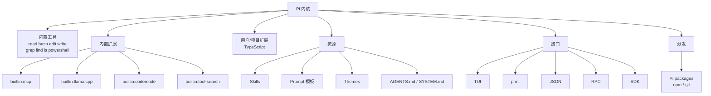

# 第 13 章 工具专章：Pi

> 本章你将学会：
> - 把 Pi 当成「可编程的 agent 内核」，而不是一个固定产品
> - 用配置组合出多 provider 路由、只读审计、嵌入式集成三种形态
> - 知道 Pi 的边界在哪，什么时候该换工具或加扩展

## 13.1 生态地图



Pi 的「生态」不是应用市场，而是**四个可替换层**：工具、扩展、资源、接口。这也是为什么它的默认体验朴素——它假设你会动手。

如果你想要同一套 Pi 内核，但不想自己拼 LSP、DAP、subagent 与权限层，可以看第 14 章的 omp：它是 Pi 的 fork，把配置根从 `.pi` 换成 `.omp`，CLI 与扩展模型同源，但默认就把这些能力装好了。

## 13.2 三套典型配置

### 13.2.1 多 provider 路由（省钱型）

目标：探索用便宜模型，实现用强模型，本地模型兜底。

```json
// ~/.pi/agent/settings.json（片段）
{
  "enabledModels": ["openai/gpt-5.1-mini", "anthropic/claude-sonnet-4-5", "ollama/qwen3-coder:30b"],
  "modelThinkingLevels": {
    "openai/gpt-5.1-mini": "low",
    "anthropic/claude-sonnet-4-5": "medium"
  }
}
```

```bash
# 启动时把三档挂到 Ctrl+P 循环
pi --models "gpt-5.1-mini:low,sonnet:medium,ollama/qwen3-coder:30b:off"
```

工作节奏：探索按 `Ctrl+P` 切到 mini，动手切 sonnet，机械改切本地。

### 13.2.2 只读审计（安全型）

```bash
pi --tools read,grep,find,ls --no-mcp --no-extensions -p "审计 src/ 的错误处理"
```

- `--tools` 只留只读工具。
- `--no-mcp` 断开外部工具（避免第三方 server 的副作用）。
- `--no-extensions` 不加载未知代码（但内置 MCP 也会被关掉，所以与 `--no-mcp` 二选一即可）。

### 13.2.3 嵌入式（产品型）

```ts
import { createAgentSession, SessionManager } from "@earendil-works/pi-coding-agent";

export async function reviewDiff(diff: string) {
  const { session } = await createAgentSession({
    cwd: process.cwd(),
    sessionManager: SessionManager.inMemory(),
    // 也可以在这里传 model / tools / systemPrompt
  });
  try {
    await session.prompt(`审查这个 diff，按 P0/P1/P2 输出：\n\n${diff}`);
    return session.getLastAssistantText();
  } finally {
    session.dispose();
  }
}
```

## 13.3 会话树的高级用法

Pi 的树会话不只是「撤销」，它可以当**实验管理工具**：

| 用法 | 操作 | 效果 |
|---|---|---|
| 方案对比 | 在节点 A `/fork` 两次，各试一种实现 | 两个分支的上下文互不污染 |
| 回到决策点 | `/tree` 选中「agent 提出两个方案」那条消息 | 从那里重新选路，旧分支保留可查 |
| 给节点打标签 | `/tree` 里 `Shift+L` | 一周后还能找到「性能优化尝试」 |
| 复制当前状态 | `/clone` | 保留完整历史，做破坏性实验 |
| 导入外部会话 | `/import <path.jsonl>` | 复用别人的排查过程 |
| 导出给同事 | `/export out.html` | 带工具调用与思考的完整回放 |

**一个实用惯例**：让 agent 在关键节点用 `pi.appendEntry()` 写一条自定义条目，或者在会话名里带上任务编号（`/name TASK-123`）。树越用越大时，命名与标签是唯一的检索手段。

## 13.4 扩展 API 全景

Pi 扩展能做的事，比大多数人以为的多：

| 能力 | API | 典型用途 |
|---|---|---|
| 监听生命周期 | `pi.on(event, handler)` | 门禁、审计、上下文改写 |
| 注册工具 | `pi.registerTool(defineTool({...}))` | 接内部 API、包一层 CLI |
| 注册命令 | `pi.registerCommand(name, {...})` | `/deploy`、`/release-notes` |
| 注册快捷键 | `pi.registerShortcut(key, {...})` | 一键切换只读模式 |
| 注册 CLI 参数 | `pi.registerFlag(name, {...})` | 给团队脚本加 `--plan` |
| 注册 provider | `pi.registerProvider(name, config)` | 接自建网关 |
| 注册 MCP server | `pi.registerMcpServer(...)` | 扩展即服务 |
| 虚拟模型路由 | `pi.registerVirtualModel(...)` | 按请求特征选模型 |
| 改提示词 / 工具集 | `before_agent_start` 返回值 | 按任务类型注入规范 |
| 渲染与 UI | 渲染器 + `ctx.ui.*` | 自定义工具展示、弹窗确认 |
| 会话内状态 | `pi.appendEntry()` | 记录「已审查通过」等标记 |
| 发消息 | `pi.sendUserMessage()` / `sendMessage()` | 自动触发下一步 |

两个容易被忽略的点：

- **`before_agent_start` 可以按任务改工具集**：例如检测到「只读」关键词时自动 `setActiveTools(["read","grep"])`。
- **`ctx.ui` 在非交互模式不可用**，必须像示例里那样「无 UI 就 fail closed」。

## 13.5 codemode：把工具当库调用

`codemode` 让模型写一段脚本，在脚本里调用工具，而不是一次一次发 tool call。收益：

| | 逐次 tool call | codemode |
|---|---|---|
| 轮数 | 每个调用一轮 | 一次脚本一轮 |
| token | 每次调用的参数/结果都进上下文 | 只有脚本与最终结果 |
| 适合 | 少量、需要模型逐步判断 | 批量、规律性强 |

```text
# 示例指令
用 codemode 统计 src/ 下每个文件的导出函数数量，只把结果表给我。
```

模型会写类似这样的脚本（工具通过 `searchTools()` 发现）：

```js
// codemode 脚本运行在 QuickJS 沙箱里：没有 Node API，只能通过 tools 访问外部
const { output } = await tools.bash({ command: "git ls-files 'src/**/*.mjs'" });
const files = output.trim().split("\n").filter(Boolean);

const rows = [];
for (const f of files) {
  const src = await tools.read({ path: f });
  const n = (src.match(/^export (async )?function/gm) ?? []).length;
  if (n) rows.push([f, n]);
}
return rows.sort((a, b) => b[1] - a[1]);   // 顶层 return 会作为结果输出
```

工具以 `tools.<name>(args)` 的形式调用；名字里非法字符会变成 `_`（例如 `mcp__dev-radius__search` → `tools.mcp__dev_radius__search`）。不确定有哪些工具时先用 `searchTools("...")` 或 `describeTool(name)` 查，避免瞎猜参数。

配合 MCP 的 `exposure: "codemode"`，外部工具默认不进上下文，只在脚本里可达——这是 Pi 控制 token 的核心机制。

## 13.6 本地模型与 llama.cpp

Pi 内置 `builtin:llama.cpp` 扩展，`/llama` 命令管理模型路由（加载、卸载、切换）。两种接法：

1. **OpenAI 兼容端点**（推荐，通用）：`models.json` 里写 `baseUrl` + `api: "openai-completions"`。
2. **llama.cpp 路由器**：`/llama` 管理，适合本机多模型切换。

实践建议：本地模型只用于「不需要聪明」的环节；把它挂在模型循环的最后一档，随时可切。

## 13.7 凭据复用与外部集成

`pi auth` 的三种输出：

```bash
pi auth check                                  # 检查 provider 是否就绪
pi auth print-api-key --provider openai        # 打印 API key
pi auth print-bearer-token --provider openai-codex   # 打印 OAuth bearer（会刷新）
```

这让「把 Pi 的登录态借给别的脚本」变得安全：脚本不存密钥，运行时取。

## 13.8 分发：Pi packages

```bash
pi install npm:@acme/pi-workflows     # 从 npm
pi install git:github.com/acme/pi-rules
pi list
pi config                             # 勾选启用哪些资源（Tab 切用户/项目）
pi update                             # 升级自身与包
```

包的典型内容：

| 资源 | 文件 | 说明 |
|---|---|---|
| 扩展 | `extensions/*.ts` | 代码能力 |
| 技能 | `skills/*/SKILL.md` | 流程知识 |
| 模板 | `prompts/*.md` | 高频提示 |
| 主题 | `themes/*.json` | 外观 |
| 设置片段 | `package.json` 的 `pi` 字段 | 声明暴露哪些 |

## 13.9 Pi 的边界

| 缺什么 | 替代方案 | 代价 |
|---|---|---|
| 内建 subagent | SDK 起多个 session / worktree 并行 | 自己写编排 |
| OS 沙箱 | 容器 / VM / 专用用户 | 需要基础设施 |
| 逐次审批 | `tool_call` 门禁 + `--tools` | 无法覆盖所有未知操作 |
| 云端任务 | RPC/SDK 接自己的调度 | 自己搭 |
| 文件级回滚 | `git` | 依赖良好提交习惯 |
| schema 约束输出 | JSON 模式 + 自己校验 | 多一步断言 |

**判断标准**：如果你的需求是「把 agent 嵌进系统」，Pi 的缺口都可以用代码补；如果你要的是「装上就有人管权限和云」，选另外两个。

## 13.10 配方与技巧

**只读审查 + 事件流 + 退出码**（CI 常用）：

```bash
git diff origin/main...HEAD \
  | pi --print --mode json --no-session --tools read,grep,find,ls \
      -- "按 P0/P1/P2 输出问题，没有就输出 LGTM" \
  > review.jsonl
jq -r 'select(.type=="message_end" and .message.role=="assistant") | .message.content[]?.text' review.jsonl | tail -1
```

**给团队加一个统一入口**（`~/.pi/agent/extensions/team.ts`）：

```ts
export default function (pi) {
  pi.registerFlag("readonly", { type: "boolean", description: "强制只读模式" });
  pi.on("session_start", async (_e, ctx) => {
    if (pi.getFlag("readonly")) pi.setActiveTools(["read", "grep", "find", "ls"]);
  });
  pi.registerCommand("handoff", {
    description: "生成本次改动的交接摘要",
    handler: async (_a, ctx) => {
      pi.sendUserMessage("用 5 条要点总结本次会话的改动、验证结果与待办，供同事接手。");
    },
  });
}
```

**省 token 的三个开关**：

- `--no-context-files`：临时在一个巨型 monorepo 里工作，不想加载一堆 AGENTS.md。
- `compaction.reserveTokens` 调大：更早压缩，长任务更稳（但丢更多细节）。
- `codemode.inlineBudget` 调小：工具多时减少 codemode 描述占用。

## 13.11 坑

- **`--no-extensions` 会连内置扩展（含 MCP）一起关**。只想关某一个内置扩展，就在设置的 `extensions` 列表里写 `-builtin:mcp`（`+builtin:`/`-builtin:` 是设置语法，不是 CLI 参数）。
- **扩展热重载会替换运行时**：`await ctx.reload()` 之后的代码属于旧运行时，别复用状态。
- **`pi install` 会改设置文件**，团队协作时注意别把个人包提交进仓库。
- **`sessionDir` 在项目信任之前就会被读取**，所以它不受信任保护（官方文档明确说明）。
- **`/share` 会把会话上传**，分享前先 `/export` 本地看一眼有没有密钥。

## 13.12 练习

1. 用 `models.json` 加一个本地 ollama 模型，挂到 `Ctrl+P` 循环，观察它在哪些任务上够用。
2. 写一个扩展：在每次 `write`/`edit` 之后自动 `git add` 该文件（参考 `examples/extensions/auto-commit-on-exit.ts` 的思路）。
3. 用 SDK 做一个「批量给 10 个文件加 JSDoc」的小工具，要求失败可重入。
4. 用 `/tree` 做一次「两种实现方案对比」，把结果导出 HTML 存档。
5. 把 `pi auth print-api-key` 接进一个已有的脚本，替换掉写死的密钥。

---

下一章：omp 实战手册——在 Pi 内核上开箱即用的 LSP、DAP、子 agent 与权限层。
