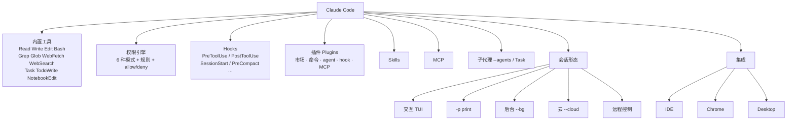

# 第 14 章 工具专章：Claude Code

> 本章你将学会：
> - 用 hooks + 权限规则把「团队规范」变成确定性行为
> - 用 checkpoint 与后台会话重构你的工作节奏
> - 判断哪些能力只有 Claude Code 有，值不值得为它绑定生态

## 14.1 生态地图



一句话概括：**Claude Code 把「代理 + 权限 + 生命周期 + 云」做成了一体化产品**。好处是开箱即用，代价是配置面比较大。

## 14.2 权限：三件套

### 14.2.1 模式

| 模式 | 行为 | 建议场景 |
|---|---|---|
| `plan` | 只读、只规划 | 陌生仓库、审计、方案评审 |
| `manual` | 每个敏感动作都问 | 第一次用、生产仓库 |
| `acceptEdits` | 自动接受编辑，命令仍确认 | 日常开发 |
| `auto` | 策略自动判定 | 有明确规则时的半自动 |
| `dontAsk` | 不问，按规则执行 | 受控环境 |
| `bypassPermissions` | 全放行 | 一次性沙箱 |

### 14.2.2 规则

```bash
claude --allowedTools "Read" "Grep" "Edit" "Bash(npm test:*)" "Bash(git diff:*)"
claude --disallowedTools "Bash(git push:*)" "Read(./.env*)"
```

规则是**模式匹配**，不是沙箱。它挡住的是「代理主动想做的事」，挡不住「你让它做的事」和「它想出来的新花样」。所以关键拦截要靠 hooks。

### 14.2.3 Hooks（确定性）

```json
{
  "hooks": {
    "PreToolUse": [
      { "matcher": "Bash", "hooks": [{ "type": "command", "command": ".claude/hooks/guard.sh" }] },
      { "matcher": "Write|Edit", "hooks": [{ "type": "command", "command": ".claude/hooks/protect.sh" }] }
    ],
    "SessionStart": [
      { "hooks": [{ "type": "command", "command": ".claude/hooks/context.sh" }] }
    ]
  }
}
```

三条纪律（本书 9.4 详述）：快、fail closed、幂等。

一个把「团队规范」变成硬约束的例子：

```bash
#!/usr/bin/env bash
# .claude/hooks/protect.sh —— 禁止改锁定文件与 CI 配置
set -uo pipefail
f=$(jq -r '.tool_input.file_path // .tool_input.path // empty') || exit 2
case "$f" in
  *package-lock.json|*pnpm-lock.yaml|*.github/workflows/*) 
    echo "blocked: $f 需要人工修改" >&2; exit 2 ;;
esac
exit 0
```

## 14.3 Checkpoint：把「后悔药」做进流程

Claude Code 的 checkpoint 记录文件状态，`/rewind` 可以回到某个历史点，**连文件一起回滚**（`--rewind-files <message-id>`）。

它的正确用法不是「出错了再回滚」，而是**在流程里预设回滚点**：

| 时机 | 动作 |
|---|---|
| 让代理做大改之前 | 先 `/compact` 简化上下文，再开始（回滚点更清晰） |
| 代理第一次「跑偏」 | `Esc` 打断 → `/rewind` 回到上一个干净点 |
| 实验性方案 | 先提交一次 git，再让代理放开改 |
| 长会话后期 | 用 `/status` 确认当前会话与 checkpoint 状态 |

**与 git 的分工**：checkpoint 适合「会话内的快速试探」，git 适合「跨会话的正式记录」。两者都用，不要用 checkpoint 替代提交。

## 14.4 后台与云

### 14.4.1 后台会话

```bash
claude --bg "把 docs/ 里过时的 API 示例更新一遍"
claude agents                 # 列出（--json 可机器读）
claude attach <id>            # 接管交互
claude logs <id>              # 看日志
claude stop <id>              # 停止
claude rm <id>                # 移除
```

适合：长任务、批量任务、你不想占用终端的时候。后台会话仍然遵循权限与会话持久化设置。

### 14.4.2 云与远程

```bash
claude --cloud "在云上跑完整的构建与测试"
claude --cloud <session_id|url>        # 接管已有云会话
claude --environment <env_id> "…"      # 指定自托管环境
claude --from-pr 123                   # 恢复与某个 PR 关联的会话
claude --remote-control                # 开启远程控制
```

云端的价值在于**环境一致性**：不是你的笔记本，而是团队统一的镜像。CI 里复现不了的问题，去云上跑常常能定位。

## 14.5 结构化输出与 CI

```bash
# 单条结果（含 usage/cost 等字段）
claude -p --output-format json "评估这个改动的影响面" > result.json

# 流式（做进度条）
claude -p --output-format stream-json --include-partial-messages "重构 date 工具" > stream.jsonl

# 强制结构
claude -p \
  --json-schema '{"type":"object","properties":{"risk":{"enum":["low","medium","high"]},"files":{"type":"array","items":{"type":"string"}}},"required":["risk","files"]}' \
  "评估这次改动"
```

CI 推荐组合：

```bash
claude -p \
  --output-format json \
  --permission-mode acceptEdits \
  --allowedTools "Read" "Edit" "Bash(npm test:*)" \
  --max-budget-usd 2 \
  --permission-prompts none \
  "跑 npm test，修到通过"
```

- `--permission-prompts none`：没人能点确认时，需要确认的动作直接拒绝（安全默认）。
- `--max-budget-usd`：硬上限。
- `--fallback-model`：主模型过载时降级（注意行为差异）。

## 14.6 设置分层

```text
企业托管策略（managed）
  └── 用户 ~/.claude/settings.json
        └── 项目 .claude/settings.json
              └── 本地 .claude/settings.local.json（不进版本控制）
```

- `--setting-sources user,project,local` 控制加载哪些层。
- `--settings '<json>'` 或文件路径做一次性覆盖。
- 企业安全策略优先级最高，个人改不动。

配套的指令文件是 `CLAUDE.md`：用户级 `~/.claude/CLAUDE.md`，项目级仓库根，子目录可再放。`/memory` 直接编辑，`#` 开头快速追加一条记忆。

排错时有三个「隔离模式」：

| 模式 | 作用 |
|---|---|
| `--bare` | 跳过 hooks/LSP/插件同步/CLAUDE.md 自动发现，只看内置能力 |
| `--safe-mode` | 关闭所有自定义（插件、MCP、hooks、主题…），排查「是不是配置把工具搞坏了」 |
| `--restricted` | 移除执行类工具、限制文件访问范围，用于受限环境 |

## 14.7 子代理

定义方式两种：

```bash
# 1) 命令行 JSON
claude --agents '{"reviewer":{"description":"只读代码审查","prompt":"只报有证据的问题"}}'

# 2) 项目文件 .claude/agents/reviewer.md
```

```markdown
---
name: reviewer
description: 只读代码审查，输出 P0/P1/P2 问题
tools: Read, Grep, Glob
---
你只审查，不修改。每条问题必须给文件:行号与触发条件。
```

主代理通过 `Task` 工具调用子代理。要点：

- **子代理有独立上下文**：主代理只收到摘要，能显著延缓压缩。
- **限定 `tools`**：只读子代理就不要给 `Edit`。
- **子代理也会烧钱**：每个都要重发系统提示。

## 14.8 技巧与坑

- **`Shift+Tab` 是你的安全带**：切到 plan 看一眼方案，再切回 acceptEdits 执行。比一路放行省时间。
- **hooks 里的 `jq` 要判空**：`tool_input` 结构随工具不同，写 `.tool_input.command // .tool_input.file_path`。
- **`/rewind` 不能替代提交**：它只覆盖它记录过的文件。
- **后台会话要有人收尾**：`claude agents` 定期清理，别攒一堆僵尸会话。
- **`--bare` 是排查「配置坏了」的利器**：如果 bare 正常、默认不正常，问题在你的配置或插件。
- **项目级设置里不要放密钥**：会被提交。用环境变量或企业托管策略。
- **插件要审**：`--plugin-url` 拉下来的插件有代码执行能力。

## 14.9 练习

1. 用 `plan` 模式做一次完整的需求分析，再切 `acceptEdits` 执行，比较两种模式的产物差异。
2. 写一个 `PreToolUse` hook：禁止 `Write` 到 `src/generated/`，并用一条命令验证。
3. 起一个后台会话改写文档，同时在前台做别的事，最后合并。
4. 用 `--json-schema` 让代理输出结构化审查结果，接进一个 20 行的汇总脚本。
5. 用 `--safe-mode` 复现一次「插件导致的异常」，定位到具体插件。

---

下一章：Codex —— 沙箱与多代理是它的骨架。
