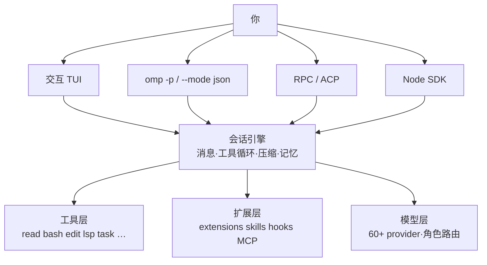

# 第 14 章 omp 实战手册

> 基准版本：omp `18.12.6`（本机 `omp --version`；上游 [`can1357/oh-my-pi`](https://github.com/can1357/oh-my-pi)，2026-10 核对）。omp 发版很密，⚠️ 具体参数以 `omp --help`、`omp <command> --help`、`omp config list` 为准。
>
> 本章你将学会：
> - 判断 omp 与 Pi 的取舍，知道它多做了什么、代价是什么
> - 从安装、登录到跑通第一次会话
> - 按类别使用 CLI 子命令与启动参数
> - 用 TUI、斜杠命令、会话树与压缩管理长任务
> - 配置模型角色、工具面、子 agent、扩展与自动化接口

## 14.1 omp 是什么

omp 是 [Pi](https://github.com/badlogic/pi-mono) 的 fork，由 Stencil Labs 维护。它不是「另一个从零写的 agent」，而是把 Pi 的内核做成**开箱即用的 coding 产品**：保留终端优先的交互，同时内置 LSP、DAP、subagent、记忆、权限层和大量 provider。

| 项 | 值 |
|---|---|
| 出身 | Pi（badlogic/pi-mono）的 fork，作者 Can Bölük / Stencil Labs |
| 许可 | MIT |
| 实现 | TypeScript + Bun；搜索、shell、AST、PTY、桌面控制等为 Rust N-API 原生模块 |
| npm 包 | `@oh-my-pi/pi-coding-agent` |
| 官网 | [omp.sh](https://omp.sh) |
| 规模（上游 README） | 60+ provider、31 个内置工具（随版本增长）、14 个 LSP 操作、28 个 DAP 操作、约 8 万行 Rust |
| 配置根 | `~/.omp/agent`（项目级 `.omp/`） |

和 Pi 的核心差异：

| 维度 | Pi | omp |
|---|---|---|
| 产品定位 | 可编程内核，默认体验朴素 | 开箱即用，默认就把常见能力装好 |
| 配置目录 | `.pi/` | `.omp/`（**不读取** `.pi/`） |
| 权限层 | 自己用扩展/工具过滤搭 | 内置 `read`/`write`/`exec` 分级与四种审批模式 |
| 代码智能 | 扩展或外部命令 | 内置 LSP（诊断、定义、引用、重命名、code action）与 DAP 调试器 |
| 编辑 | replace / patch 等 | 默认 hashline（内容哈希锚点）+ `ast_edit` 结构化改写 |
| 并行 | 自己起 session / worktree | `task` 批量 subagent、隔离工作区、Agent Hub |
| 记忆 | 无内建 | 4 种 backend + `off`：`local` / `hindsight` / `mnemopi` / `sharpshooter` |
| 会话 | 树形会话 | 树形会话 + `--restore` + 跨机 `omp session pack` |
| 入口 | TUI / print / JSON / RPC / SDK | 以上全部 + ACP + 实时协作 `/collab` |



图 14-1 omp 的入口与分层。读图要点：四个入口共用同一套会话引擎；扩展改的是工具与提示词，不另起协议。

**选型建议**：想要「装上就能在真实仓库里改代码、跑测试、调 LSP/DAP」，omp 的默认值更省事；想要最小内核、自己掌控每一层，Pi 更合适。omp 的代价是体积更大、版本变化更快、默认权限更松（见 14.13）。

## 14.2 安装与升级

macOS / Linux：

```bash
curl -fsSL https://omp.sh/install | sh
```

固定版本（脚本会校验预编译二进制的 SHA-256）：

```bash
curl -fsSL https://omp.sh/install | sh -s -- --binary --ref v18.12.6
```

Homebrew、Bun、Nix、Windows、mise：

```bash
brew install can1357/tap/omp
bun install -g @oh-my-pi/pi-coding-agent
nix run github:can1357/oh-my-pi
nix profile add github:can1357/oh-my-pi
mise use -g github:can1357/oh-my-pi
```

```powershell
irm https://omp.sh/install.ps1 | iex
```

系统要求：macOS / Linux / Windows。用 Bun 安装或从源码运行时要求 Bun ≥ 1.3.14；安装脚本的预编译二进制不依赖本机 Bun。Alpine 等 musl 环境先装 `libstdc++` 与 `libgcc`：

```bash
apk add libstdc++ libgcc
```

验证与补全：

```bash
omp --version
omp setup --check

eval "$(omp completions zsh)"
eval "$(omp completions bash)"
omp completions fish > ~/.config/fish/completions/omp.fish
```

omp 的补全脚本由命令元数据实时生成，子命令、flag、枚举值以及模型名都能补全。

升级与通道：

```bash
omp update
omp update --check
omp update --canary
omp update --stable
omp update --plugins
```

⚠️ 版本敏感：omp 的小版本可能改默认值或命令名；升级后先跑 `omp --help` 与 `omp config list` 对照。

## 14.3 第一次运行

最短路径：

```bash
omp setup
omp login
omp models
omp "用三句话解释这个仓库"
```

`omp setup` 做首次引导：选择 provider、登录、选默认模型，并可选安装 Python、语音、本地小模型等依赖。也可以分步做：

```bash
omp login anthropic
omp login openai-codex
omp models find deepseek
omp models refresh
```

`omp models refresh` 会重建模型目录缓存；`omp models --json` 适合脚本。

### 14.3.1 交互、一次性与附件

```bash
omp                         # 进入 TUI
omp "修复 npm test 的失败"    # 带初始消息进入 TUI
omp -p "总结最近一次提交"      # 跑完即退，只把最后一条回复写到 stdout
omp @prompt.md @image.png "这张图和需求有关吗"
echo "审查这个 diff" | omp -p
```

`@<path>` 会把文件或图片附加到初始消息。非 TTY stdin 会自动读入，不需要 `-`。`--` 之后的全部内容都按字面消息处理。

### 14.3.2 配置放在哪

| 路径 | 内容 |
|---|---|
| `~/.omp/agent/config.yml` | 全局设置（YAML，主写入目标） |
| `<cwd>/.omp/config.yml` | 项目设置；只认当前工作目录，不向上查找 |
| `~/.omp/agent/models.yml` | 自定义 provider / 模型 |
| `~/.omp/agent/keybindings.yml` | 键位覆盖 |
| `~/.omp/agent/mcp.json` | MCP server |
| `~/.omp/agent/skills/<name>/SKILL.md` | 技能 |
| `~/.omp/agent/commands/*.md` | 文件式斜杠命令 |
| `~/.omp/agent/prompts/*.md` | 提示模板 |
| `~/.omp/agent/hooks/pre/*.ts`、`post/*.ts` | hooks |
| `~/.omp/agent/extensions/` | 扩展 |
| `~/.omp/agent/agents/` | 自定义 task agent |
| `~/.omp/agent/sessions/` | 会话文件 |
| `~/.omp/agent/AGENTS.md`、`RULES.md` | 用户级上下文 / 常驻规则 |

项目级把 `~/.omp/agent` 换成 `<cwd>/.omp` 即可。omp 还会读取 `.claude/`、`.codex/`、`.gemini/`、`.cursor/`、`.windsurf/`、`.cline/`、`.github/copilot/`、`.vscode/` 等既有配置，见 14.11。

设置优先级从低到高：

```text
内置默认 ← 全局 config.yml ← 项目 config.yml ← --config 覆盖层 ← 运行时 flag ← 设置环境变量
```

常用命令：

```bash
omp config list
omp config list --json
omp config get tools.approvalMode
omp config set tools.approvalMode write
omp config reset tools.approvalMode
omp config path
```

### 14.3.3 Profile：把工作和个人分开

```bash
omp --profile work
omp --profile work --alias omp-work
OMP_PROFILE=work omp
omp --profile work config path
```

Profile 会隔离 auth、会话、设置和缓存，路径默认是 `~/.omp/profiles/<name>/agent`。`OMP_PROFILE` 优先于 `PI_PROFILE`；显式 `--profile` 又优先于两者。键位是例外：默认 profile 的 `keybindings.yml` 会先加载，再由当前 profile 逐项覆盖。

### 14.3.4 项目输入与信任边界

打开仓库时，omp **按设计**加载项目里的 settings、extensions、hooks、tools、commands、skills、rules 与 MCP 配置。这些输入属于项目的一部分，不要默认把仓库里的代码当成已审过的安全代码；不可信仓库要主动收窄输入：

```bash
omp --no-extensions
omp --trusted-extension /absolute/path/to/only-this.ts
omp --no-tools
omp --config no-project-mcp.yml
```

`no-project-mcp.yml` 的写法：

```yaml
mcp:
  enableProjectConfig: false
```

注意：

- `--trusted-extension` 只能与「精确的已存在绝对路径」一起用，不能和 `--extension` / `-e` / `--hook` 组合。
- `--no-extensions` 只关闭环境发现，显式 `-e` 仍会加载。
- `--no-tools` 关闭内置工具，但项目工具模块是独立发现面，不等于「项目里没有任何可执行代码」。

## 14.4 CLI 地图

调用形状：

```text
omp [command] [flags] [messages...]
```

第一个位置参数不是注册子命令时，omp 会把它当成 prompt 走默认的 `launch`。所以 `omp "fix the build"` 进入会话，而 `omp models` 执行子命令。`marketplace`、`uninstall`、`extensions` 这类裸词会提示你改用 `omp plugin …`；真要把它当 prompt，用 `omp launch <word>`。

### 14.4.1 启动参数（launch flags）

会话和工作区：

| Flag | 作用 |
|---|---|
| `--cwd <dir>` | 指定启动目录 |
| `--add-dir <dir>` | 追加工作区目录（可重复） |
| `--allow-home` | 允许直接在 `~` 启动，而不是自动切到临时目录 |
| `--profile <name>` | 使用隔离 profile |
| `--alias <name>` | 为 profile 创建 shell 快捷命令后退出 |
| `--config <file>` | 叠加一份 `config.yml` 风格的覆盖层（可重复） |
| `--session-dir <dir>` | 指定会话存储/查找目录 |
| `--no-session` | 不保存会话（临时） |

会话历史：

| Flag | 作用 |
|---|---|
| `-c`, `--continue` | 继续上一个会话 |
| `-r`, `--resume [id]` | 按 ID 前缀/路径恢复；不带值时打开选择器 |
| `--restore [id]` | 恢复会话并续跑上次进程中断的回合与 subagent（仅交互） |
| `--fork <session>` | 从已保存会话分叉出新会话 |
| `--from-claude` | 导入 Claude Code 会话 |
| `--from-codex` | 导入 Codex 会话 |
| `--export <session>` | 导出会话为 HTML 后退出 |
| `--no-title` | 关闭标题自动生成 |

模型与思考：

| Flag | 作用 |
|---|---|
| `--model <id-or-role>` | 指定模型或角色（`slow`、`@slow`、`opus`、`openai/gpt-5.2`） |
| `--smol <id>` | 轻量任务模型（等价 `PI_SMOL_MODEL`） |
| `--slow <id>` | 深推理模型（等价 `PI_SLOW_MODEL`） |
| `--plan <id>` | 计划模型（等价 `PI_PLAN_MODEL`） |
| `--models <a,b,c>` | 限定 `Ctrl+P` 循环的模型集合 |
| `--thinking <level>` | `off` / `minimal` / `low` / `medium` / `high` / `xhigh` / `max` / `auto` |
| `--service-tier <tier>` | OpenAI 服务等级：`none` / `auto` / `default` / `flex` / `scale` / `priority` / `ultrafast` |
| `--hide-thinking` | 只隐藏思考块，不关闭模型思考 |
| `--print-thoughts` | print 模式输出思考块 |
| `--external-thinking` | 用私有 scratchpad 替代部分 provider 推理（有被判定滥用的风险） |

模式、工具与审批：

| Flag | 作用 |
|---|---|
| `--tools <a,b,c>` | 只启用列出的工具 |
| `--no-tools` | 关闭全部内置工具 |
| `--no-lsp` | 关闭 LSP 工具、格式化与诊断 |
| `--no-pty` | 关闭 PTY 交互式 bash |
| `--approval-mode <mode>` | `always-ask` / `always-ask-cached` / `write` / `yolo` |
| `--auto-approve`, `--yolo` | 强制 yolo；显式 deny/prompt 策略仍生效 |
| `--advisor` | 启用每回合旁路审查的 advisor |
| `--max-time <duration>` | 到点停止，如 `600`、`10m`、`1h` |
| `--prewalk` / `--prewalk-into <id>` | 在第一次写文件前从当前模型切到便宜模型 |
| `--plan-yolo` / `--plan-yolo-into <id>` | 只读计划 → 自动批准计划 → 切模型执行 |
| `--goal <objective>` | 直接以 goal 模式启动（仅交互） |

扩展、技能与提示词：

| Flag | 作用 |
|---|---|
| `-e`, `--extension <path>` | 加载扩展（可重复） |
| `--hook <path>` | 加载 hook（当前等同 extension 路径） |
| `--trusted-extension <abs-path>` | 精确 allowlist，关闭环境 extension 发现 |
| `--plugin-dir <dir>` | 追加本地插件目录 |
| `--no-extensions` | 关闭扩展发现 |
| `--skills <globs>` | 按 glob 过滤技能，如 `git-*,docker` |
| `--no-skills` | 关闭技能 |
| `--no-rules` | 关闭 rules 发现 |
| `--system-prompt <text\|file>` | 覆盖系统提示 |
| `--system-prompt-template <path>` | 用 Handlebars 模板覆盖系统提示 |
| `--append-system-prompt <text\|file>` | 追加系统提示 |

输出：

| Flag | 作用 |
|---|---|
| `--mode <mode>` | `text`（默认）/ `json` / `rpc` / `rpc-ui` / `acp` |
| `-p`, `--print` | 非交互执行后退出 |
| `--no-ui` | 在 RPC/RPC-UI 下让扩展无 UI |
| `-h`, `--help` / `-v`, `--version` | 帮助 / 版本 |

### 14.4.2 子命令

`omp --help` 列出全部子命令；这里是按用途分组的高频项。

| 类别 | 命令 | 用途 |
|---|---|---|
| 会话 | `launch` | 默认命令：启动会话 |
| 会话 | `acp` | 以 ACP server 运行（stdio） |
| 会话 | `session pack/unpack/moved` | 打包/解包会话，或标记已迁走 |
| 会话 | `share` | 把已保存会话分享为加密链接 |
| 会话 | `join` | 加入协作会话 |
| 会话 | `collab` | 列出本地 Collab 宿主；`collab link` 取控制链接 |
| 工作区 | `worktree`, `wt` | 增加/列出/清理 git worktree |
| 工作区 | `git` | 全屏 git UI：diff、暂存、提交 |
| 工作区 | `commit` | 生成提交消息并更新 changelog |
| 代码 | `read` | 预览 read 工具会返回什么 |
| 代码 | `grep` | 测试 grep 工具 |
| 代码 | `find` | 语义搜索：描述行为，找实现文件与行号 |
| 代码 | `cleanse` | 加权并行 subagent 修项目诊断 |
| 代码 | `compress` | 把文本改写成高密度 prompt 语体 |
| 模型 | `login` / `auth` | 登录 / 导入导出凭据 |
| 模型 | `models` | 列出、搜索、刷新模型目录 |
| 模型 | `usage` | 查看各账号额度与重置 |
| 模型 | `bench` | 测 TTFT、prefill、decode、并行扩展 |
| 模型 | `token` | 取 provider 的 API key 或 OAuth token |
| 模型 | `toks` | 用内置离线 tokenizer 计数 |
| 模型 | `tiny-models` | 下载标题/记忆/补全用的本地小模型 |
| 配置 | `setup` | 引导或安装可选依赖 |
| 配置 | `config` | 读写设置 |
| 配置 | `agents` | 导出内置 task agent |
| 配置 | `ssh` | 管理 SSH host |
| 扩展 | `plugin` | 安装/卸载/启用/禁用插件 |
| 扩展 | `skill` | 在 skills.omp.sh 上搜索/安装/发布技能 |
| 扩展 | `install` | `plugin install` / `link` 的别名 |
| 扩展 | `browser-relay` | 让浏览器工具接管本机 Chrome tab |
| 观察 | `stats` | 本地用量看板 |
| 观察 | `ps` | 列出/控制后台进程 |
| 观察 | `render` / `gallery` | 重放 transcript / 预览 TUI 渲染器 |
| 观察 | `play` / `clip` / `stream` | 回放录制 / 上传片段 / 直播会话 |
| 观察 | `ttsr` | 检查与测试 TTSR 规则 |
| 观察 | `grievances` | 查看/清理自动 QA 上报 |
| 维护 | `update` / `gc` / `images` | 升级 / 存储回收 / 图片后端维护 |
| 测试 | `bench` / `if-bench` / `predict` / `dry-balance` | 基准与实验命令 |

`omp <command> --help` 才是该命令的权威参数表。`__complete` 是补全脚本用的隐藏命令，不需要手动调用。

## 14.5 交互式 TUI

```text
┌────────────────────────────────────────────────────┐
│ π  omp 18.12.6   model   ctx 42%   $0.38           │
├────────────────────────────────────────────────────┤
│ 你  重构 session 存储，保持向后兼容                │
│ ✓ read src/session.ts                       1.2s   │
│ ✓ edit src/session.ts  (+12 −3)                    │
│ ⚠ Approve bash: npm test                           │
│   [Approve] [Approve for session] [Deny]           │
├────────────────────────────────────────────────────┤
│ > …                                                │
│   Enter 发送 · Ctrl+Q 排队 · Alt+A Agent Hub       │
└────────────────────────────────────────────────────┘
```

图 14-2 TUI 的五个区域：状态行、对话与工具卡、审批 dock、输入框、键位提示。读图要点：**审批发生在工具执行前**，不是执行后追认。

常用键位（`/hotkeys` 查看当前生效值）：

| 键 | 作用 |
|---|---|
| `Ctrl+P` / `Shift+Ctrl+P` | 在当前角色的模型间前后循环 |
| `Alt+P` | 临时为本会话选模型 |
| `Alt+M` | 模型选择器并设置角色 |
| `Shift+Tab` | 循环思考等级 |
| `Ctrl+T` | 显示/隐藏思考块 |
| `Ctrl+O` | 展开/收起工具输出 |
| `Ctrl+Shift+O` | 显示/隐藏工具活动 |
| `Ctrl+R` | 搜索历史 prompt |
| `Ctrl+G` | 用 `$EDITOR` 编辑草稿 |
| `Ctrl+Q` / `Ctrl+Enter` | 排队 follow-up（运行中不打断） |
| `Alt+Up` / `Shift+Up` | 把排队消息取回编辑框 |
| `F5` / `Alt+R` | 重试上一条失败回复 |
| `Alt+A` | 打开 Agent Hub |
| `Ctrl+L` | 开始/停止实时语音 |
| `Ctrl+Enter` / `Ctrl+Q`（审批 dock） | 直接批准 |
| `Esc`（审批 dock） | 拒绝 |
| `Esc` 两次（空输入框） | 默认打开 rewind（可配置为 tree） |
| `Ctrl+C` | 清空草稿；空草稿连按两次退出 |

自定义键位写在 `~/.omp/agent/keybindings.yml`：

```yaml
app.model.cycleForward: Ctrl+P
app.agents.hub: Alt+A
app.history.search: []
```

空数组表示禁用该动作。键位文件不是 `config.yml` 的子对象。

其他交互能力：

- **审批**：四种模式与三档工具分级，见 14.13；`/forget-approvals` 清空「记住的批准」。
- **结构化提问**：agent 可调用 `ask` 工具弹出选项，而不是在正文里猜。
- **消息队列**：运行中发送的消息默认排队，可 steer/follow-up，不丢草稿。
- **粘贴与图片**：支持图片粘贴、文件路径附件、`@` 引用；Windows Terminal 若吞掉 `Ctrl+V`，用 `Alt+V`。
- **Vim 模式**：`tui.vimMode: true` 或 `/settings` 打开，支持 motion、text object、Visual。
- **语音**：`/live` 进入实时语音；`stt.enabled` 后可按住说话。
- **录制**：`/record` 录屏，`omp play` 回放，`omp clip` 上传。
- **Agent Hub**：`Alt+A` 看每个 subagent 的状态、模型、成本、上下文和当前工具；可读 transcript、发消息、复活或 kill。

## 14.6 斜杠命令

内置命令按 `/` 自动补全；输入 `/help` 或看 `/hotkeys`。`/skill:<name>` 是技能入口，不属于内置命令。

### 14.6.1 高频命令

| 命令 | 作用 |
|---|---|
| `/new` | 新建会话 |
| `/clear` | 清空当前上下文，保留会话 |
| `/compact [说明]` | 手动压缩上下文 |
| `/resume [id\|@claude\|@codex]` | 恢复或导入会话 |
| `/fork [pane\|window\|tab]` | 分叉会话；带 pane/window/tab 时在新终端打开 |
| `/tree` | 浏览会话树并切换分支 |
| `/rename [title]` | 重命名会话；省略标题则自动生成 |
| `/export [--themes] [path]` | 导出 HTML |
| `/share` | 生成端到端加密的分享链接 |
| `/model` / `/models` | 切换模型与角色 |
| `/switch` | 临时切换模型（同 `Alt+P`） |
| `/effort` | 调整/循环思考等级 |
| `/plan [prompt]` | 进入只读计划模式 |
| `/goal [objective]` | 进入持续目标模式 |
| `/vibe [prompt]` | 进入导演 + worker 的 vibe 模式 |
| `/advisor [on\|off\|status]` | 每回合旁路审查 |
| `/prewalk` | 计划后切换到便宜模型执行 |
| `/loop` | 让下一条 prompt 反复重提，可加次数/时长/条件 |
| `/todo` | 查看/修改 todo |
| `/context` | 查看上下文占用明细 |
| `/tools` | 查看当前对模型可见的工具 |
| `/memory` | 记忆查看、同步、清理 |
| `/mcp` | 管理 MCP server |
| `/skills` | 搜索/安装/更新技能 |
| `/plugins` | 管理已安装插件 |
| `/agents` | 管理 task agent 定义与模型 |
| `/hub` | 打开实时 Agent Hub |
| `/settings` | 设置面板 |
| `/hotkeys` | 键位表 |
| `/help` | 帮助 |
| `/quit` / `/exit` | 退出 |

### 14.6.2 会话与上下文

| 命令 | 作用 |
|---|---|
| `/fresh` | 重置 provider 流状态，不改本地 transcript |
| `/shake [elide\|images\|thinking]` | 机械丢掉重内容，不生成摘要 |
| `/handoff` | 摘要成交接文档并原地压缩 |
| `/delete` | 删除当前会话并新开 |
| `/move` | 把会话移到另一个目录 |
| `/wt` / `/worktree` | 把当前会话（含改动）移进新 worktree |
| `/add-dir` / `/remove-dir` / `/dirs` | 管理多根工作区 |
| `/session [info\|delete\|pin]` | 会话信息与账号 pin |
| `/jobs [full\|kill <id>]` | 后台任务状态 |
| `/restart` | 用相同参数重启并恢复会话 |
| `/branch` / `/rewind` | 回到历史节点 |
| `/dump [all]` | 把 transcript 复制到剪贴板；`all` 打 zip |
| `/trace` | 在 stats 面板打开本会话 trace |
| `/copy` / `/open` | 从对话里选文本复制 / 打开最后链接 |

### 14.6.3 模型、模式与质量

| 命令 | 作用 |
|---|---|
| `/modelpreset [save\|list\|delete]` | 保存/切换整套角色与思考等级 |
| `/fast` / `/slow` | 切换服务等级：priority / flex 或低优先级 |
| `/extended-context` | 开关更大的上下文窗口 |
| `/goal budget <N\|off>` | 调整当前 goal 的 token 预算 |
| `/skillful [on\|off]` | 本次会话是否把技能清单放进系统提示 |
| `/cleanse [request]` | 加权并行 subagent 修项目诊断 |
| `/security` | 规划/运行/导入/比较安全扫描 |
| `/ratchet` | 为 LLM 流程构建 eval 并持续爬山优化 |
| `/computer [on\|off]` | 开关原生桌面控制 |
| `/browser [headless\|visible]` | 切换浏览器模式 |
| `/force:<tool> [prompt]` | 强制下一回合使用指定工具 |
| `/queue <message>` | 等 agent 结束后再发一条 |
| `/btw [question]` | 旁路问题，不污染主任务 |
| `/tan <work>` | 起一个后台 agent 处理旁支工作 |
| `/omfg <complaint>` | 针对反复出现的行为生成一条 TTSR 规则 |
| `/live` / `/record` / `/pause` | 实时语音 / 录屏 / 冻结所有 agent |
| `/seance [id]` | 把历史会话 fork 成只读顾问 subagent |

### 14.6.4 协作与分发

| 命令 | 作用 |
|---|---|
| `/collab [view\|list\|status\|stop]` | 把会话放到 relay，生成链接和二维码 |
| `/join <link>` | 加入协作会话 |
| `/leave` | 离开协作会话 |
| `/marketplace` / `/plugins` / `/reload-plugins` | 插件市场、启停、热重载 |
| `/changelog [last N\|full]` | 查看更新日志 |
| `/debug` | 调试工具选择器 |
| `/extensions` | 扩展状态 |
| `/usage` / `/stats` | 额度与用量 |
| `/git` | 内置 git UI |
| `/pause` / `/forget-approvals` | 冻结 agent / 清除已记住的批准 |

### 14.6.5 文件式命令与技能命令

在 `.omp/commands/` 或 `~/.omp/agent/commands/` 放 Markdown，就能定义 `/命令名`：

```md
<!-- .omp/commands/review.md -->
审查当前 diff，重点检查：$ARGUMENTS

按 P0/P1/P2 输出；没有发现问题就输出 LGTM。
```

```bash
/review 并发安全
```

支持 `$1`、`$2`、`$@`、`$@[start]`、`$@[start:length]`、`$ARGUMENTS`；参数按引号感知切分。模板未使用参数占位符时，剩余参数会追加到结尾。

技能则以 `/skill:<name>` 调用，例如：

```text
/skill:code-review 审查 src/session.ts 的并发问题
```

## 14.7 会话、分支与压缩

### 14.7.1 保存、恢复、分叉

```bash
omp -c                          # 继续上一个
omp -r                          # 打开选择器
omp -r 01a0285c                 # ID 前缀
omp --restore ~/.omp/agent/sessions/.../session.jsonl
omp --fork 01a0285c
omp --from-claude
omp --from-codex
omp --export session.jsonl out.html
```

- `--restore` 只用于交互模式：它恢复会话，并续跑上次被中断的回合与 subagent。
- `--continue` / `--resume` / `--restore` / `--fork` / 外部导入都需要持久化，不能与 `--no-session` 同用。
- `--from-claude` 与 `--from-codex` 互斥，也不能与 `-c` / `-r` / `--fork` 组合。
- `/resume @claude`、`/resume @codex` 在 TUI 内导入。

会话可以跨机器搬：

```bash
omp session pack ~/.omp/agent/sessions/<project>/<file>.jsonl /tmp/session.tar
omp session unpack /tmp/session.tar --cwd ~/src/project
omp session moved <file>.jsonl --to laptop
```

分享前需要脱敏时，用 `omp anonymize` 生成一份可公开的副本：

```bash
omp anonymize 01a0285c -o ./bug-report
```

它会保留结构、把 turn 内容脱敏、把路径与字面量替换成一致的 mock token；不是简单删几行。

### 14.7.2 会话树与分支

```text
/tree
├─ 你：重构 session 存储
│  ├─ • agent：方案 A（当前分支）
│  └─ agent：方案 B
```

图 14-3 会话树。读图要点：`•` 标出当前路径；切换分支不会删除另一条分支，只在原分支上留一条 branch summary。

- `Enter` 跳到节点继续；`Shift+Enter` 先摘要再切换；`Shift+L` 打标签。
- `Ctrl+O` / `Shift+Ctrl+O` 循环过滤：默认、无工具、仅用户、仅有标签、全部。
- `/fork` 从当前节点开新会话；`/fork pane` 在 tmux/Zellij 等新 pane 打开。
- 分支被放弃时，omp 会写 branch summary，而不是把旧上下文直接丢掉。

### 14.7.3 压缩与瘦身

| 操作 | 命令/触发 | 结果 |
|---|---|---|
| 自动压缩 | 上下文过阈值、溢出、输出截断、空闲 | 生成摘要条目，保留最近一段原文 |
| 手动压缩 | `/compact [说明]` | 可指定摘要重点 |
| 机械瘦身 | `/shake` | 删工具结果/大块/图片/思考，不调模型 |
| 交接 | `/handoff` | 摘要成交接文档并原地压缩 |
| 重置流 | `/fresh` | provider 流坏了/缓存陈旧时用，不动本地记录 |
| 清空上下文 | `/clear` | 保留会话身份与历史 |
| 新会话 | `/new` | 换一个会话文件 |
| 删除 | `/delete` | 删除当前会话并新开 |

omp 的压缩默认按 `compaction.methodOrder` 依次尝试：`remote`（provider 原生压缩）→ `snapcompact`（把历史渲染成位图归档）→ `handoff` → `shake` → `soft`。`snapcompact` 需要当前模型支持图片输入；它不调模型、不联网，适合溢出恢复。

关键设置：

```yaml
compaction:
  enabled: true
  thresholdPercent: 80
  keepRecentTokens: 20000
  autoContinue: true
```

`compaction.thresholdTokens` 是固定 token 触发；`compaction.modelThresholds` 可按模型覆盖。`compaction.reserveTokens` 是绝对保留量，未设置时取 `max(16384, 15% 窗口)`。

### 14.7.4 导出、分享与协作

```text
/export [--themes] [path]    # 本地 HTML，未脱敏
/dump [all]                  # 当前上下文到剪贴板；all 打包 subagent
/share                       # 端到端加密链接
/collab [view]               # 实时协作；view 是只读链接
```

`/share` 默认先做密钥脱敏，再用 AES-256-GCM 加密；密钥只放在链接的 `#fragment`，不会发给服务器。它支持 share server 或 secret gist，超过 1 MB 会先裁图片、再裁长字符串、最后裁旧条目。

`/export` 是**明文** HTML，会包含原始上下文、图片和扩展载荷；分享前先看一遍。

`/collab` 把当前会话挂到 relay，返回 `omp join <...>` 命令、浏览器链接和二维码；帧在客户端加密，relay 看不到密钥。

## 14.8 模型、角色与成本

### 14.8.1 角色路由

omp 把模型按用途分成角色，而不是只有一个「当前模型」：

| 角色 | 用途 |
|---|---|
| `default` | 普通回合 |
| `smol` | 便宜/快速：子 agent 扇出、轻量任务 |
| `slow` | 深推理、难问题 |
| `plan` | 计划模式 |
| `commit` | 提交消息与 changelog |
| `vision` | 图片理解 |
| `task` | 子 agent 默认模型 |
| `advisor` | 每回合旁路审查 |
| `tiny` | 会话标题、小分类 |
| `memory` | 记忆抽取/整合 |
| `judge` | 判定 API（TypeSafe Jev、OpenRouter Decisions 等） |
| `image` / `web` / `speech` / `dictation` | 生图 / 搜索 / TTS / STT |

配置写在 `config.yml` 的 `modelRoles`，不要写进 `models.yml`：

```yaml
modelRoles:
  default: anthropic/claude-sonnet-4-5
  smol: openai/gpt-4.1-mini
  slow: anthropic/claude-opus-4-5:high
  plan: anthropic/claude-opus-4-5
  advisor: anthropic/claude-sonnet-4-5:medium

retry:
  fallbackChains:
    default:
      - openai/gpt-5.2
      - openrouter/anthropic/claude-sonnet-4-5
```

角色值可以带思考后缀（`:low`、`:high`、`:max`、`:inherit`）或引用另一个角色（`@smol`）。`retry.fallbackChains` 支持按角色、精确模型或 provider 通配配置；显式 `[]` 表示不降级。

### 14.8.2 自定义 provider

`~/.omp/agent/models.yml`：

```yaml
providers:
  spark:
    baseUrl: http://192.168.10.223:8000/v1
    api: openai-completions
    apiKey: dummy
    models:
      - id: minimax-m3
        name: MiniMax M3
        contextWindow: 100000
        maxTokens: 32000
```

```bash
omp models spark
omp setup
```

也可以在 `config.yml` 里直接指定默认：

```yaml
modelRoles:
  default: spark/minimax-m3
```

支持的 API 形状包括 `openai-completions`、`openai-responses`、`openai-codex-responses`、`azure-openai-responses`、`anthropic-messages`、`bedrock-converse-stream`、`google-generative-ai`、`google-gemini-cli`、`google-vertex` 等。

### 14.8.3 凭据与路由技巧

API key 解析顺序（从高到低）：

```text
--api-key → models.yml apiKey → 存储的 OAuth → 登录得到的 API key
→ 扩展 fallback → 环境变量 → 其他已存 key
```

四个实用开关：

| 能力 | 配置 | 用途 |
|---|---|---|
| 降级链 | `retry.fallbackChains` | 429 / 额度墙时自动换下一个 |
| 路径级模型 | `enabledModels` / `disabledProviders` 的 `path:` 形式 | 某个仓库单独用一套模型 |
| 多 key 轮转 | 同一 provider 叠多个凭据 | 按会话亲和与 per-key backoff 轮转 |
| 角色预设 | `/modelpreset save cheap` | 一键换整套角色与思考等级 |

路径级示例：

```yaml
enabledModels:
  - claude-sonnet-4-5
  - path: ~/work/high-context
    models:
      - anthropic/claude-opus-4-5
```

### 14.8.4 成本控制

```text
/fast                  # priority 档，快但贵
/slow                  # flex / 低优先级，便宜但慢
/budget 200k           # 给本次会话设预算
/extended-context off  # 别为偶尔的长上下文一直付大窗口的钱
/effort low            # 降思考等级
```

外部观测：

```bash
omp usage
omp usage clients --days 7
omp usage reset
omp bench --detailed
omp toks src/session.ts
```

`omp usage` 汇总每个已认证账号的额度；`omp stats` 打开本地用量看板；`omp bench` 用 p50/p95 比较 TTFT、prefill、decode 与并行扩展。

## 14.9 工具面

上游 README 标称 31 个内置工具；实际可见集合随版本和设置变化。会话里用 `/tools` 看当前模型真正拿到的清单，用 `read xd://` 看隐藏的 `xd://` 设备。

| 类别 | 工具 | 说明 |
|---|---|---|
| 文件与搜索 | `read` | 文件、目录、归档、SQLite、PDF、notebook、URL、`ssh://`、内部 scheme |
| 文件与搜索 | `write` | 创建/覆盖文件、归档条目、SQLite 行 |
| 文件与搜索 | `edit` | 默认 hashline：按内容哈希锚点打补丁 |
| 文件与搜索 | `ast_edit` / `ast_grep` | ast-grep 结构化改写与查询（50+ 语法） |
| 文件与搜索 | `grep` / `glob` / `find` | 内容搜索 / 路径匹配 / 语义定位 |
| 运行时 | `bash` | 内嵌 shell；常用 coreutils 在进程内执行；可选 PTY、后台任务 |
| 运行时 | `eval` | 持久 Python 与 Bun 内核，可回调 agent 工具 |
| 代码智能 | `lsp` | 诊断、定义、引用、符号、重命名、code action、raw request |
| 代码智能 | `debug` | DAP：断点、单步、线程、栈、变量 |
| 代码智能 | `security_scan` | 安全扫描（设置开启） |
| 协作 | `task` | 批量 subagent，可隔离工作区 |
| 协作 | `wait` | 等后台结果、peer 消息或 steering |
| 协作 | `todo` / `ask` | todo 列表 / 结构化提问 |
| 桌面与网络 | `browser` | Puppeteer/CDP；可接管本机 Chrome |
| 桌面与网络 | `computer` | 窗口、截图、原生输入、AX 树、剪贴板 |
| 桌面与网络 | `web_search` | 23 个后端，返回答案与引用 |
| 桌面与网络 | `github` | repo、PR、issue、code search、Actions |
| 桌面与网络 | `generate_image` / `tts` | 生图 / 语音 |
| 记忆与技能 | `retain` / `recall` / `reflect` / `memory_edit` | 记忆写入、检索、综合、修改 |
| 记忆与技能 | `learn` / `manage_skill` | 固化经验 / 管理技能 |
| 记忆与技能 | `checkpoint` / `rewind` | 标记上下文 / 剪掉探索过程保留报告 |

默认关闭或按设置开启：`github`、`security_scan`、`generate_image`、`tts`、`checkpoint`、`rewind`，以及按 `memory.backend` 决定的记忆工具。

### 14.9.1 read 的多态

`read` 是 omp 最像「文件系统抽象层」的工具：

```text
read src/foo.ts                 # 代码摘要（大文件）或原文
read src/foo.ts:50-80           # 行范围
read src/foo.ts:50+30           # 从 50 起 30 行
read src/foo.ts:-40             # 最后 40 行
read src/foo.ts:5-16,960-973    # 多段
read src/foo.ts:raw             # 逐字，不带行号/摘要
read archive.zip:src/index.ts   # 压缩包成员
read data.db:users              # SQLite 表
read https://arxiv.org/pdf/...  # PDF 转结构化文本
read pr://1428                  # PR 当路径读
read issue://42                 # issue
read agent://Scout/findings/0   # 从 subagent 输出按 JSON path 取值
read skill://code-review/SKILL.md
read ssh://host/etc/nginx.conf
read conflict://1               # 解决冲突
```

一个重要的行为：大文件默认会**结构化摘要**（保留签名、导入、关键块），不是把整文件倒进上下文；需要逐字时加 `:raw`。

### 14.9.2 编辑：hashline 与 AST

默认 `edit` 不是「字符串替换」，而是带快照标签的行锚点补丁：

```text
[src/example.ts#1A2B]
PUT 4.=4:
+const value = 2;
```

模型必须复制最近一次 `read`/`grep` 返回的四位十六进制标签。文件变了、锚点对不上，补丁在落盘前被拒，避免「改到旧版本」。支持 `PUT`/`CUT`/`REM`/`MV`、块锚点、命名 register，适合大范围重构。

`ast_edit` 先返回 `(proposed)` 预览，模型写一行理由到 `xd://resolve`，TUI 变成 Accept 卡后才真正落盘，全有或全无。改结构（重命名、替换调用、codemod）优先用它，不要用正则硬改。

### 14.9.3 内部 URL 与 xd://

omp 把 PR、issue、subagent 输出、技能、远程文件都映射成路径。上游 README 说共有 16 种内置 scheme，常用的有：

| Scheme | 指向 |
|---|---|
| `pr://` / `issue://` | GitHub PR / issue |
| `agent://` | subagent 最终输出，`/key/index` 取值 |
| `history://` | subagent 的简要 transcript |
| `skill://` | 技能正文与相对文件 |
| `ssh://` | 远程主机路径 |
| `local://` | 会话共享的本地草稿 |
| `artifact://` | 溢出的大输出，可分页 |
| `proc://` | 后台任务/服务状态与控制 |
| `conflict://` | Git 合并冲突，写入 `@ours`/`@theirs`/`@base` |
| `memory://` | 记忆文档 |
| `xd://` | 按需发现的隐藏工具设备 |
| `mcp://` | MCP 资源 |

`xd://` 是「工具按需加载」：不常用工具不占系统提示。列出：

```text
read xd://
```

执行：

```text
write xd://<tool>  { ...JSON 参数... }
```

只有 `tools.xdev` 开启时可用。

### 14.9.4 LSP、DAP 与写路径

omp 内置 LSP，不是把 IDE 当外部服务：

- 14 个操作：诊断、hover、定义、类型定义、实现、引用、符号、workspace symbol、重命名、code action、格式化、raw request 等。
- 重命名走 `workspace/willRenameFiles`，会先更新 re-export、barrel 文件和别名导入，再移动文件。
- 写入后自动跑诊断/格式化（`--no-lsp` 可整体关闭）。

DAP 支持 lldb-dap、dlv、debugpy 等：agent 可以 attach、下断点、单步、读栈帧和变量，而不是靠 `print` 猜。

### 14.9.5 eval、浏览器与桌面

`eval` 有两个持久内核：

- Python：读文件、跑数据处理、画图，仍可调用 agent 工具；
- Bun：JavaScript/TypeScript，适合批处理与前端验证。

两个内核都能通过 loopback 回调 `read`、`grep`、`task` 等工具，不必把中间结果搬回对话。

`browser` 提供 `open`、导航、检查、交互、元素查询与 `tab.run(js)`；可以接 headless Chromium、CDP 应用，或通过 browser-relay 接管你已有的 Chrome tab。`computer` 则操作真实桌面：窗口枚举、截图、原生输入、AX 树、剪贴板。两者审批等级不同，默认关闭的 `computer` 需要显式开启。

### 14.9.6 web_search

`web_search` 是内建工具，不依赖某个搜索 MCP：

- `auto` 按 23 个后端的链依次尝试；
- 可显式指定 `perplexity`、`exa`、`tavily`、`brave`、`kagi`、`duckduckgo`、`searxng` 等；
- GitHub、npm/PyPI/crates.io、arXiv、Stack Overflow、MDN、docs.rs 等站点会转成结构化 Markdown；
- 返回答案 + 引用，`read` 可直接跟进 URL。

## 14.10 子 agent 与并行

### 14.10.1 task 的 wire 形状

`task` 默认批量模式，一次调用可以扇出多个独立 subagent：

```json
{
  "context": "仓库：examples/task-cli。测试：node --test。不要改 package.json。",
  "tasks": [
    {
      "name": "StorageAudit",
      "agent": "scout",
      "task": "审查 src/store.ts 的并发与错误处理，列出具体行号。",
      "solutionSpace": "原因开放：并发/错误路径都未确认"
    },
    {
      "name": "TestFix",
      "agent": "task",
      "task": "修复 node --test 的失败，只改实现，不改测试断言。",
      "solutionSpace": "一个修法：失败断言已给出",
      "isolated": true,
      "outputSchema": {
        "type": "object",
        "properties": { "changed": { "type": "array", "items": { "type": "string" } } },
        "required": ["changed"]
      }
    }
  ]
}
```

关键字段：

| 字段 | 说明 |
|---|---|
| `context` | 必填。所有子任务共享的背景，进入每个 subagent 的系统提示 |
| `task` | 必填。自包含的任务说明 |
| `solutionSpace` | 必填。问题开放程度；用于自动思考分级 |
| `agent` | `scout` / `reviewer` / `security-reviewer` / `task` / `sonic` 或自定义 |
| `isolated` | 在独立工作区跑，结束时回传 patch 或分支 |
| `outputSchema` | 结构化输出契约；父 agent 直接读对象 |
| `name` | 稳定的 agent id，也用于 `agent://` |

批量调用里每个 item 可以用不同 agent。`task` 的并发上限默认 32，递归深度默认 2。

### 14.10.2 后台、等待与通信

后台 spawn 返回 `agent://<id>` 与 job id；结果会自动送回父会话：

```text
read agent://Scout                 # 最终输出
read agent://Scout/findings/0/path # 按 JSON path 取字段
read history://Scout               # 简要 transcript
write agent://Scout "再看一下错误路径"  # 追问；parked 会复活
write agent://all "..."            # 广播给可见 peer
read proc://<jobId>                # 查看后台任务
write proc://<jobId>/kill          # 取消
```

`task.maxConcurrency` 默认 32；`task.agentIdleTtlMs` 默认 420000 ms（7 分钟），空闲后 park，消息或 Hub 可复活。每个 subagent 输出上限 500000 字节 / 5000 行（可用 `PI_TASK_MAX_OUTPUT_BYTES` / `PI_TASK_MAX_OUTPUT_LINES` 调整）。

### 14.10.3 隔离工作区

`task.isolation.enabled: true` 时，`isolated: true` 的任务在独立工作区执行：

| 设置 | 取值 |
|---|---|
| `task.isolation.backend` | `auto` / `apfs` / `btrfs` / `zfs` / `reflink` / `overlayfs` / `projfs` / `block-clone` / `rcopy` |
| `task.isolation.merge` | `patch`（捕获/应用根 patch）或 `branch`（提交到 `omp/task/<id>` 后 cherry-pick） |
| `task.isolation.apply` | `false` 时只保留捕获的改动，不自动合并 |

嵌套 git 仓库会分别 diff、分别合并。快照基线上限 1 GiB。

### 14.10.4 Agent Hub、vibe 与并发提示词

`Alt+A` 打开 Agent Hub：roster 显示 running/idle/parked/aborted、模型、成本、tokens、当前工具；`Enter` 聚焦某个 agent 的 transcript，可以直接发消息或改模型；`r` 复活，`x` kill。`/hub` 是同一入口。

vibe 模式把主会话变成导演，只保留 `read`、`todo` 和 5 个 worker 控制工具（`vibe_spawn` / `vibe_send` / `vibe_wait` / `vibe_kill` / `vibe_list`），worker 分 `fast`（sonic）与 `good`（task）两档：

```text
/vibe 修复 packages/tui 里不稳定的测试
```

三个提示词关键词会改变单回合行为（必须是小写独立单词）：

| 关键词 | 效果 |
|---|---|
| `ultrathink` | 多步推理，并把自动思考等级拉到当前模型最高 |
| `orchestrate` | 拆分独立工作，并行 subagent，逐阶段验证 |
| `workflowz` | 用 eval 内核的 `agent()` / `workpool()` 构建确定性多 agent 流程 |
| `jevify` | 用 eval 内核的 `judge()` 批量分类，先冻结标准再读数据 |

`prewalk` 是另一种路由：先用强模型读仓库、写 todo，在第一次 `edit`/`write` 后切到 `@smol` 继续实现。`/prewalk`、`--prewalk` 或 `prewalk.enabled` 都能开启；`prewalk.auto: suggest|on` 则让 judge 按任务决定是否值得切。

`advisor` 用第二个模型逐回合旁路审查，发现偏离验收标准或风险时插入一条 note；它有自己的上下文与模型，不会把审查过程塞进主 agent 的对话历史。

### 14.10.5 worktree

```bash
omp worktree
omp worktree add ../feature -b feature origin/main
omp worktree add --detach ../review HEAD~2
omp worktree clear --dry-run
omp worktree clear
```

`/wt` 把当前会话连同未提交改动移进新 worktree，适合「先隔离再继续」。

## 14.11 扩展体系

### 14.11.1 目录地图

```text
.omp/
├── AGENTS.md                 # 项目上下文
├── RULES.md                  # 常驻规则（每次请求都带）
├── config.yml                # 项目设置
├── mcp.json                  # MCP server
├── commands/*.md             # 文件式斜杠命令
├── prompts/*.md              # 提示模板
├── rules/*.md|*.mdc          # 路径/工具匹配规则
├── skills/<name>/SKILL.md    # 技能
├── hooks/pre/*.ts            # 工具调用前
├── hooks/post/*.ts           # 工具调用后
├── tools/*.ts                # 自定义工具
├── extensions/*.ts           # 扩展模块
├── agents/*.md               # task agent 定义
└── plugins/                  # 项目级插件安装状态
```

用户级把根换成 `~/.omp/agent/`。原生 `.omp` provider 的优先级最高（100），高于 `.claude`（80）、`.codex`（70）、`.gemini`（60）等。

### 14.11.2 扩展

扩展是一个默认导出工厂的 TS/JS 模块：

```ts
import type { ExtensionAPI } from "@oh-my-pi/pi-coding-agent";

export default function (pi: ExtensionAPI) {
  pi.setLabel("Team Policy");

  pi.on("tool_call", async (event) => {
    if (event.toolName === "bash" && String(event.input.command).includes("rm -rf")) {
      return { block: true, reason: "Blocked by team policy" };
    }
  });

  pi.registerCommand("handoff", {
    description: "生成本次改动的交接摘要",
    handler: async (_args, ctx) => {
      ctx.ui.notify("生成中…", "info");
    },
  });
}
```

可注册的能力：

| API | 用途 |
|---|---|
| `pi.on(event, handler)` | 生命周期、工具调用、消息事件 |
| `pi.registerTool(...)` | 给模型增加工具 |
| `pi.registerCommand(...)` | 增加斜杠命令 |
| `pi.registerShortcut(...)` | 增加快捷键 |
| `pi.registerFlag(...)` | 增加 CLI 参数 |
| `pi.registerProvider(...)` | 注册 provider/模型 |
| `pi.registerMessageRenderer(...)` | 自定义消息渲染 |
| `pi.registerFileWriteFallback(...)` | 文件写入失败时的回退 |
| `pi.sendMessage` / `sendUserMessage` / `appendEntry` | 注入消息或会话条目 |
| `pi.getActiveTools` / `setActiveTools` | 按任务改工具集 |
| `pi.setModel` / `setThinkingLevel` / `setServiceTier` | 运行时调整模型 |

约束：**加载阶段只能注册**；`sendMessage` 等动作要等 runner 初始化后在事件/命令里调用。`/reload-plugins` 会重载 skills、commands、hooks、tools、agents、MCP；已加载的扩展模块不会凭空替换运行时。

### 14.11.3 技能

技能是 `skills/<name>/SKILL.md`，至少要有 `name` 和 `description`（原生 provider 强制 description）：

```md
---
name: code-review
description: 审查 diff，按 P0/P1/P2 分级并给出证据
---

1. 读 diff 与相关调用点。
2. 只报有证据的问题，标注文件:行号。
3. 没有阻断项时输出 LGTM。
```

- 发现是非递归的：只扫 `skills/*/SKILL.md`，嵌套目录不认。
- 系统提示只放名称 + 描述；正文在模型 `read skill://<name>/SKILL.md` 时才进入上下文。
- `/skill:<name> [args]` 直接注入正文，支持命名空间 `/skill:<ns>/<name>`。
- 注册表安装：

```bash
omp skill install @alice/pdf-tools
omp skill install -g @alice/pdf-tools@^1.2
omp skill search "pdf" --sort downloads
omp skill publish ./skills/pdf-tools --dry-run
```

### 14.11.4 hooks

`--hook` 当前是 `--extension` 的别名；发现路径只扫 `hooks/pre/*.{ts,js}` 与 `hooks/post/*.{ts,js}`，直接放在 `hooks/` 下的文件不会被发现。hook 里同样用 `pi.on(...)`：

```ts
export default function (pi) {
  pi.on("tool_result", async (event) => {
    if (event.isError && event.toolName === "bash") {
      pi.sendUserMessage("命令失败，先读 stderr 再改。");
    }
  });
}
```

### 14.11.5 MCP

原生配置在 `.omp/mcp.json` 或 `~/.omp/agent/mcp.json`：

```json
{
  "$schema": "https://raw.githubusercontent.com/can1357/oh-my-pi/main/packages/coding-agent/src/config/mcp-schema.json",
  "mcpServers": {
    "filesystem": {
      "type": "stdio",
      "command": "npx",
      "args": ["-y", "@modelcontextprotocol/server-filesystem", "/tmp"]
    }
  },
  "disabledServers": []
}
```

omp 还会导入 Claude Code、Codex、Gemini CLI、OpenCode、Cursor、Windsurf、VS Code 的 MCP 配置。MCP 工具在模型侧命名为 `mcp__<server>_<tool>`，审批策略按最终注册名匹配。

管理：

```text
/mcp add
/mcp list
/mcp enable <name>
/mcp disable <name>
/mcp test <name>
```

### 14.11.6 插件与市场

插件是更大的分发单位，可以同时带 skills、commands、agents、rules、hooks、tools、MCP、LSP、DAP：

```bash
omp plugin marketplace add anthropics/claude-plugins-official
omp plugin install --scope user wordpress.com@claude-plugins-official
omp plugin list
omp plugin upgrade
omp plugin doctor --fix
```

TUI 内用 `/marketplace discover`、`/plugins list`、`/plugins enable|disable`。市场格式兼容 Claude Code 的 `.claude-plugin/marketplace.json`，也支持 `.omp-plugin/marketplace.json`。

### 14.11.7 复用其他工具留下的配置

omp 启动时会读取磁盘上已有的约定，不需要迁移脚本：

- `.claude/CLAUDE.md`、`.claude/skills/`、`.claude/commands/`、`.claude/mcp.json`
- `.codex/AGENTS.md`、`.codex/commands/`、`.codex/config.toml` 的 `[mcp_servers.*]`
- `.gemini/GEMINI.md`、`.gemini/settings.json`
- `.cursor/rules/*.mdc`、`.cursor/mcp.json`
- `.windsurf/`、`.cline/`、`.github/copilot-instructions.md`、`.vscode/mcp.json`
- 根目录 `AGENTS.md`、`CLAUDE.md`

原生 `.omp` 优先；同名能力去重时高优先级 provider 赢。别把 `.pi/` 当成会被读取——omp 的通用发现顺序里没有 `.pi`。

## 14.12 自动化出口

### 14.12.1 print 与 JSON

```bash
omp -p "总结最近一次提交"
omp -p --print-thoughts "解释这次重构的推理"
omp -p --mode json "列出 src/ 下所有 TODO" > todos.jsonl
```

`-p` 的行为：

- 跑完整个回合才把最后一条 assistant 文本写到 stdout，不是逐 token；
- `Working...` 之类的进度写 stderr；
- 回合失败时退出码非零；
- `--mode json` 输出 NDJSON：先 session header，再事件；完整消息在 `message_end`，增量不重复整段快照。

CI 里做只读审查：

```bash
git diff origin/main...HEAD \
  | omp -p --no-session --mode json \
      --tools read,grep,glob \
      --approval-mode always-ask \
      -- "按 P0/P1/P2 审查这个 diff；没有阻断问题就输出 LGTM" \
  > review.jsonl
```

解析（示例输出，字段以实际事件为准）：

```bash
jq -r 'select(.type == "message_end") | .message.content[]?.text' review.jsonl | tail -20
```

只读工具在 `always-ask` 下自动通过；如果 agent 试图 `write`/`bash`，无人应答的审批会 fail closed，而不是偷偷放行。

### 14.12.2 RPC

```bash
omp --mode rpc --no-session
```

NDJSON stdin/stdout，不是 JSON-RPC 2.0：

```text
> {"id":"r1","type":"prompt","message":"list .ts files"}
< {"id":"r1","type":"response", ...}
> {"id":"r2","type":"set_model","provider":"anthropic","modelId":"sonnet-4.5"}
> {"id":"r3","type":"abort"}
```

`--mode rpc-ui` 额外发 `extension_ui_request`（工具卡、选择器、对话框），宿主必须应答；`--no-ui` 让扩展进入无 UI 模式。

### 14.12.3 ACP

```bash
omp acp
```

ACP 是给编辑器（如 Zed）的 JSON-RPC 协议。编辑器声明能力后：

| omp 工具 | ACP 路由 |
|---|---|
| `bash` | `terminal/create` + `terminal/output` |
| `read` | `fs/read_text_file` |
| `write` | `fs/write_text_file` |
| `edit`, `bash` | `session/request_permission` |

也就是说，编辑器里的 omp 仍然用同一套工具，但读写会走编辑器缓冲区，破坏性操作走编辑器的权限弹窗。

### 14.12.4 SDK

```ts
import {
  ModelRegistry,
  SessionManager,
  createAgentSession,
  discoverAuthStorage,
} from "@oh-my-pi/pi-coding-agent";

const auth = await discoverAuthStorage();
const models = new ModelRegistry(auth);
await models.refresh();

const { session } = await createAgentSession({
  sessionManager: SessionManager.inMemory(),
  authStorage: auth,
  modelRegistry: models,
});

await session.prompt("list .ts files");
```

SDK 适合把 agent 嵌进自己的服务，或者写批处理脚本。Node/TypeScript 宿主直接拿引擎；其他语言走 RPC/ACP。

### 14.12.5 专用子命令

```bash
omp commit --dry-run          # 看它会怎么拆提交
omp commit --push             # 提交并推送
omp git                       # 全屏 git UI
omp find "会话恢复时如何重放中断的回合"
omp cleanse                   # 并行修诊断
omp share <session>           # 加密分享
omp anonymize <session>       # 脱敏副本
```

`omp commit` 不只看 `git diff`：它会读 `git_overview`、`git_file_diff`、`git_hunk`，把不相关的改动拆成原子提交，按依赖排序；有环时在写任何东西前拒绝。源文件优先于测试、文档、配置，lockfile 不参与分析。

## 14.13 权限、安全与边界

### 14.13.1 工具分级

每个工具声明一个审批等级：

| 等级 | 含义 | 例子 |
|---|---|---|
| `read` | 读数据或只改 UI 会话元数据 | `read`、`grep`、`lsp` 导航 |
| `write` | 改工作区/会话状态，但不执行任意代码 | `write`、`edit` |
| `exec` | 执行代码、shell、浏览器、subagent | `bash`、`eval`、`browser`、`task` |

没有声明等级的工具按 `exec` 处理；MCP 工具按 `write` 处理。

### 14.13.2 四种审批模式

| 模式 | 自动通过 | 会询问 |
|---|---|---|
| `always-ask` | `read` | `write`、`exec` |
| `always-ask-cached` | 已授权的文件/目录读取 | 未授权读取、`write`、`exec` |
| `write` | `read`、`write` | `exec` |
| `yolo` | 全部 | 无 |

⚠️ **schema 默认是 `yolo`**。本机 `omp config get tools.approvalMode` 返回 `yolo`。在不可信仓库、生产环境或 CI 里，先显式改成 `write` 或 `always-ask`：

```bash
omp --approval-mode always-ask
omp config set tools.approvalMode write
```

审批 dock 的三个选项是 Approve、Approve `<tool>` for this session、Deny；`always-ask-cached` 还会记录文件/目录授权，`/forget-approvals` 清空。用户策略可以按工具覆盖：

```yaml
tools:
  approvalMode: write
  approval:
    bash: prompt
    read: allow
    mcp__filesystem_delete: deny
```

`bash` 对 `rm -rf /`、fork bomb、远程下载后执行、写 `/etc/passwd`、关机等危险模式有强制 override：非 yolo 模式下会强制弹审批；但 **yolo 下这个裸 override 会被忽略**，只有显式 `prompt`/`deny` 策略仍然生效。所以不要把 yolo 当成安全边界。审批也不是沙箱：批准后的命令仍拥有 shell 的全部文件系统、网络和子进程权限。需要真正的隔离，用容器/VM/独立用户，或限制 `--tools`。

### 14.13.3 子 agent 的权限

subagent 以 `tools.approvalMode: yolo` 运行——它没有交互 UI，无法回答审批。授权的边界是**父会话对 `task` 的批准**：父会话允许 `task`，就等于允许它启动的子 agent 在各自工具面内行动。per-tool 的 `deny` 仍然绝对生效；解析成 `prompt` 的调用在 headless 子 agent 里会直接失败。

### 14.13.4 项目输入、密钥与分享

- 项目配置、扩展、hooks、tools、skills、rules、MCP 默认加载；用 14.3.4 的 flag 收窄。
- `omp auth export` 会导出**所有**已存凭据（API key 与 OAuth），文件必须当密钥保管；跨机迁移用 `omp auth export | ssh host omp auth import -`。
- `omp token <provider>` 在运行时取 token，适合给其他脚本用，不必把 key 写进脚本。
- `/share` 默认脱敏 + 加密，密钥只在 URL fragment；`/export`、`/dump` 是明文，可能含原始上下文、图片和扩展载荷。
- `/collab` 的 relay 看不到密钥；但加入者能实时看到会话内容，别在不可信会话里开。
- `--no-session` 不落盘，但工具输出仍可能进入日志/终端回放；`/record` 也会录下屏幕内容。

## 14.14 与 Pi 的差异与迁移

| 项 | Pi | omp | 迁移动作 |
|---|---|---|---|
| 配置根 | `.pi/` | `.omp/` | 复制并改路径；omp 不读取 `.pi` |
| 设置格式 | `settings.json` 等 | `config.yml`（YAML） | `omp config` 重新写，别手工猜键名 |
| 扩展 API | Pi 包 | `@oh-my-pi/pi-coding-agent` | 改 import 与类型；按 omp docs 校对 |
| 斜杠命令 | `.pi/` 下的命令与提示配置 | `.omp/commands`、`.omp/prompts` | 文件迁移后用 `/reload-plugins` |
| 技能 | `.pi/agent/skills` | `.omp/skills` | 布局仍是 `skills/<name>/SKILL.md` |
| MCP | `mcp.json` | `.omp/mcp.json` | omp 也能导入 `.claude`/`.codex` 等 |
| 会话 | Pi 会话 | omp 会话 | omp 支持导入 Claude/Codex；Pi 会话未承诺兼容，先导出留档 |
| 权限 | 自建 | 内置四模式 | 先设 `write`/`always-ask`，再逐步放宽 |

迁移检查清单：

1. `omp setup` + `omp login`，确认 `omp models` 能看到目标模型。
2. 把 `AGENTS.md` / `RULES.md` 放到 `.omp/` 或仓库根；确认 `omp` 启动时已加载。
3. 把高频提示词模板迁到 `.omp/commands/`，用 `/命令名` 验证参数替换。
4. 把技能复制到 `.omp/skills/<name>/SKILL.md`，用 `/skill:<name>` 验证。
5. 把 MCP 配到 `.omp/mcp.json`，用 `/mcp list` 与 `/mcp test` 验证。
6. 先跑只读任务（`--tools read,grep,glob`），再放开写与 exec。
7. 用 `/export` 留一份旧会话存档；确认不需要旧格式后再清理。

## 14.15 坑与边界

- **默认 yolo**：装上就能改文件、跑命令。不可信仓库先改审批模式。
- **`--no-extensions` 不是万能开关**：显式 `-e` 仍加载，项目工具模块也仍可能被发现；要更严格用 `--trusted-extension` 或容器。
- **`--trusted-extension` 不能和 `-e`/`--hook` 同用**：它是 allowlist，不是叠加。
- **项目 settings 不向上查找**：`<cwd>/.omp/config.yml` 只看当前目录；`AGENTS.md` 则会向上找最近的 `.omp/`。
- **`.pi` 不会被读取**：通用配置发现顺序是 `.omp` → `.claude` → `.codex` → `.gemini`，没有 `.pi`。
- **裸词路由**：`omp marketplace` 之类的词会提示你用 `omp plugin`；当 prompt 用要写 `omp launch marketplace`。
- **`--mode text` 是 headless**：省略 `--mode` 才会进 TUI；显式 `text` 直接非交互。
- **print 模式不做计划审批**：`plan.defaultOnStartup` 被忽略；无人值守用 `--plan-yolo`。
- **`--restore` 仅交互**：它要续跑中断回合与 subagent；脚本里用 `--resume`。
- **`-c`/`-r`/`--fork` 需要持久化**：与 `--no-session` 冲突。
- **`--goal` 不能带 prompt**：它要求全新会话，且不能与 `--resume`、`--plan-yolo`、`--no-tools` 等组合。
- **子 agent 无审批 UI**：`prompt` 级策略在子 agent 里等于失败；父会话的 `task` 批准是唯一边界。
- **`/export` 不是脱敏**：要分享先 `/share` 或 `omp anonymize`。
- **`omp models refresh` 会重建缓存**：离线环境先备份 `~/.omp/models.db` 或别刷新。
- **版本漂移**：命令、默认值和小节编号都可能变；脚本里锁 `--ref v<version>`，升级后跑一次 smoke。

## 14.16 练习

1. 用 `omp setup` 配两个 provider，设 `default` 与 `smol` 两个角色，用 `Ctrl+P` 在会话中切换，观察同一任务的质量/成本差异。
2. 在 `.omp/commands/review.md` 写一个 `/review` 模板，要求按 P0/P1/P2 输出并带文件行号；用 `$ARGUMENTS` 传入关注点。
3. 用 `--tools read,grep,glob --approval-mode always-ask -p` 做一个只读审查脚本，故意让它尝试写文件，确认它 fail closed。
4. 用 `task` 批量起两个 subagent：一个 `scout` 读代码，一个 `task` 在 `isolated: true` 下改代码；用 `agent://` 读取结果，用 Agent Hub 观察状态。
5. 用 `/tree` 制造两个实现分支，给其中一个打标签，再用 `/handoff` 压缩并导出 HTML，比较压缩前后模型还能答对哪些问题。
6. 写一个扩展：在 `tool_call` 里拦截 `bash` 的危险命令，并注册一个 `/handoff` 命令；用 `/reload-plugins` 验证热加载边界。
7. 用 `omp session pack` 把会话搬到另一台机器，再 `omp session unpack --cwd` 继续；记录哪些东西（artifacts、图片、subagent）跟着走了。

---

下一站：第 15 章介绍 Claude Code；第 18 章是三家工具的横向对比，omp 可以当成「Pi 的加强档」放进同一张决策矩阵。
