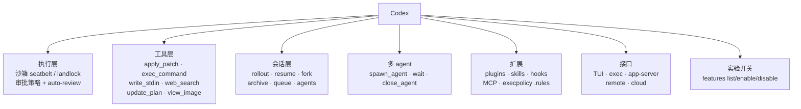
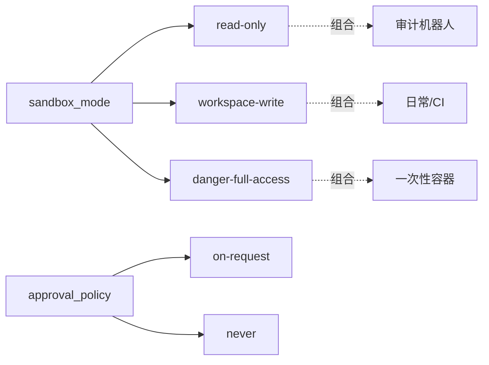

# 第 15 章 工具专章：Codex

> 本章你将学会：
> - 把沙箱与审批理解成两个正交维度，组合出你需要的档位
> - 用 `exec / review / apply / queue / worktree` 把 Codex 变成流水线组件
> - 判断「无人值守」在什么条件下才是真的安全

## 15.1 生态地图



Codex 的设计主线是**「先保证不闯祸，再谈效率」**。所以你会在它的命令列表里看到大量与执行控制相关的项（`sandbox`、`approve`、`doctor`、`features`），而 TUI 装饰类命令（`/pet`、`/theme`）反而更像附加品。

## 15.2 沙箱：两个维度，不是一个开关



常用四档：

| 目的 | 配置 | 说明 |
|---|---|---|
| 只读审计 | `-s read-only -a never` | 完全无人值守且安全 |
| 日常开发 | `-s workspace-write -a on-request` | 危险动作问你 |
| CI 修复 | `-s workspace-write -a never` | 出不了圈，靠 diff 兜底 |
| 一次性容器 | `--dangerously-bypass-approvals-and-sandbox` | 只在可销毁环境 |

### 15.2.1 底层实现

| 平台 | 机制 |
|---|---|
| macOS | seatbelt（沙箱配置文件限制文件/网络/进程） |
| Linux | landlock（文件系统访问控制）+ seccomp 过滤 |
| 容器/CI | 通常已有隔离，Codex 沙箱再叠一层 |

关键点：**这是内核级强制，不依赖模型配合**。所以即使模型「想」去读 `~/.ssh`，也会拿到 `Permission denied`。这是它相对「规则匹配」的根本区别。

### 15.2.2 可写范围与网络

```toml
sandbox_mode = "workspace-write"

[sandbox_workspace_write]
network_access = false
writable_roots = ["."]
```

- `writable_roots`：额外可写目录（测试需要写 `/tmp` 之外的路径时加）。
- `network_access = false`：断网。需要查文档时再放开，或用白名单。
- 被拒时的排查：让它把错误原样贴出来，通常是路径不在 roots 里，而不是工具坏了。

## 15.3 审批：从「问人」到「自动审查」

除了 `on-request` / `never`，Codex 还提供了一个中间态：

```bash
codex --approve-for-me            # 用 workspace-write 沙箱 + 自动审查代替人工确认
```

含义是：当模型请求一个需要批准的动作时，先由一个审查流程判断「这个动作在当前任务里是否合理」，再决定放行或拒绝。适合「无人值守但仍要兜底」的场景。

交互内还有 `/approve`（批准一次被自动审查拒绝的重试）——这是把「误杀」救回来的出口。

## 15.4 配置：profile + 逐项覆盖

```toml
# ~/.codex/config.toml
model = "gpt-5.1-codex"
model_reasoning_effort = "medium"
sandbox_mode = "workspace-write"
approval_policy = "on-request"

[profiles.review]
sandbox_mode = "read-only"
approval_policy = "never"
model_reasoning_effort = "high"

[profiles.ci]
approval_policy = "never"
```

```bash
codex -p review "审查这个分支"
codex -p ci exec --json "修到测试通过"
codex -c model_reasoning_effort="low" "改个错别字"
codex --ignore-user-config "用默认配置跑一次，排除我的配置干扰"
```

覆盖优先级：`-c` > `--profile` 文件 > `~/.codex/config.toml` > 内置默认。

`--strict-config` 会让未知字段直接报错——升级后排查「配置写错但被静默忽略」很有用。

## 15.5 五个命令，覆盖 80% 的自动化工序

| 命令 | 作用 | 典型用法 |
|---|---|---|
| `codex exec` | 非交互执行 | CI、脚本、批处理 |
| `codex review` | 只审查不改 | PR 门禁 |
| `codex apply <id>` | 把会话产生的 diff 落地 | 人工审完再应用 |
| `codex queue` | 给运行中的会话追加任务 | 不打断当前工作 |
| `codex --worktree` | 独立工作树里跑 | 并行实验 |

一个完整的安全流水线：

```bash
# 1) 只读审查
codex review --base origin/main > review.md || exit 1

# 2) 在 worktree 里修
codex --worktree -s workspace-write -a never "修复 review.md 里的 P0 问题"

# 3) 人工看 diff，确认后合并
git -C .worktrees/<name> diff

# 4) 归档会话
codex archive <session-id>
```

## 15.6 多 Agent

Codex 的多 agent 是「任务」级的：每个 subagent 是一条独立 thread，有自己的上下文。

```text
# TUI 内
/agents        # 查看所有 agent 会话，切换/停止
```

模型可用的内部工具：

| 工具 | 用途 |
|---|---|
| `spawn_agent` | 派生一个子任务（继承当前工作目录） |
| `send_input` | 给 subagent 追加指令 |
| `wait` | 等待 subagent 完成或需要审批 |
| `close_agent` | 关闭 |

实践建议：

- 让 subagent 做**只读调查**（三个角度并行），主 agent 汇总——这是最安全也最省上下文的用法。
- 需要在 subagent 之间共享文件时，用 worktree 隔离，否则会互相覆盖。
- subagent 的审批请求会冒泡到主会话，别在无人值守时指望它自动解决。

## 15.7 TUI 里值得知道的命令

| 命令 | 作用 |
|---|---|
| `/status` | 当前会话配置、模型、沙箱、token |
| `/usage` | 用量与限额 |
| `/diff` | 看包含未跟踪文件的 diff |
| `/mention` | 引用文件 |
| `/plan` | 切 Plan 模式（只规划） |
| `/permissions` | 调沙箱/审批档位 |
| `/approve` | 批准一次被自动审查拒绝的动作 |
| `/ps`、`/stop` | 列出/停止后台终端 |
| `/daemon` | 管理共享后台服务 |
| `/keymap` | 查看与重绑快捷键 |
| `/vim`、`/tui`、`/raw` | 编辑模式、TUI 模式、原始滚动 |
| `/theme`、`/pet`、`/statusline` | 外观 |
| `/debug-config` | 查看配置层与来源（排错利器） |
| `/rollout` | 打印会话记录文件路径 |
| `/experimental` | 打开实验特性 |

## 15.8 服务化：app-server 与远程

```bash
codex app-server                 # 起 app-server（JSON-RPC）
codex --remote ws://host:port    # TUI 连远程 app-server
codex remote-control             # 管理带远程控制的 daemon
```

适用场景：

- 多端共享同一个会话（桌面 + 终端 + IDE）。
- 把 Codex 当成服务嵌进内部平台。
- 长任务跑在服务器上，本地只做 UI。

注意：默认会有一个共享 daemon，`--no-daemon` 可以绕开——排查「多端状态不一致」时有用。

## 15.9 排错路径

| 现象 | 先查 |
|---|---|
| 命令被拒 | `/status` 看沙箱档位；错误里通常是路径或网络 |
| 配置没生效 | `/debug-config`、`--strict-config` |
| 认证异常 | `codex login status` |
| 安装/运行时异常 | `codex doctor` |
| 新特性不可用 | `codex features list` |
| 多端状态混乱 | `--no-daemon` 重试，或 `/daemon` 重启 |
| TUI 渲染问题 | `--no-alt-screen`、`/theme`、`/tui` |

## 15.10 技巧与坑

- **`-a never` 不等于「无限制」**：它只是不问，沙箱仍然生效。真正的无限制要 `danger-full-access`。
- **`--ephemeral` 是 CI 必备**：否则每次跑都在 `~/.codex/sessions` 留一堆会话。
- **`codex apply` 的价值在「审后落地」**：diff 在会话里生成，你确认后才进工作区。
- **profile 名字别用保留字**（`review` / `ci` 是自定义的，没问题；避免和内置子命令重名）。
- **hooks 有 trust 机制**：首次运行会让你确认 hook 来源，自动化里别随手 `--dangerously-bypass-hook-trust`。
- **网络关掉后，`web_search` 不可用**，需要联网的审查任务记得开 `--search` 或放开 sandbox 网络。
- **token 用量看 `/usage`**，长会话配合 `/compact`、`/recap`。
- **`/pet` 不是玩笑**：有些人用状态栏小宠物判断「它还在跑还是卡住了」，比读日志快。

## 15.11 练习

1. 用 `read-only` 与 `workspace-write` 各跑一次同一个任务，记录哪些操作被拒、错误文案是什么。
2. 写一个 `review` profile，让 `codex -p review` 等价于「高思考 + 只读 + 不问人」。
3. 用 `--worktree` 并行开两个方案，比较 patch 与测试结果后合并其中一个。
4. 用 `codex exec --json` + `jq` 统计一次任务的 turn、工具调用与 token。
5. 故意让 agent 访问 `~/.ssh`，确认沙箱拦住，并记录报错；再把它加进你的安全测试用例。

---

下一章拆开引擎盖：自己实现一个 coding agent 需要哪些零件。
