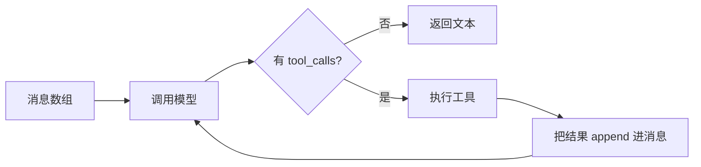

# 第 16 章 内部原理：代理循环、协议与会话格式

> 本章你将学会：
> - 用约 100 行代码实现一个能读文件、跑命令、改代码的最小代理
> - 看懂三家会话文件的格式与压缩条目的结构
> - 判断一个「新出的编码代理」在架构上是否靠谱

## 16.1 最小可用代理

去掉 UI、权限、压缩、扩展，代理的内核只有四件事：



下面是一个真能跑的版本（Node 22+，兼容 OpenAI Chat Completions 协议的端点）：

```js
// mini-agent.mjs —— 约 100 行内核
import { execFile } from 'node:child_process';
import { readFile, writeFile, mkdir } from 'node:fs/promises';
import path from 'node:path';
import { promisify } from 'node:util';
const run = promisify(execFile);

const BASE = process.env.BASE_URL ?? 'https://api.openai.com/v1';
const KEY = process.env.OPENAI_API_KEY;
const MODEL = process.env.MODEL ?? 'gpt-5.1';
const MAX_TURNS = 25;

const tools = [
  {
    type: 'function',
    function: {
      name: 'read_file',
      description: '读取工作区内的文本文件。超过 400 行会被截断并提示剩余行数。',
      parameters: { type: 'object', properties: { path: { type: 'string' } }, required: ['path'] },
    },
  },
  {
    type: 'function',
    function: {
      name: 'write_file',
      description: '覆盖写入文本文件（自动创建目录）。改动前请先读取。',
      parameters: {
        type: 'object',
        properties: { path: { type: 'string' }, content: { type: 'string' } },
        required: ['path', 'content'],
      },
    },
  },
  {
    type: 'function',
    function: {
      name: 'bash',
      description: '在工作区执行 shell 命令，返回 stdout+stderr，最多 200 行。',
      parameters: { type: 'object', properties: { command: { type: 'string' } }, required: ['command'] },
    },
  },
];

async function execute(call) {
  const args = JSON.parse(call.function.arguments || '{}');
  switch (call.function.name) {
    case 'read_file': {
      const text = await readFile(args.path, 'utf8');
      const lines = text.split('\n');
      return lines.length > 400
        ? lines.slice(0, 400).join('\n') + `\n…（已截断，共 ${lines.length} 行，请用 grep 定位）`
        : text;
    }
    case 'write_file': {
      const abs = path.resolve(args.path);
      await mkdir(path.dirname(abs), { recursive: true });
      await writeFile(abs, args.content);
      return `已写入 ${args.path}（${args.content.split('\n').length} 行）`;
    }
    case 'bash': {
      try {
        const { stdout, stderr } = await run('bash', ['-lc', args.command], { timeout: 120_000 });
        return (stdout + stderr).split('\n').slice(0, 200).join('\n') || '(无输出)';
      } catch (err) {
        return `退出码 ${err.code}\n${(err.stdout ?? '') + (err.stderr ?? '')}`;
      }
    }
    default:
      return `未知工具 ${call.function.name}`;
  }
}

async function chat(messages) {
  const res = await fetch(`${BASE}/chat/completions`, {
    method: 'POST',
    headers: { 'content-type': 'application/json', authorization: `Bearer ${KEY}` },
    body: JSON.stringify({ model: MODEL, messages, tools, tool_choice: 'auto' }),
  });
  if (!res.ok) throw new Error(`HTTP ${res.status}: ${await res.text()}`);
  return res.json();
}

const messages = [
  {
    role: 'system',
    content: '你是编码代理。修改文件前先读它；改完运行测试；只做被要求的事；输出简洁。',
  },
  { role: 'user', content: process.argv.slice(2).join(' ') || '列出当前目录结构' },
];

for (let turn = 1; turn <= MAX_TURNS; turn++) {
  const data = await chat(messages);
  const msg = data.choices[0].message;
  messages.push(msg);

  if (!msg.tool_calls?.length) {
    console.log(msg.content ?? '(空)');
    break;
  }

  for (const call of msg.tool_calls) {
    console.error(`[turn ${turn}] ${call.function.name} ${call.function.arguments.slice(0, 120)}`);
    const output = await execute(call);
    messages.push({ role: 'tool', tool_call_id: call.id, content: String(output).slice(0, 20_000) });
  }
}
```

跑起来：

```bash
OPENAI_API_KEY=... MODEL=gpt-5.1 node mini-agent.mjs "读 README.md，然后告诉我怎么跑测试"
```

这 100 行里已经包含了正式实现的所有关键决策点，逐条对应：

| 代码里的东西 | 为什么必须有 |
|---|---|
| `MAX_TURNS` | 防死循环。正式实现还会加「同一错误重试上限」 |
| 读文件截断 + 提示剩余行数 | 上下文控制的第一道闸 |
| bash 输出只留 200 行 | 工具结果是上下文膨胀的主因 |
| `tool_call_id` 回填 | 协议要求；缺了模型会认为结果无关 |
| 先读后写 | 写进系统提示的纪律，不是代码强制 |
| 超时 120s | 防止一条命令卡死整个 run |

**缺的东西才是工程量所在**：权限、沙箱、流式、压缩、重试、会话持久化、UI、扩展。这也是为什么「自研一个能跑的只要一个下午，能用于生产要半年」。

## 16.2 消息格式：三家本质相同

所有实现最终都归一化成三类消息：

```json
[
  {"role":"system","content":"…"},
  {"role":"user","content":"修一下登录"},
  {"role":"assistant","content":"我先看代码","tool_calls":[{"id":"call_1","function":{"name":"read_file","arguments":"{\"path\":\"a.ts\"}"}}]},
  {"role":"tool","tool_call_id":"call_1","content":"…文件内容…"},
  {"role":"assistant","content":"改好了"}
]
```

差异只在细节：

| | 表示方式 |
|---|---|
| OpenAI 兼容 | `tool_calls` + `role:"tool"` |
| Anthropic | `content: [{type:"tool_use"},{type:"tool_result"}]` |
| Pi 内部 | `AgentMessage` 联合类型，content blocks（text / thinking / tool_call） |
| Codex | Responses API 的 item 模型（`function_call` / `function_call_output`） |

Pi 的 `message-types.md` 里定义了 content block：`text`、`thinking`、`tool_call`、图片等。**统一成 block 数组**的好处是：思考、文本、工具调用可以交错存在，渲染层可以按块折叠。

## 16.3 会话文件：树，不是列表

Pi 的会话是 JSONL，第一行是头，之后每行是一个带 `id`/`parentId` 的条目：

```json
{"type":"session","version":3,"id":"9c1f…","timestamp":"2026-01-01T00:00:00.000Z","cwd":"/work/api"}
{"type":"message","id":"a1b2c3d4","parentId":null,"timestamp":"2026-01-01T00:00:01.000Z","message":{"role":"user","content":"修登录"}}
{"type":"message","id":"e5f6a7b8","parentId":"a1b2c3d4","timestamp":"…","message":{"role":"assistant","content":[…],"usage":{…}}}
{"type":"compaction","id":"c9d0e1f2","parentId":"e5f6a7b8","timestamp":"…","summary":"## Goal\n…","firstKeptEntryId":"e5f6a7b8","tokensBefore":81000}
```

关键点：

- **`parentId` 构成树**。`/tree` 跳到旧节点再说话，就是在这棵树上开新分支，**旧分支不删除**。
- **`/fork` 复制一段历史到新文件**，会话头里记录 `parentSession`。
- **压缩条目本身也是一个节点**：它记录 `summary`、`firstKeptEntryId`（从这里开始保留原文）、`tokensBefore`。
- 系统提示与工具声明也持久化为 message 条目：首次请求存完整 prompt 分段，后续变更以「按名字 patch 分段 + toolsAdded/toolsRemoved」的形式追加。**回放这些条目就能还原每一轮的真实上下文**——这是调试「它为什么那样回答」的唯一可靠方式。

Codex 用类似的 rollout（JSONL 事件流）+ 分页历史；Claude 用 JSONL 转录 + checkpoint。格式不同，思想一致：**追加写、可回放、可分支**。

## 16.4 压缩是怎么算的

Pi 的触发条件是：

```
contextTokens > contextWindow - reserveTokens        # reserveTokens 默认 16384
```

也就是说，它不会等到「满了」才压，而是提前留出一整块给下一轮输出。检查时机有三个：下一轮开始前、新用户输入前、以及上下文溢出报错后的兜底恢复。

**切点（cut point）规则**很讲究：

| 可以作为切点 | 不能作为切点 |
|---|---|
| 用户消息 | **工具结果**（必须跟着它的 tool_call 一起走） |
| 助手消息 | |
| bash 执行记录 | |
| 自定义消息 / 分支摘要 | |

原因：如果把「工具调用」和「工具结果」切开，模型会看到一条没有结果的调用，直接崩坏。

摘要的固定结构（这也是你写 `/compact` 指示时该覆盖的字段）：

```markdown
## Goal
## Constraints & Preferences
## Progress
## Key Decisions
## Next Steps
## Critical Context
```

**实践建议**：自定义压缩指示时，重点保 `Constraints & Preferences` 与 `Critical Context`——这两块最容易丢，也最影响后续行为（「不要改测试断言」丢了，下一轮它就会改）。

## 16.5 RPC 协议的实现要点

Pi 的 RPC 是「JSONL 双向流」，实现时有五个坑：

| 要点 | 说明 |
|---|---|
| 严格 LF 分帧 | JSON 字符串里可以有 `U+2028/U+2029`，别用 `readline` |
| 命令-响应用 `id` 关联 | 命令是异步的，响应可能乱序 |
| `prompt` 成功 ≠ 完成 | 只代表「已接受」，要等 `agent_settled` |
| 背压 | 不读 stdout 会阻塞子进程；写 stdin 也要尊重背压 |
| stdout 专用 | 日志一律 stderr，否则协议被污染 |

事件顺序（一次运行）：

```text
agent_start → turn_start → message_start/update/end → turn_start … → turn_end
            → agent_end → (重试/压缩/排队则再来一轮) → agent_settled
```

`agent_end` **不是**最终信号——这是自研客户端最常见的 bug（提前退出，丢掉重试结果）。

## 16.6 工具设计的五条原则

从三家的实现里能提炼出同一套原则：

1. **描述写给模型看，不是写给人看。** 说清「什么时候用」「参数含义」「返回什么」，而不是「这是一个读取文件的工具」。
2. **参数 schema 越窄越好。** `path` 而不是 `options` 大对象；枚举值写死。
3. **结果是给模型的，要裁剪。** 截断 + 告诉它「完整内容在哪」。
4. **错误要可读、可行动。** `找不到任务 #9` 比 `Error: undefined` 有用一个数量级。
5. **副作用工具要幂等或可回滚。** Codex 用 `apply_patch` 而不是「随便写」，就是在用协议约束副作用。

Pi 额外要求 `content`（给模型）+ `details`（给渲染/状态），并建议文件写操作用 `withFileMutationQueue()` 串行化——**并发写同一个文件是真实存在的 bug 源**。

## 16.7 三家的架构对照

| 维度 | Pi | Claude Code | Codex |
|---|---|---|---|
| 语言/形态 | TypeScript，Node ≥22，jiti 加载扩展 | 原生单文件 | Rust 单二进制 |
| 会话 | JSONL 树（id/parentId），原生分支 | JSONL + checkpoint（可回滚文件） | rollout + 分页历史 + 归档 |
| 压缩 | 阈值 + 切点规则 + 结构化摘要 | 自动压缩 + 阈值可配 | `/compact` + `/recap` |
| 权限 | 无审批，靠工具裁剪/容器/扩展门禁 | 模式 + 规则 + Hooks | 沙箱（seatbelt/landlock）+ 审批策略 |
| 扩展 | 同进程 TS 扩展（工具/命令/UI/provider） | Hooks + 插件 + MCP | Hooks + 插件 + MCP + app-server |
| 外部接口 | JSON / RPC / TS SDK | print + stream-json | exec + JSON + app-server |
| 独特实现 | `codemode`（脚本调工具）、树会话 | checkpoint、后台/云会话 | OS 沙箱、多代理、`apply_patch` |

## 16.8 如果你要自己做一个

最小可行路线（按顺序）：

1. **消息数组 + 一次 provider 调用**（半天）。
2. **工具执行 + 结果回填 + 轮数上限**（一天）。
3. **流式输出 + 打断**（一天）。
4. **会话持久化（JSONL，先线性）**（一天）。
5. **上下文裁剪 / 压缩（先粗暴：保留最近 N 条 + 摘要）**（两天）。
6. **权限：工具白名单 + 命令门禁**（一天）。
7. **UI 或复用现成 TUI**（取决于你的野心）。
8. **子代理/并行**（最后做）。

**不要做的事**：一开始就写插件系统、多代理、云端。这三样都是「内核稳定后才有意义」的东西。

## 16.9 练习

1. 跑通 `mini-agent.mjs`，然后故意把 `MAX_TURNS` 设为 3，观察它如何被强行截断。
2. 给它加一个 `grep` 工具（用 `rg`），对比「读整个文件」与「grep 定位」的 token 消耗。
3. 打开一个真实的 Pi 会话文件（`~/.pi/agent/sessions/…/*.jsonl`），画出它的树结构（用 `jq` 提取 id/parentId 即可）。
4. 用 RPC 协议写一个客户端，要求：支持 `prompt`、收到 `agent_settled` 才退出、把工具调用打到 stderr。
5. 设计一个切点规则：如果把「工具结果」也允许作为切点，会发生什么？（提示：模型会看到没有结果的 tool_call）

---

最后一章：把它们放在一起比较，并决定你的团队该用哪个。
