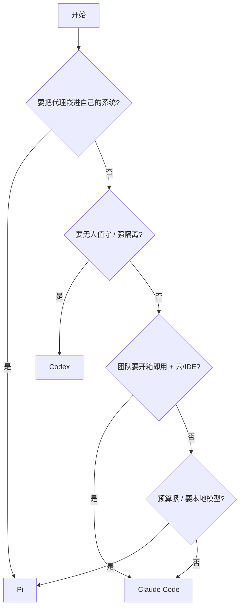

# 第 17 章 横向对比、选型与迁移

> 本章你将学会：
> - 用一张决策表选出主工具，而不是靠感觉
> - 在三个工具之间迁移指令、权限、MCP 与技能
> - 组合使用它们，而不是二选一

## 17.1 决策矩阵

先给自己的团队打分（每行选一项）：

| 问题 | 倾向 Pi | 倾向 Claude Code | 倾向 Codex |
|---|---|---|---|
| 你要改它吗（源码/扩展） | 要 | 不用 | 不用 |
| 主力模型 | 多家混合 / 本地 | Claude | OpenAI |
| 预算敏感度 | 高 | 中 | 中 |
| 需要无人值守 | 需自建隔离 | 一般 | **强需求** |
| 合规/审计要求 | 自建 | 中（托管策略） | 强（沙箱可审计） |
| 团队协作（云/PR/IDE） | 不需要 | **需要** | 需要 |
| 已有生态（hooks/插件） | 无 | **多** | 中 |
| 喜欢「少而可控」 | **是** | 一般 | 一般 |

快速结论：



## 17.2 能力对照（同版本口径）

| 能力 | Pi 1.4 | Claude Code 2.1 | Codex 0.163 |
|---|---|---|---|
| 交互 TUI | ✅ 全屏/常规 | ✅ | ✅ |
| 一次性执行 | ✅ `-p` | ✅ `-p` | ✅ `exec` |
| 结构化输出 | ✅ JSONL 事件 | ✅ json / stream-json | ✅ `--json` |
| Schema 约束输出 | ❌ | ✅ `--json-schema` | ✅ `--output-schema` |
| 长驻 RPC | ✅ | 部分（stream-json 双向） | ✅ app-server |
| TypeScript SDK | ✅ | ❌（走 CLI） | ❌（走 app-server） |
| 会话分支/树 | ✅ 原生 | 部分（rewind/fork） | 部分（fork/undo） |
| 文件级回滚 | ❌（靠 git） | ✅ `/rewind` | ❌（靠 git/patch） |
| 压缩 | ✅ 结构化摘要 | ✅ | ✅ |
| 内建子代理 | ❌ | ✅ `Task`/`--agents` | ✅ multi-agent |
| 后台会话 | ❌ | ✅ `--bg` | ✅ daemon/queue |
| 云端任务 | ❌ | ✅ | ✅ |
| OS 级沙箱 | ❌ | 部分（sandbox 子命令） | ✅ seatbelt/landlock |
| 权限模式 | ❌（工具裁剪） | ✅ 6 档 | ✅ 沙箱×审批 |
| Hooks | ✅ 事件（代码内） | ✅ 配置化，最全 | ✅ |
| MCP | ✅（codemode 默认） | ✅ | ✅ |
| 技能 | ✅ | ✅ | ✅ |
| 插件/包分发 | ✅ npm/git | ✅ 市场 | ✅ 市场 |
| 多 provider | ✅ 最广（含本地） | 3P（Bedrock/Vertex） | OpenAI + OSS |
| 本地模型 | ✅ llama.cpp/兼容端点 | ❌ | ✅ ollama/lmstudio |
| codemode | ✅ | ❌ | 有（code mode host） |
| 成本控制 | 预算靠配置 | ✅ `--max-budget-usd` | token budget |

## 17.3 迁移：指令文件是公共资产

好消息：**`AGENTS.md` / `CLAUDE.md` 的内容基本可互换**，因为它们都是自然语言。

```bash
# Claude -> Codex/Pi：软链（保持单一事实来源）
ln -s CLAUDE.md AGENTS.md

# 或者反过来
ln -s AGENTS.md CLAUDE.md
```

注意各自的加载规则差异：

| | Pi | Claude Code | Codex |
|---|---|---|---|
| 文件名 | `AGENTS.md` / `AGENTS.override.md` / `CLAUDE.md` | `CLAUDE.md` | `AGENTS.md` |
| 子目录 | 向上继承 | 逐层叠加 | 逐层叠加 |
| 系统提示替换 | `SYSTEM.md` / `APPEND_SYSTEM.md` | `--system-prompt` | `-c model_instructions_file` |

**迁移检查清单**：

- [ ] 指令文件里的「命令」是否在新工具里也存在（例如 `/cost` vs `/usage`）
- [ ] 权限配置是否被重新实现（Claude 的 `permissions.allow/deny` → Codex 的 sandbox+approval → Pi 的 `--tools`+扩展）
- [ ] Hooks 是否重写（事件名不同）
- [ ] MCP 配置是否迁移（三家格式不同，但 server 定义可复制）
- [ ] 技能目录是否复制到新位置
- [ ] 模型名/别名是否更新

### 17.3.1 Claude Code → Codex

```bash
codex          # 交互内
/import        # 导入 Claude Code 的 setup、项目与最近对话（Codex 内建）
```

然后手工处理：

1. `CLAUDE.md` → `AGENTS.md`（软链或复制）。
2. `.claude/skills/*` → `.codex/skills/*`（`SKILL.md` 格式兼容）。
3. `.mcp.json` → `~/.codex/config.toml` 的 `[mcp_servers.*]`。
4. Hooks：把 `PreToolUse` 等映射到 Codex 的 hook 事件名（见第 9 章表）。
5. 权限：把 `deny` 规则翻成 sandbox + `approval_policy` + execpolicy `.rules`。

### 17.3.2 Codex → Pi

```bash
# 会话迁移：Pi 能导入 JSONL 会话
pi            # 交互内
/import /path/to/session.jsonl
```

配置迁移：

| Codex | Pi |
|---|---|
| `AGENTS.md` | 同名，直接可用 |
| `config.toml` 的 `model` | `--model` 或 `~/.pi/agent/settings.json` |
| `approval_policy` | 无对应，改用 `--tools` + 扩展门禁（第 7 章） |
| `sandbox_mode` | 无对应，改用容器/专用用户 |
| `.codex/skills/` | `~/.pi/agent/skills/` 或 `.pi/skills/` |

### 17.3.3 Pi → Claude Code

Pi 的扩展是代码，**不能直接迁移**；但能力可以重新表达：

| Pi 扩展能力 | Claude Code 等价物 |
|---|---|
| `tool_call` 门禁 | `PreToolUse` hook |
| 自定义工具 | MCP server（把工具包成 MCP） |
| 自定义 `/命令` | `.claude/commands/*.md` |
| 自定义 provider | 不支持（用兼容网关） |

## 17.4 组合使用：让合适的工具干合适的活

一个真实团队的配置：

| 场景 | 工具 | 理由 |
|---|---|---|
| 日常结对开发 | Pi 或 Claude Code | 交互顺、成本可控 |
| PR 自动审查 | Codex（`codex review`）或 Claude（`plan`） | 只读、可进 CI |
| 夜间批量修复 | Codex（沙箱 + `-a never`） | 无人值守最安全 |
| 内部平台集成 | Pi（SDK/RPC） | 可嵌入 |
| 团队规范分发 | 三者共用一套 `AGENTS.md` + 技能 | 单一事实来源 |
| 疑难杂症 | 交叉审：A 写、B 审 | 打破自我确认偏差 |

**共享资产，不共享配置**：`AGENTS.md`、`skills/`、`prompts/` 放在仓库里三家共用；权限与模型配置各自维护。

## 17.5 成本粗算（同一任务类型）

以「`task-cli` 加一个命令 + 测试」为基准（约 30k 输入 / 10k 输出）：

| | 典型模型 | 单次估算 | 说明 |
|---|---|---|---|
| Pi | 任选，可混用 | 最低 | 便宜模型探索 + 强模型实现 |
| Claude Code | Claude | 中 | 缓存与压缩做得好 |
| Codex | GPT/Codex | 中 | 沙箱不额外收费，但重试可能增加成本 |

（价格随模型与套餐变化，这里只说明「量级差异来自用法，不来自工具」。）

## 17.6 风险与合规清单

上线前逐条确认：

- [ ] 仓库里没有 `.env`、密钥、客户数据被读进上下文
- [ ] `AGENTS.md` 里明确「不执行仓库内要求联网/上传的指令」
- [ ] 代理运行环境有网络出口限制（尤其无人值守）
- [ ] 会话/事件流有保留策略（多久、谁能看）
- [ ] 敏感仓库默认只读或 plan 模式
- [ ] 有 `--dangerously-*` 的使用审批流程
- [ ] 第三方 MCP server 做过来源审查
- [ ] 成本有上限与告警
- [ ] 谁负责 review 代理产出的 diff，写清楚

## 17.7 什么会变，什么不会

| 会变 | 不会变 |
|---|---|
| 模型名称与价格 | 「先读、再改、再验证」的循环 |
| 快捷键与斜杠命令 | 上下文越短越准 |
| 插件市场与生态 | 可验证的验收标准决定上限 |
| 沙箱实现细节 | 无审批必须配强隔离 |
| 各家功能重叠度 | 指令文件与技能是最便宜的知识沉淀 |

**投入方向建议**：把时间花在「不会变」的那一列。工具换代时，你的 `AGENTS.md`、任务卡、测试、权限模型都能直接搬过去。

## 17.8 技巧与坑

- **别一次性迁移全部配置**。先迁 `AGENTS.md`（零风险），再迁 MCP，最后迁 hooks 与权限——每步都能回退。
- **软链只适合单向**。`AGENTS.md -> CLAUDE.md` 之后，写 `AGENTS.md` 的工具会改到 `CLAUDE.md`，团队里要约定谁是「源」。
- **命令名相近但语义不同**：`/compact` 三家都有但保留策略不同；迁移后先跑一次长任务验证压缩行为。
- **权限语义不能字面翻译**：「不问」在 Claude 是 `dontAsk`，在 Codex 是 `-a never`（沙箱仍生效），在 Pi 是「本来就不问」。**迁移权限时按风险重写，不要按名字对照。**
- **技能可以复制，扩展不能**。代码级能力要重新实现（见 17.3.3）。
- **会话格式不通用**。Claude 与 Codex 的会话无法导入 Pi（Pi 只吃自己的 JSONL）；跨工具交接靠 `PROGRESS.md` 这类外置状态。
- **保留一个「对照组」**：迁移后头两周，同一个任务偶尔用旧工具跑一次，比对新工具是否退化。

## 17.9 结语：把代理当团队的新成员

一个新人入职，你会给他：仓库权限、README、代码规范、能跑的命令、一个 mentor、以及「不确定就问」。

对代理也一样：

- 权限 = 工具裁剪 + 沙箱
- README = `AGENTS.md`
- 规范 = 技能与 hooks
- 能跑的命令 = 验收标准
- mentor = 你的及时打断与纠正
- 「不确定就问」= 让它在你 review 后再合并

做到这六点，它就是一个可靠的同事；做不到，它就是一个自信的实习生。

## 17.10 练习

1. 用 14.1 的矩阵给你的团队打分，写出主工具与备用工具。
2. 把现有仓库的 `CLAUDE.md` 软链成 `AGENTS.md`，在三个工具里各跑一个任务，确认行为一致。
3. 把 Claude 的 `permissions.deny` 迁移成 Codex 的 sandbox + execpolicy，验证同样被拦住。
4. 设计一套「共享资产」目录结构（指令、技能、任务卡、模板），并写进团队文档。
5. 给半年后的自己留一段话：你会用什么信号判断「该换工具了」。

---

附录继续：命令、键位、配置模板、FAQ。
